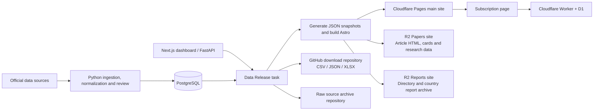

# GlobalID V2

GlobalID V2 is an infectious disease surveillance platform built around three connected parts:

- a Python pipeline for crawling, normalizing, exporting, and generating reports
- a FastAPI backend used by the operational dashboard
- two web frontends: a Next.js dashboard for internal analysis and an Astro site for publishing static report data

The current repository is centered on China disease surveillance data, but the data model, country bootstrap configuration, and mapping system are structured for multi-country expansion.

## Branches and data repositories

This source-code repository has two persistent branches:

- `development`: the integration branch for day-to-day changes
- `master`: the stable branch used for releases and production deployments

Merge tested changes into `development`, then promote `development` to
`master`. Delete temporary topic or recovery branches after their commits have
been integrated or confirmed obsolete. Automated data jobs must not create
branches or commits in this source-code repository.

Data publishing uses separate Git repositories and therefore has its own fixed
branches. The public download repository exposes time-partitioned CSV/JSON/XLSX files from its
`main` branch. The raw source archive uses the
`main` branch of the dedicated `globalID-data-archive` repository. Local paths
such as `data/cache`, `data/current`, `data/raw`, `exports`, and the nested
`exports/raw-git-archive` working clone are ignored by this repository.

In other words, the download and archive repositories' `main` branches are data
distribution channels, not extra development branches of GlobalID V2. See
`docs/DATA_VERSIONING.md` for the complete boundary and release flow.

## What This Repository Contains

- intelligent crawling with incremental updates and optional missing-month backfill
- structured disease storage in PostgreSQL/TimescaleDB-style schema
- AI-assisted report generation with review support
- data export to CSV, Excel, JSON, and ZIP packages
- a FastAPI API for dashboard use
- a Next.js dashboard for operations, quality checks, and task visibility
- an Astro-based static site that builds from generated JSON snapshots

## Repository Layout

```text
globalID2/
├── main.py                     # Main Typer CLI entrypoint
├── requirements.txt           # Python dependencies
├── docker-compose.yml         # Base infra: PostgreSQL, Redis, Qdrant
├── schema.sql                 # Generated schema snapshot
├── configs/                   # Country bootstrap, mappings, prompts, source config
├── data/                      # Raw, processed, cache, backup, and test data
├── dashboard/                 # Next.js dashboard app
│   ├── api/                   # FastAPI backend mounted as dashboard.api.main:app
│   └── src/                   # Dashboard frontend
├── astro-site/                # Astro static report site
├── docs/                      # Architecture and operational documentation
├── scripts/                   # Database rebuild, site-data export, maintenance scripts
├── src/                       # Core Python application code
├── tests/                     # Python tests
├── reports/                   # Generated reports
├── exports/                   # Exported datasets
└── logs/                      # Runtime logs
```

## Core Components

### 1. Python pipeline

The root CLI in `main.py` drives the main workflows:

- `crawl`: fetch source reports, optionally process them, and store normalized records
- `generate-report`: generate an AI-assisted disease surveillance report
- `init-database`: create tables and bootstrap country metadata
- `export-data`: export processed data in multiple formats
- `run --full`: run crawl plus report generation as a single pipeline
- `test`: run integration tests

### 2. FastAPI backend

The API entrypoint is `dashboard.api.main:app`. It serves the dashboard and exposes endpoints under `/api/v1` for:

- overview and KPI summaries
- countries and diseases
- reports
- crawl and task management
- quality checks
- AI-related task views
- data explorer and sources

### 3. Next.js dashboard

The dashboard under `dashboard/` is the current operational UI. Typical pages include:

- `/` Overview
- `/operations/*` ingestion, task, schedule, and runtime operations
- `/data/*` governance, analytics, quality, explorer, knowledge, and mappings
- `/production/*` AI runs, reports, releases, subscriptions, and campaigns
- `/settings/*` integrations, models, and runtime configuration

### 4. Astro static site

The Astro site under `astro-site/` consumes JSON snapshots generated from PostgreSQL by `scripts/generate_site_data.py`. It builds static English, Chinese, and French pages, with React/ECharts components loading static JSON for interactive charts and maps. Public surveillance pages do not query the operational database at request time.

### Public-site architecture



| Public channel | Content | Destination |
| --- | --- | --- |
| Main site | Countries, diseases, reports, Situation, research indexes, and shared assets | Cloudflare Pages at `globalinfectiousdisease.com` |
| Papers site | Research article pages, social cards, and `site-data/research/*` | R2 at `papers.globalinfectiousdisease.com` |
| Reports site | Country report pages, `robots.txt`, and sitemap | R2 bucket custom domain at `reports.globalinfectiousdisease.com` |
| Data downloads | Time-partitioned CSV/JSON/XLSX files and their manifest | Dedicated GitHub data repository, `main` branch |
| Subscriptions | Subscription API and subscriber storage | Cloudflare Worker and D1 at `subscriptions.globalinfectiousdisease.com` |

The release task generates data, builds and validates Astro, then splits the
papers and reports bundles from the main-site artifact. It publishes the enabled
download, raw-archive, and R2 channels before verifying the reports host and
deploying Pages. Raw archiving is a separate retention channel; the diagram
shows data flow rather than execution order. Public data freshness depends on
completion of this release workflow. See [Reports hosting](docs/REPORTS_HOSTING.md)
for R2 hosting and the automatic country-report schedule.
Papers and Reports bundles include their referenced build assets and transitive
dependencies. R2 uploads those assets before HTML and retains the preceding
generation for cached pages. Legacy Papers bundles that still reference main-site
build assets require a verified compatibility deployment before publication.

Incremental publishing uses scoped data exports, deterministic download files,
cached article, research collection, country and disease rendering, cached
compression sizes, reusable rewritten paper HTML,
and pooled R2 uploads
with up to 32 concurrent transfers. Interrupted R2 uploads resume from actual
remote object checksums. Validated release candidates retain their frozen curve
projection so compatible retries can skip generation and rendering. Release
timings record the 10-minute target; initial cache population and bulk uploads
are tracked separately from ordinary incremental runs.
Related-paper scoring precomputes article metadata, selects candidates through
disease/topic indexes, and generates explanations only for the final matches.
Unchanged recommendation inputs reuse a checksummed projection while fresh
surveillance links are attached separately.
The shared disease-name lookup uses a fixed order so article ranking changes
do not invalidate every cached article page.
Browser research data uses order-preserving, content-addressed shards so a small
record change does not shift every later shard. Shards upload before their root
indexes, and retired shard URLs remain available for at least 48 hours.

See [Papers hosting](docs/PAPERS_HOSTING.md),
[data versioning](docs/DATA_VERSIONING.md), and
[public downloads](docs/PUBLIC_DATA_DOWNLOADS.md) for publishing details. See
[release recovery](docs/DATA_RELEASE_RESILIENCE.md) for retry and timing behavior.

## Requirements

### Local development

- Python 3.11+
- Node.js 22.23.4 or newer (the installed Astro version requires at least 22.23.4)
- PostgreSQL 14+ or compatible TimescaleDB image
- Redis
- optional: Qdrant

The system `node` on the service PATH must also satisfy this requirement:
Reports builds launch it directly from the Python worker. The Node package in
`astro-site/node_modules` only changes npm-script resolution and does not upgrade
the system runtime. Check `node --version` in the service environment after upgrades.

### Docker workflow

- Docker
- Docker Compose / `docker compose`

## Configuration

Copy the example environment file and adjust values for your machine and model provider:

```bash
cp .env.example .env
```

The shipped example includes these categories:

- application settings: `APP_ENV`, `APP_NAME`, `DEBUG`, `LOG_LEVEL`
- runtime database: `DATABASE_URL`, `DATABASE_URL_SYNC`
- performance: `MAX_PARALLEL_TASKS`, `MAX_CRAWLER_CONCURRENT`, `TASK_WORKER_CONCURRENCY`, `TASK_WORKER_AI_CONCURRENCY`
- AI bootstrap defaults: `DEFAULT_AI_PROVIDER`, `DEFAULT_MODEL`, `AI__MODEL_CHAIN_RAW`
- paths: `DATA_DIR`, `LOG_DIR`, `CONFIG_DIR`

Dashboard work uses separate general, release, and AI organizer lanes.
`TASK_WORKER_AI_CONCURRENCY` bounds active AI business organizers, including
parents awaiting model results, and is clamped by `TASK_WORKER_AI_CONCURRENCY_MIN`
and `TASK_WORKER_CONCURRENCY`. Model HTTP concurrency is admitted separately by
the model center's per-route durable leases. Adding model capacity does not add
business task stacks. `AI__IDLE_BACKLOG_REVIEW_BUFFER_SIZE` sets the maximum open
literature workflow budget (default/maximum 512). The supply target follows twice
the available text-model permits, with a floor of 64 inside the saved budget;
an explicit smaller budget remains binding across restarts. When the AI organizer
budget exceeds one, background work
leaves one slot for reports. Health checks have a separate single-organizer lane.
With `TASK_WORKER_AI_DYNAMIC_CONCURRENCY_ENABLED=true`, no routable models pauses
new AI business tasks; health checks can still recover the routes. Disabling it
keeps the configured organizer budget. Situation tasks that explicitly skip AI
use the ordinary collection lane. Runtime model occupancy comes from unexpired
database leases across all dispatchers; it measures occupied permits, including
request preparation, rather than live HTTP connections.
The systemd worker drop-in starts 12 auxiliary model dispatchers alongside the
main worker. The example configuration allows 12 AI organizers with
`TASK_WORKER_CONCURRENCY=16`; organizer slots and dispatcher processes do not
multiply the model center's global route limits. Service templates budget up to
69 database pool connections across these dispatchers, the main worker, API,
scheduler, and historical rescreen service. Keep additional clients within the
database's connection limit when changing these settings. The installer also
installs the managed service drop-ins so the dispatcher count survives reinstalls.
The [AI runtime architecture and cutover notes](docs/AI_MODEL_CENTER_ARCHITECTURE_REVIEW_2026-11-10.md#重构实施记录2026-11-10)
describe activity leases, explicit retry generations, durable review workflows,
and the coordinated migration from the previous scheduler.
`TASK_WORKER_TASK_HEARTBEAT_SECONDS`, `TASK_WORKER_STALE_TASK_SECONDS`, and
`TASK_WORKER_RECOVERY_SCAN_SECONDS` control task-lease recovery; keep the stale threshold
comfortably above the heartbeat interval. `SCHEDULER_WORKER_GRACE_SECONDS` bounds how long
the scheduler may remain active without a worker heartbeat.

For disease knowledge building, runtime routing comes from the dashboard model
center. Environment model values only seed the model-center tables during first
initialization or an explicit forced bootstrap. The worker deterministically
rotates preferred model-center routes per disease/language. Requests wait in the
durable queue until a route meets the request's requirements; provider failures
are retried or moved to another route by the dispatcher. Each review requires a
different underlying model unless that data line explicitly allows a single
model. Changing providers alone does not make two identically named models
independent reviewers.

The Situation module reads official reports (WHO Disease Outbreak News, ECDC
CDTR, Africa CDC, PAHO and others) in full and extracts alerts: one disease in
one place, with the counts and dates the report states and one sentence quoted
from it. Two independent models read each document (the original PDF when the
model route accepts files, extracted text otherwise), and an alert is public
only after the reviewer accepts it. Full text stays internal; the public export
carries structured facts, the quote and the link. The normal operational
sequence is:

```bash
venv/bin/alembic upgrade head
venv/bin/python scripts/run_situation_notices.py
venv/bin/python scripts/generate_site_data.py
cd astro-site && npm run build:astro
cd .. && venv/bin/python scripts/validate_situation_release.py --site-dir astro-site/dist
```

See [`docs/SITUATION_AUTOMATION.md`](docs/SITUATION_AUTOMATION.md) for the
pipeline stages, export layout and release checks.

The Python configuration layer also supports provider-specific credentials such as:

- `OPENAI_API_KEY`
- `ANTHROPIC_API_KEY`
- `GLM_API_KEY`
- `QIANWEN_API_KEY`
- `AZURE_API_KEY`
- `CUSTOM_API_KEY`

### AI-assisted disease duplicate review

The disease duplicate audit can run fully offline, or ask an OpenAI-compatible
model to classify review candidates:

```bash
python3 scripts/audit_disease_duplicates.py --fail-on-high
python3 scripts/audit_disease_duplicates.py --ai-review --ai-output reports/disease_duplicate_ai_review.json
```

`--ai-review` uses the same model-center routing used by the management
dashboard. Configure providers and model routes in `/ai/models`; the audit will
use active, routable model-center routes and respect cooldown/unavailable state.

The AI layer is advisory only: it recommends `merge`, `keep_separate`, or
`needs_human_review`, but it does not edit mapping CSVs automatically.

The management dashboard also exposes this workflow at `/ai/disease-audit`.
That dashboard entry uses the configured AI model center routes rather than
direct environment variables, and it can review both duplicate disease concepts
and newly observed unmapped disease terms from current source data.

If you want email delivery for generated reports, configure SMTP values as well.

## Quick Start

### Option A: local Python workflow

1. Create a virtual environment and install dependencies.

```bash
python3 -m venv venv
source venv/bin/activate
pip install -r requirements.txt
```

2. Start infrastructure services.

```bash
docker compose up -d
```

This starts:

- PostgreSQL on `localhost:5432`
- Redis on `localhost:6379`
- Qdrant on `localhost:6333`

Infrastructure data is stored in fixed Docker volumes:

- `globalid_postgres_data`
- `globalid_redis_data`
- `globalid_qdrant_data`

These volumes survive host reboots. The containers also use `restart: unless-stopped`, so they will start again automatically after the machine reboots as long as Docker starts on boot.

Do not run `docker compose down -v` unless you explicitly want to delete persisted data.

3. Initialize the database schema.

```bash
python main.py init-database
```

4. Rebuild and seed the working disease dataset.

```bash
python scripts/full_rebuild_database.py --yes
```

5. Run a crawl or export command.

```bash
python main.py crawl --country CN --source all
python main.py export-data --country CN --period latest --output-format all
```

### Option B: full dashboard stack with Docker

If you want the database, API, and dashboard together:

```bash
docker compose -f docker/dashboard-full-stack.yml up -d
```

This stack uses the same fixed Docker volumes as the base infra stack, so switching between the two compose files will keep the same PostgreSQL, Redis, and Qdrant data.

If you already used Docker before this change, your existing database may still be in an older auto-generated volume such as `globalID2_postgres_data` or `docker_postgres_data`. You can inspect existing PostgreSQL volumes with:

```bash
docker volume ls | grep postgres
```

If needed, copy the old PostgreSQL data into the new shared volume before restarting the stack:

```bash
docker run --rm \
	-v OLD_VOLUME:/from \
	-v globalid_postgres_data:/to \
	alpine sh -c "cd /from && cp -a . /to"
```

Replace `OLD_VOLUME` with the volume name you find on your machine.

Default services:

- dashboard: `http://localhost:3000`
- API: `http://localhost:8000/api/v1`
- PostgreSQL: `localhost:5432`
- Redis: `localhost:6379`
- Qdrant: `localhost:6333`

You can override host ports when needed:

```bash
API_PORT=18000 DASHBOARD_PORT=13000 POSTGRES_PORT=15432 REDIS_PORT=16379 \
QDRANT_HTTP_PORT=16333 QDRANT_GRPC_PORT=16334 \
docker compose -f docker/dashboard-full-stack.yml up -d
```

## Running The Applications

### Python CLI

```bash
python main.py --help
```

Available top-level commands:

- `crawl`
- `generate-report`
- `init-database`
- `export-data`
- `test`
- `run`

### FastAPI backend

Run the backend directly from the repository root:

```bash
uvicorn dashboard.api.main:app --host 0.0.0.0 --port 8000
```

For development hot reload only:

```bash
uvicorn dashboard.api.main:app --reload --host 0.0.0.0 --port 8000
```

Health endpoints:

- `GET /health`
- `GET /api/v1/health`

### Task worker (recommended)

Run task execution in a separate process so API reloads do not interrupt running tasks:

```bash
python -m src.services.task_worker
```

Run scheduling in its own process so the API remains stateless:

```bash
python -m src.control_plane.scheduler
```

### Next.js dashboard

```bash
cd dashboard
npm install
npm run dev
```

The browser always uses same-origin `/api/v1`. If the API runs elsewhere, set the server-only `API_PROXY_TARGET` for the Next.js process.

### Astro site

1. Generate database-backed JSON snapshots:

```bash
python scripts/generate_site_data.py
```

2. Start the site locally:

```bash
cd astro-site
npm install
npm run dev

npm run build
npx wrangler pages deploy dist
```

## Boot Autostart

If you want the database containers, dashboard API, dashboard worker, dashboard web, and Astro site to come back automatically after the machine boots, this repository now includes systemd templates and an installer script.

1. Make sure dependencies are already installed once on this machine:

```bash
docker compose up -d
cd dashboard && npm install
cd ../astro-site && npm install
cd ..
```

2. Install and enable the services:

```bash
sudo ./scripts/install_systemd_services.sh --enable --start
```

This installs:

- `globalid-docker.service`
- `globalid-dashboard-api.service`
- `globalid-dashboard-worker.service`
- `globalid-dashboard-web.service`
- `globalid-site.service`
- `globalid-stack.target`

Useful commands:

```bash
systemctl status globalid-stack.target
journalctl -u globalid-dashboard-api.service -f
venv/bin/python scripts/check_task_runtime.py
journalctl -u globalid-dashboard-web.service -f
journalctl -u globalid-site.service -f
sudo ./scripts/install_systemd_services.sh --uninstall
```

Optional `.env` knobs for autostart behavior:

- `GLOBALID_API_PORT=8000`
- `GLOBALID_DASHBOARD_PORT=3000`
- `GLOBALID_SITE_PORT=4321`
- `GLOBALID_DASHBOARD_BUILD_ON_START=1` to rebuild the dashboard before starting it
- `GLOBALID_SITE_BUILD_ON_START=1` to rebuild the Astro site before serving it
- `GLOBALID_SITE_REGENERATE_ON_START=1` to rerun `scripts/generate_site_data.py` from the database on boot before rebuilding the site

The site service serves the generated `astro-site/dist/` directory over Python's built-in static HTTP server. If you change site data but do not set `GLOBALID_SITE_REGENERATE_ON_START=1`, the service will continue serving the last built output.

Generated data is deliberately excluded from the code repository. Data Release regenerates
site JSON from PostgreSQL, publishes validated time-partitioned CSV/JSON/XLSX files to the dedicated data
repository's `main` branch, builds Astro, and deploys the build without committing any
generated files back to the code branch. See `docs/DATA_VERSIONING.md` for the repository and
retention boundaries.

## Common Workflows

### Rebuild the database from curated files

This is the main setup path when refreshing the disease registry, mappings, and historical records.

Directory convention:
- `data/history/`: one-time historical backfill inputs and merged history files
- `data/current/`: crawler outputs used by ongoing incremental JP/AU/NZ/TW/BR updates
- `data/raw/`: raw pages / raw payload caches kept for debugging and traceability

```bash
python scripts/full_rebuild_database.py --yes
```

The rebuild script can:

### Import Japan weekly historical data (TOTAL/総数)

If you have JP historical weekly data at `data/history/jp/weekly_cases_standardized.csv`,
use the dedicated importer. By default it ingests only `Reporting Area=総数` rows to
avoid prefecture-level primary-key collisions in `disease_records`.

```bash
python scripts/import_jp_weekly_history.py
```

Replace existing JP disease records before import:

```bash
python scripts/import_jp_weekly_history.py --replace-existing
```

- clear disease-related tables
- bootstrap country records
- import standard diseases from `configs/standard_diseases.csv`
- import disease mappings from the country mapping configuration
- sync the `diseases` table
- import historical data from `data/history/<country>/history_merged.csv`
- verify final counts

For US history, prepare both the NNDSS weekly series and the separate NHSS
annual HIV/AIDS series before rebuilding:

```bash
python3 scripts/us_prepare_nndss_history.py --input-csv data/history/us/NNDSS_Weekly_Data_20260317.csv
python3 scripts/us_prepare_hiv_history.py
python3 scripts/us_hiv_data_quality_check.py
python3 scripts/full_rebuild_database.py --country us --yes
```

For a non-destructive HIV-only database backfill, use
`python3 scripts/us_prepare_hiv_history.py --import-db` instead of rebuilding
all US history.

To refresh US national weekly data from the CDC API and merge it into the history file under `data/history/us/`:

```bash
python3 scripts/us_prepare_nndss_history.py
python3 scripts/us_prepare_hiv_history.py
python3 scripts/us_hiv_data_quality_check.py
python3 scripts/full_rebuild_database.py --country us --mode history --yes
```

US-specific notes:

- `US RESIDENTS` / `U.S. Residents` is the only NNDSS scope projected into the legacy US national key; missing resident rows fail closed and are never replaced by `TOTAL`
- NNDSS `TOTAL` is retained only in the lossless series table under `source:SRC_US_NNDSS:reporting-area:total`, because it also includes territories and non-U.S. residents
- HIV is not present in the NNDSS weekly feed; `nhss_hiv` discovers the current CDC NHSS release workbook and imports national annual diagnoses among persons aged 13 years and older
- the HIV history backfill combines the official AtlasPlus historical extract with revised values from the current NHSS workbook; overlap is resolved in favor of the current release
- all-stage HIV diagnoses (`D162`) and AIDS classifications (`D005`) are separate, non-additive series
- CDC NNDSS weekly numbers are provisional, so the incremental importer refreshes an 8-week revision window; NHSS annual rows are re-upserted so revised releases replace earlier values
- diagnosis-only rows retain deaths as missing (`NULL`), not zero
- state-level US ingestion would require a schema extension because multiple states can produce the same `(week, disease, country)` key

### Crawl data incrementally

Default crawl behavior is incremental and supports filling missing months discovered in source indexes.

```bash
python main.py crawl --country CN --source all
```

Useful variants:

```bash
python main.py crawl --country CN --source cdc_weekly
python main.py crawl --country CN --source nhc
python main.py crawl --country CN --source pubmed
python main.py crawl --country CN --force
python main.py crawl --country US --source all
python main.py crawl --country US --source nndss_api
python main.py crawl --country US --source nhss_hiv
python main.py crawl --country BR --source sinan_datasus
python main.py crawl --country BR --source DENG,CHIK,ZIKA
python main.py crawl --country BR --fill-missing --start-year 2000 --source sinan_datasus
```

Behavior summary:

- lightweight source-list fetch first
- comparison against database state
- detailed crawl only for new or missing content
- optional raw-page text archiving in `data/raw/`

US incremental notes:

- US now follows the same task and crawl workflow as CN (`TaskManager` -> `CrawlService` -> workbook/progress updates)
- source checks are independent: a newer NNDSS date no longer blocks an older-dated annual NHSS release
- NNDSS refreshes its latest 8 weeks to capture provisional revisions; the small NHSS annual trend is upserted on every source refresh
- `--source all` runs both publication channels, while `nndss_api` and `nhss_hiv` can be scheduled independently

BR incremental notes:

- Brazil uses DATASUS/SINAN public annual `.dbc` microdata from final and preliminary FTP folders, aggregated to national monthly notification counts.
- The default BR crawl refreshes the configured recent-month window (from `country_bootstrap.json`).
- BR files are now cached by file signature (`filename + status + size + ftp mtime`) under `data/cache/br/sinan_monthly_aggregates`; repeated runs reuse cached monthly buckets without re-decompressing unchanged `.dbc` files.
- Use `--fill-missing` for one-off historical backfills; `--force` is equivalent to a full range re-fetch from `full_history_start_year`.
- `--source sinan_datasus` uses all configured SINAN prefixes; a comma-separated prefix list such as `DENG,CHIK,ZIKA` limits the crawl.
- `--start-year` lets you set the history start year for BR backfills (default: 2000), so you can split by year range for predictable runtime.
- Use `--save-raw` when you want the original DBC files archived under `data/raw/br/`.

If a one-off scripted backfill is preferred, run:

```bash
./venv/bin/python scripts/import_br_history.py --start-year 2000 --end-year 2026 --save-raw
```

### Generate an AI-assisted report

```bash
python main.py generate-report --country CN --report-type monthly --days 365
```

Examples:

```bash
python main.py generate-report --country CN --report-type weekly --days 7
python main.py generate-report --country CN --report-type monthly --period-start 2025-01-01 --period-end 2025-12-31
python main.py generate-report --country CN --report-type weekly --send-email
```

### Run the end-to-end pipeline

```bash
python main.py run --full
```

Use `--force` with `run` to skip crawling and generate from the latest data already stored in the database.

### Export processed data

```bash
python main.py export-data --country CN --period latest --output-format csv
python main.py export-data --country CN --period all --output-format all
python main.py export-data --country CN --period 2025-06 --output-format json
python main.py export-data --country CN --package
```

Outputs are written under `exports/`.

## Development Commands

The Makefile includes convenience targets for common tasks:

```bash
make help
make install
make test
make test-health
make format
make lint
make check
make site-data
make site-dev
make site-build
make site-preview
make clean
```

Note: some Docker-oriented Make targets use `sudo docker-compose`, which may or may not match your local Docker setup.

## Data And Storage

Important working directories:

- `data/raw/`: archived raw crawl content
- `data/processed/`: normalized and merged source data
- `data/cache/`: local cache artifacts
- `reports/`: generated reports and report exports
- `exports/`: exported data packages
- `logs/`: runtime and error logs

The database schema includes core entities for:

- countries
- diseases and standard diseases
- disease mappings
- disease records
- crawl runs and archived raw pages
- reports
- tasks and report generation lifecycle data

See `schema.sql` for the generated schema snapshot.

## Documentation

Key documents in `docs/`:

- `DASHBOARD_GUIDE.md`: active dashboard usage
- `ADD_NEW_COUNTRY_GUIDE.md`: end-to-end checklist for onboarding a new country
- `DATA_LINE_AND_CONTROL_PLANE_REFACTOR.md`: data pipeline and control plane design
- `database_design.md`: schema and storage notes
- `DISEASE_ONTOLOGY_V3.md`: disease ontology and source series
- `PARSER.md`: parser-related documentation

## Testing

Run the Python integration test entrypoint:

```bash
python main.py test
```

Or use pytest directly:

```bash
pytest -v
```

For dashboard work:

```bash
cd dashboard
npm run lint
```

## Troubleshooting

### Ports already in use

Either stop the conflicting service or override ports in the Docker full-stack file using environment variables.

### Dashboard cannot reach the API

Check `dashboard/.env.local` and make sure:

- `API_PROXY_TARGET` points to the running FastAPI service
- the web and API processes use the same server-only `DASHBOARD_API_KEY`

### Database initialization appears incomplete

If tables exist but reference data is missing, run both:

```bash
python main.py init-database
python scripts/full_rebuild_database.py --yes
```

### Static site data is stale

Regenerate the JSON data before building Astro:

```bash
python scripts/generate_site_data.py
```

## Current Status

This repository already includes:

- a working Python CLI pipeline
- an operational FastAPI backend under `dashboard/api`
- an active Next.js dashboard under `dashboard/`
- an Astro site under `astro-site/`
- database rebuild and site-data generation scripts

The README intentionally documents the current implementation rather than earlier planning documents.
