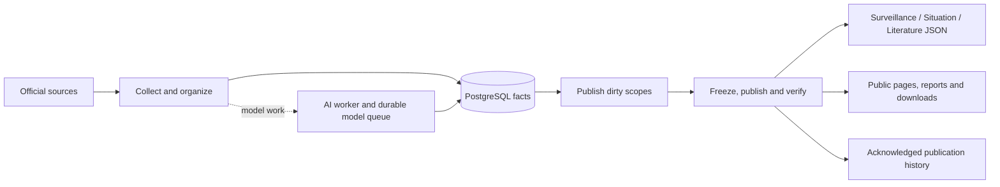

# GlobalID V2

GlobalID V2 (GIDS) collects infectious-disease surveillance data, organizes
research and official situation notices, and publishes multilingual public
pages and datasets. It combines a Python pipeline, a FastAPI API, a Next.js
operations dashboard, and an Astro public site.

## Start here

- [Quick start](QUICKSTART.md): dependencies, local services and first commands.
- [Documentation index](docs/README.md): current architecture and operating guides.
- [Script index](scripts/README.md): supported commands and historical maintenance tools.
- [Country and regional sources](docs/data-sources/README.md): source contracts and coverage boundaries.
- [Control center](docs/control-center/README.md): operators, API, deployment and troubleshooting.
- [Changelog](CHANGELOG.md): version history.

## Version 0.19.3

CPU-heavy Brazil SINAN parsing runs in bounded child processes; ingestion
transactions and publication ownership remain in the parent worker. Main-site
JSON routes, Pages, Papers and the theme are deployed and checked separately.
The daily update chart needs both data archives and the independent website
changelog JSON. See the [acceptance record](docs/acceptance/DATA_UPDATES_20261114.md)
for verified deployments, remaining source limitations and cleanup evidence.
Papers generation cleanup is a separate maintenance operation with a minimum
48-hour retention window and exact dependency checks. On 14 November, maintenance
removed 838 old Pages deployments and 35,964 expired Papers objects (2.76 GB),
while preserving the current publication and its dependencies. See the
[retention guide](docs/operations/papers-generation-retention.md).

Compare, seasonality and Situation selectors use the available geographic
hierarchy, including lower-level administrative units. Public labels are neutral
in English, Chinese and French; stable links, data codes and API fields remain
compatible. Missing observations remain missing rather than being displayed as
zero.

The [core reorganization plan](docs/architecture/CORE_CODE_REORGANIZATION_PLAN.md)
and [batch implementation record](docs/architecture/CORE_CODE_REORGANIZATION_PROGRESS.md)
track all 49 candidates. Pure parsing, queries, policies and UI components are
separated from the owners of database transactions, locks and publication tasks.
Publication input fingerprints include the extracted generation modules.

This version preserves the shared header/footer, hides the footer on the map,
and serves version records and data publication history through independent JSON.
The acceptance record below identifies which checks ran locally and whether a
production deployment has actually completed.

## Runtime and publication

Collection follows `collect → organize → store`. Storage commits facts and the
corresponding `publish_dirty` markers together. A later publication task freezes
its inputs, verifies immutable objects, advances the appropriate channel pointer,
and acknowledges only its selected markers.

Surveillance, Situation and Literature have independent JSON publication
channels. The public site uses the existing same-origin data delivery path;
Papers projection v3 and theme v1 have separate publication contracts. The
dashboard observes these workflows and queues work through the API.

Website releases use the control panel's **plan → task → receipt** workflow.
Successful site releases retain verified source-data snapshots; template-only
builds use a private workspace so ongoing collection does not replace their
inputs. Reports retain their independent release: use `reports_only` or a full
release for report-template changes. Older deployments need one full release
to establish the retained snapshot.

The [November 14 acceptance record](docs/acceptance/DATA_UPDATES_20261114.md)
tracks the data-updates page, runtime restart, article preservation checks and
actual deployment result. Its date range and daily chart include acknowledged
data publications and selected website versions; they do not measure email
delivery. Source-specific failures and Literature review backlog remain open.



See the [data-line architecture](docs/architecture/DATA_LINE_AND_CONTROL_PLANE_REFACTOR.md)
and [publication implementation](docs/publishing/MAIN_SITE_JSON_PUBLICATION_IMPLEMENTATION.md).
The [2026-11-14 status record](docs/releases/PROJECT_STATUS_20261114.md) preserves
the latest documented audit, deployment references and remaining acceptance
boundaries. Live generations, source health and queue sizes belong to the
control plane; dated counts are historical observations.

## Repository layout

| Path | Purpose |
| --- | --- |
| `main.py`, `src/` | CLI, collection, models, services and generation |
| `dashboard/` | FastAPI API and Next.js operations dashboard |
| `astro-site/` | Multilingual public site |
| `cloudflare/` | Publication and subscription services |
| `configs/`, `shared/` | Source registries, mappings and shared contracts |
| `migrations/`, `schema.sql` | Managed database revisions and generated schema snapshot |
| `scripts/` | Operational commands; historical tools in `maintenance/` and `imports/` |
| `deploy/`, `docker/` | Service templates and infrastructure |
| `docs/`, `tests/` | Documentation, evidence and tests |
| `data/`, `exports/`, `reports/`, `logs/` | Local runtime data and generated artifacts |

## Development

Use Python 3.11+, Node.js 22.23.4+ and PostgreSQL 14+ (or compatible TimescaleDB).
Docker Compose provides the database, Redis and Qdrant. The worker's system
Node executable must meet the same version requirement as the site build.

```bash
venv/bin/python main.py --help
make help
```

Install and start the local stack using [Quick start](QUICKSTART.md).
Configuration, worker roles and systemd commands are in
[Development and local operations](docs/operations/DEVELOPMENT.md).
Run the checks appropriate to your changes; `make check` combines the repository,
Python, dashboard, public-site and subscription checks and requires their dependencies.

## Source and data repositories

`development` is the integration branch; `master` is the stable release branch.
Download datasets and raw archives use separate repositories with their own
`main` branches. Generated data must not be committed to this application
repository. See [data versioning](docs/operations/DATA_VERSIONING.md) and
[repository maintenance](docs/operations/REPOSITORY_SIZE_MAINTENANCE.md).
