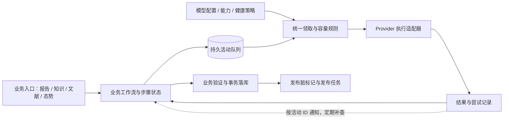
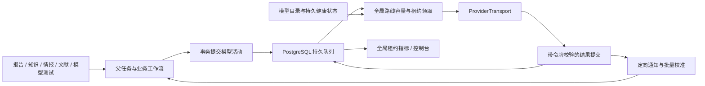

# AI 模型中心与文献流程架构复核

日期：2026-11-10，Asia/Shanghai。基线：主工作区 `development@b77cbb1`，包含审查开始时已有的未提交修改。

本文前面的审查章节记录重构前的 Grok 记录核对、代码审查、数据库只读采样及隔离复现。随后按用户要求实施了不保留旧调度机制的重构，见文末“重构实施记录”。生产数据库迁移、真实模型调用和服务重启不属于已执行的验证。

## 1. 判断

原设计有值得保留的基础：PostgreSQL 持久活动队列、路线级容量预留、租约过期恢复、请求回放、模型 HTTP 入口限制，以及文献写入前的内容指纹检查。

主要问题在于这些基础之上逐步叠加了协程池、进程内计数、父任务容量、辅助调度器和多套文献落库路径。它们对“任务”“容量”“完成”“失败”的定义没有完全统一。单纯调整并发常量、增加进程或拆分大文件，都不能消除这些冲突。

Grok 的持久文献工作流方向合理，但现有实现仍有正确性缺陷，其通知机制也会放大数据库查询。建议作为可参考的实现草稿，按新的边界分批吸收；目前不宜整体合并上线。

## 2. Grok 实际做到哪里

读取的主要记录：

- 会话：`/home/likangguo/.grok/sessions/%2Fhome%2Flikangguo%2FglobalID%2FglobalID2/01a1c315-38a8-77d1-ac57-1d7d0c6494db/chat_history.jsonl`。
- 最新设计：`/tmp/grok-likangguo/grok-design-doc-b357d8b3.md`，约 88 KB。
- 执行状态：`/tmp/grok-likangguo/grok-exec-plan-466bf2a9.json`。
- PR1–PR5 的执行摘要、通用评审和简洁性评审。
- 独立副本：`/home/likangguo/.grok/worktrees/globalid-globalid2/`。

| 分片 | 实际产物 | 本次核实的状态 |
| --- | --- | --- |
| PR1：工作流表与索引 | `a7e4c7b`、`9c65285` | 记录为 completed；未进入当前主工作区 |
| PR2：辅助调度器部署变更 | `181af9e` | 记录为 completed；现场仍有六个辅助进程 |
| PR3：活动 API、Condition 等待 | `599c508`、`bf5a087` | 记录为 completed；本次另发现全局唤醒与串行读库问题 |
| PR4：文献工作流 | `811c3c3` | fixing；四项通用评审问题仍 open |
| PR5：父任务槽与心跳 | `99e4272`、`d53b207` | fixing；供应商容量心跳的读写契约未闭合 |

执行记录仍是 `implementing`，`stack_assembly_started=false`，`pr_urls=[]`。主工作区分支名、各独立副本 HEAD、执行 JSON 中的 commit SHA 并不全部对齐，接续时必须按实际提交内容核对，不能只 checkout 一个同名分支就认为取到了完整实现。

现场 `alembic_version=0026_publish_dirty_changes`，`ai_workflows` 表不存在；0027、0028 对应的两个活动索引存在。新方案没有在当前数据库中落地。

因此，目前能够确认的是“重构尚未集成、评审未闭合”，没有证据表明这个新方案曾完整上线后失败。

## 3. 运行事实与因果边界

Grok 设计记录的早晨样本是约 227 个可用许可、66–68 个在途调用、queued 为 0；下午样本也曾接近空队列。这支持调查生产者供给，但不足以单独证明“0.5 秒轮询就是全部根因”。串行 author→reviewer 是单篇文章的正常依赖；在并行文章足够多时，这个依赖本身也不能解释只有约 67 个请求。

本次 21:27:13–21:27:23 的三次只读样本：

| 指标 | 本次观察 |
| --- | --- |
| `queued` | 21、21、20 |
| `leased` 状态行 | 12、12、11；与未过期租约统计因取样时点有少量差异 |
| 主 worker | 一个；`ps` 显示生命周期平均 CPU 约 103%，不是瞬时 CPU 剖析 |
| 辅助 dispatcher | 六个，仍在运行 |
| 数据库 `idle in transaction` | 21、16、13 个连接，涵盖该数据库全部客户端 |
| advisory lock 等待 | 3、3、9 个连接，尚未逐一映射到具体业务协程 |

21:27:13 之前十分钟的调用日志：terra 5 次失败、gemini 5 次失败，这两条路线没有成功日志；Grok 4.5 为 69 次失败、没有成功日志。其他路线仍有成功。稍后的错误类型聚合包括 `PermissionDeniedError`、`APITimeoutError` 和 `RuntimeError`；未据此臆测具体供应商故障原因。

这意味着今晚至少同时存在上游失败、排队和数据库等待，不能把早晨的“空队列”判断当成全天不变的系统结论。配置许可之和也不能直接当成当前有效容量。

下一轮性能诊断应同步记录：可用路线快照、逐路线兼容待执行数、租约数、真实 HTTP 在途数、事件循环延迟、连接池等待、SQL/锁耗时、每阶段输入输出速率。只有这些时间序列对齐后，才能确定主要瓶颈及优化收益。

## 4. 当前设计的具体问题

### 4.1 容量含义和统计来源不统一

- `src/services/task_worker.py:197`：父任务容量直接取各路线容量之和，`maximum` 没有约束最终结果；`enabled` 被保存但 `refresh()` 不读取。父任务数与模型 HTTP 并发属于不同资源。
- `src/ai/work_queue.py:687`：数据库租约已经控制路线并发。
- `src/ai/model_center.py:704`：`RuntimeRouteAdmissionController` 再维护进程内准入和计数。
- `src/services/ai_content_governance_service.py:1364`：文献流的协程持有 `_review_gate` 跑完 author、reviewer 以及可能的第二意见。
- `src/services/task_worker.py:700` 和 `dashboard/api/routers/ai.py:1229`：模型页覆盖的是主 worker 的进程内快照，无法完整反映辅助 dispatcher 的占用。

需要精确区分：`ReviewRoutePool` 在 worker 的 parent context 下已经退化为 `QueuedModelCompleter`，并不是每条旧准入逻辑都仍在主路径上生效。重构应先绘制真实调用路径，再删除失效分支。

### 4.2 等待成本随并发和运行时长增长

`src/ai/work_queue.py:337` 每个等待者每 0.5 秒读取整行活动。仅按 200 个等待者估算，活动状态读取就是约 400 次/秒，尚不包括取消检查、领取、完成和心跳；这是代码推算，不是本次实测 QPS。

`src/services/ai_content_governance_service.py:1159` 用持续增长的 `ReviewClaims.ids`、排序和 `!= ALL(array)` 排除历史候选。长时间 drain 会增加 Python 处理和 SQL 参数负担，且重启后不能保留这份游标。

现有未提交修改将 enqueue 的本地锁放在数据库访问前，并把路线池锁与候选领取锁分开，方向合理，但只解决局部竞争。SQLAlchemy Session 的创建也不等于立即借出连接，检查连接占用必须看实际首次数据库访问的位置。

### 4.3 长任务缺少清晰的业务状态和失败归属

当前文献多步进度主要存在协程栈里，活动持久化只能恢复单次调用。`submit_completion` 把子活动失败加入 `ParentContext.failures`，即便业务层已经捕获并把单篇文章延后，`src/services/_lifecycle.py:88` 仍可能把整个父任务判失败。

重试还需要分开三种预算：HTTP 传输尝试、内容修订轮数、整篇工作流的时间/费用上限。当前 `_execute` 把路线冷却也当作不增加 attempt 的重入队理由，`MAX_ATTEMPTS=3` 因而不代表整项工作最多请求三次。路线等待可以不记传输失败，但工作流仍需明确截止或延期条件。

### 4.4 多条文献落库路径已经发生规则漂移

`review_literature_articles()` 与 `_write_stream_results()` 的行为不同：

- `src/services/ai_content_governance_service.py:1686` 在 hold 分支引用未定义的 `ungrounded`，会触发 `NameError`。
- 批量文章方法没有像流式文章写入路径一样调用 `decision_is_grounded`，接受的 publish/exclude 可以绕过这一确定性证据检查。
- 流式文章路径在读取并检查指纹时没有像摘要路径一样锁住目标文章；存在检查后并发修改的窗口，需要事务内行锁或条件更新关闭窗口。

本次用隔离的已选中文章、伪数据库及模型结果复现了前两项：hold 抛 `NameError`；没有支持引文的 publish 到达 `_apply_article(..., 'published')`。这是应用层路径验证，不是对线上文献的修改。

`run_once()` 仍调用这个批量方法，因此它不是完全无调用方的死代码。应把文章/摘要落库规则各收敛为一个事务接口，所有自动、手动、补跑入口复用。

## 5. Grok 新方案需要改的地方

### 5.1 全局 Condition 会产生查询风暴

`bf5a087` 的 `src/ai/work_queue.py:599` 中，所有 `await_activity()` 共用 `_slot_condition()`；每次 `notify_all()` 唤醒所有活动等待者，并在持有 Condition 锁时执行 `_read_activity()`。

后者又执行 advisory lock、`FOR UPDATE`、整行读取和父任务取消查询。一个活动的变化会引发多个无关活动查库，且这些读库操作被同一把进程锁串行化。

本次直接加载该分支函数，在不访问数据库和模型的隔离环境中替换状态读取：32 个等待者，一次无关通知，额外触发 32 次读取；最大同时执行的读取回调为 1。每次模拟 2 ms I/O 时，一轮约 76.5 ms。该数字只用于证明放大和串行行为，不能作为生产性能预测。

改法：按 activity id 定向唤醒；容量变化和活动完成使用不同通知通道；锁只保护内存注册与版本，不包住数据库 I/O。初次登记前后重读状态避免丢唤醒，重连/启动时批量补查，低频 reconciliation 作为兜底。

### 5.2 为进程内通知强制单进程，约束倒置

单进程可以是第一阶段部署选择。但“只能在同一事件循环接通知”不应成为永久禁止多个执行进程的架构理由，尤其当前主 worker 已有较高 CPU 占用。

建议保留一个逻辑上的调度规则和数据库容量权威，允许多个相同执行器共享它。先以一个或少量实例压测，再决定是否减少六个辅助进程。不要在性能尚未证明时，把停掉辅助进程作为修复轮询的先决条件。

跨进程通知可以采用 PostgreSQL `LISTEN/NOTIFY`：它只提示“有状态变化”，持久真相仍是活动表。监听连接重建后必须重新查询状态，不能把通知当可靠队列。官方文档特别说明了首次 LISTEN 与并发提交之间的竞态及“先提交监听，再读取状态”的顺序。[PostgreSQL LISTEN](https://www.postgresql.org/docs/current/sql-listen.html)

### 5.3 提交时钉路线造成第二次调度

新方案先在 `submit_activity` 中按路线容量钉 `buffer_route_key`，领取时又允许别的路线拿走。这实际上维护了“排队预留”和“执行准入”两套路线分配。

缓冲准入函数没有按 priority 区分。低优先级已填满缓冲时，新高优先级请求在拿到活动 id 前就阻塞，队列的优先级排序无法帮助尚未入队的请求。路线失效时也需要额外处理原有 pin。

建议提交表达业务需求和能力约束，在领取时分配实际路线。对业务生产者设置有界预取和 lane 配额，缓冲满时仍保留可恢复的业务步骤，并保证高优先级提交入口。如果确有路由亲和需求，把它作为偏好或明确约束，避免用它计算另一套硬许可。

### 5.4 工作流重写尚未保住原业务语义

PR4 四项 open 评审经代码核对仍成立：

1. 前一轮曾解析成功后，后续作者输出无效，超过 `max_rounds` 仍继续 bind 作者活动。
2. reviewer 接受 hold 时，会转向同一意见中的 `revise_author`，而非立即进入第二意见。
3. 文章和摘要共用 publish/exclude/reject/hold，混淆两类业务允许的结论集合。
4. `_bind` 先锁 workflow 再锁 parent，取消反向锁定，存在 PostgreSQL 死锁路径；取消函数捕获异常后只记录日志返回。

本次纯函数复现：作者轮数超过上限仍继续增长至 4、5、6；accepted hold 返回 `revise_author` 且 opinion 仍为 1。

PR5 的心跳问题也未闭合：删掉 `ai_provider_capacities` 写端，但 API 仍读取该键。已有测试通过不能代替跨模块契约验证。

### 5.5 吞吐目标不应改变评审质量规则

现有 `_route_accepts_work()` 把“另一模型忙”也视为没有替代，可退回原模型。Grok 保留了这个语义，但它将独立评审要求与瞬时空闲容量绑定。

应把 `require_distinct_model` 与 `allow_degraded_review` 变成工作流策略。严格独立评审等待另一合格模型；允许降级时记录真实执行模型、降级原因和最终 review mode。不能只为提高利用率而隐式降低评审要求。

## 6. 建议的目标架构

沿用 PostgreSQL 和 Python，先建立边界清楚的有限状态机。当前范围不需要同时迁移到 Celery、Temporal 或新消息中间件。



| 层 | 负责 | 不应承担 |
| --- | --- | --- |
| 模型目录与策略 | provider/model 配置、能力、健康、可用窗口、容量上限 | 文献状态机、持久任务等待 |
| 活动仓储 | 提交、幂等、领取、租约、结果、取消、恢复 | prompt 和发表政策 |
| 调度策略 | 能力匹配、优先级、公平性、真实容量预留 | 重新实现业务 reviewer 逻辑 |
| Provider 适配器 | 一次外部尝试、响应规范化、结构化错误 | 无限重试、业务 fallback 决策 |
| 文献状态机 | precheck、author、reviewer、修订、第二意见 | 数据库连接生命周期、进程计数 |
| 文献应用服务 | 指纹/版本/编辑锁/证据检查与最终落库 | 调用模型、等待路线恢复 |

实现时先抽纯规则和仓储接口，再逐步拆 `model_center.py`、`work_queue.py`。按行数机械拆文件不会改变职责耦合。

### 持久化与执行契约

- 工作流保存 `kind`、subject id、输入指纹、策略版本、当前 step、版本号、活动 id、取消/截止状态。同一主题同时只允许一个有效执行版本。
- 活动保存稳定的逻辑 step key、能力要求、优先级、允许/禁止模型、状态、`available_at`、lease owner/token、deadline、结果引用。传输重试编号与业务修订轮数分开。
- 工作流版本前移与后继活动插入在同一事务中完成；唯一约束防止重复步骤，版本号防止旧结果推进新状态。
- 完成写入必须校验当前 lease token；租约拥有者心跳续租或按明确 deadline 回收。多个执行器时禁止任何进程启动即释放所有别人的租约。
- 最终文献状态、状态事件和发布脏标记在同一事务写入；先检查取消、当前输入指纹、编辑锁和策略版本。
- 外部 HTTP 可能在“供应商已完成、本地尚未落库”的崩溃窗口重复执行。设计承认至少一次尝试，保证业务落库幂等；供应商支持幂等键时使用稳定键，不能声称普通队列可以保证只计费一次。

同事务提交业务状态与任务是 River 的核心实践；活动可能重复执行、因此需幂等，是 Temporal 的明确约束。这里借鉴这些契约，不把自建状态表等同于完整 Temporal 引擎。[River transactional enqueueing](https://riverqueue.com/docs/transactional-enqueueing)、[Temporal activity idempotency](https://docs.temporal.io/activity-definition)

### 通知与容量

- 通知发送在事务成功之后；同进程按 id 唤醒 future，跨进程通知只携带标识。
- 通知丢失、断线和重启靠批量状态补查恢复。没有必要让每个请求单独每 0.5 秒读库。
- 保留区别明确的三个限制：业务预取/内存预算、数据库连接预算、外部模型容量。它们不是应全部删除的“重复信号量”。
- 全局模型许可只有一个权威；若供应商存在账户级共享限额，再单独建显式 quota group，不从 provider 名称或心跳猜测。
- 路线级 queued/leased/http_started 分开统计；leased 不一定等于真实 HTTP 在途，探针和缓存命中也需要分开。
- 调度使用优先级加 lane 公平份额/老化；容量可以借用，持续后台积压也不能永远饿死摘要或交互任务。

### 文献业务边界

文献流程建议明确为：发现/去重 → 元数据及证据补齐 → 相关性筛选 → 证据摘要 → 翻译与一致性校验 → 编辑/质量门禁 → 发布投影。每步记录输入和策略版本，失败只影响本篇或该步骤的重试策略。

要分别表达完整性、相关性、摘要准备度、编辑锁、发布状态，避免把同一个 `review` 当成所有等待原因。优先级分数用于排队；hold 表示不确定；缺证据进入补齐；均不自动等于排除。

11 月 9 日评审文档中的部分问题已被后续代码修正：当前 `classification.py:590` 无疾病匹配也进入 review。本次没有把旧评审全部照搬成现存缺陷。历史排除数据是否已完成重评、书目层与证据页如何发布，应作为独立业务验收继续跟踪。

## 7. 建议实施顺序

| 阶段 | 具体交付 | 放行条件 |
| --- | --- | --- |
| 0：建立基线 | 统一 DB 租约/API/面板统计；补阶段时延、事件循环和连接等待指标；保存可重放输入 | 能区分无兼容任务、上游不可用、生产者慢、调度慢 |
| 1：统一业务正确性 | 收敛文章/摘要应用接口；修复 hold 未定义变量和证据检查分叉；保留编辑锁、取消、内容指纹 | 正常、hold、无引文、并发编辑、取消、事务失败均通过；失败不改变最终数据 |
| 2：改造活动运行时 | 定向通知、批量补查、明确 lease owner/token、错误分类；保留现有调用接口做迁移适配 | PostgreSQL 竞争/崩溃恢复测试通过；无全局通知查询放大；多执行器不超额 |
| 3：迁移文献筛选 | 从一个小批次/一个 kind 开始，纯 reducer + 事务推进 + 有界 keyset feeder | 与旧逻辑的录制输入对照一致；严格限定修订和第二意见次数 |
| 4：扩展及清理 | 摘要与其他业务逐条接入；替换旧容量和等待实现，删除实际无调用方的代码 | 全链路与 API 契约一致；达到容量和业务指标后再调整进程拓扑 |

阶段 1 和阶段 2 可分开交付，但不建议同时大改文献判定规则、数据库结构、通知机制和服务部署。每阶段都应能独立回退执行入口；已有新状态保留，不通过删除数据实现回滚。

Grok 产物的使用方式：PR1 可复用表结构思路，需重新审查字段和迁移；PR2 暂缓；PR3 保留 API 分离和优先级的思路，替换全局 Condition 与 pin；PR4 保留游标/状态机方向，先修业务语义再做一条完整纵向路径；PR5 保留“父任务数与模型数分离”，重新验证心跳/API/面板契约。按提交逐项移植，避免把尚未集成的五笔直接当成可发布栈。

## 8. 验证结果与后续验收

本次运行：

```bash
venv/bin/python -m pytest -q \
  tests/unit/test_ai_work_queue.py \
  tests/unit/test_model_transport_boundary.py \
  tests/unit/test_model_wait_connections.py \
  tests/unit/test_ai_content_governance_service.py \
  tests/unit/test_governance_stream_cancellation.py \
  tests/unit/test_task_worker_config.py
```

结果：**133 passed，4 failed，21.20 秒**。四项失败均在 `test_model_wait_connections.py`：article/summary 连接释放、晚到文章结果、review/dirty 事务失败。

这些测试中的文章缺少当前筛选要求的足够摘要；实际调用到模拟 `_review_all` 时出现空 items。真实 `_review_all([])` 直接返回，因此不能把测试里的连接断言失败直接解释为生产的模型等待泄漏。应先让测试样本满足最新 precheck，再检验真实非空路径；本文没有修改测试来掩盖失败，也不宣称此处已有完整回归保障。

另完成的隔离实验：Grok 全局通知放大、Grok 超轮数修订/hold 路径、当前批量文章 hold/无引文发布路径。它们未调用生产模型、未写生产数据库。

正式重构至少需要增加以下可测验收：

1. 真实 PostgreSQL 下的并行领取、固定锁顺序、取消与完成竞争、重启恢复；SQLite 的 `BEGIN IMMEDIATE` 不能验证 PostgreSQL advisory lock 的死锁行为。
2. 模拟快慢混合路线、持续兼容 backlog、429、断连及大容量路线故障；看单位时间正确完成的文献数、成本、错误率和队列等待，而非只看槽位百分比。
3. 在可用且存在兼容工作的测试窗口内，以有效容量为分母评估利用率，例如目标超过 85%；这是待压测的验收目标，不是当前性能结论。独立评审限制、限流和没有合格工作造成的空闲单独归因。
4. 一次完成只引发对应 waiter/工作流推进；通知量和状态读取量不随全部等待者数量相乘。
5. 输入修改、策略变更、取消、编辑锁、重复完成均不导致错误发布；重试次数和费用预算可解释。
6. API/面板与数据库快照一致；容量来源、样本时间和过期状态可见。
7. 小批量灰度先验证，再扩大；用同一组录制输入比较新旧业务结果，避免为了打满模型而改变筛选质量。

当前最有价值的下一步是阶段 0–1：建立可信的性能基线并统一文献落库规则，然后用一条经过验证的活动运行时承载新的持久工作流。


## 重构实施记录（2026-11-10）

### 设计依据与边界

采用 River 的[业务变更与入队同一事务](https://riverqueue.com/docs/transactional-enqueueing)原则，以及 Oban 的[队列隔离、持久任务记录与有界并发](https://oban.hexdocs.pm/Oban.html)思路。保留项目已有 PostgreSQL 技术栈，在 Python 中落实这些约束，没有引入另一套队列服务。通知遵循 PostgreSQL 的[提交后投递语义](https://www.postgresql.org/docs/current/sql-notify.html)：通知只携带活动 ID，结果以数据库为准；断连、漏通知由批量读取补偿。



职责分布：

| 边界 | 实现 | 负责的约束 |
| --- | --- | --- |
| 模型配置与健康 | `src/ai/model_center.py`、`src/ai/catalogue/` | 数据持久化、纯路线快照、错误分类、探测、冷却恢复 |
| 活动调度 | `src/ai/runtime/` | 入队幂等性、全局容量、领取、续约、有限重试、结果通知 |
| 模型协议 | `src/ai/providers.py` | 仅执行已分配路线，复用并关闭 SDK 连接，关闭 SDK 自动重试 |
| 业务调用入口 | `src/ai/agents/base.py` | 入队、缓存与实际模型来源；不再维护模型候选链或自有准入 |
| 文献工作流 | `src/literature/review_workflow/` | 持久游标、作者/审核状态、两轮修订与二次意见、截止时间 |
| 文献结果应用 | `src/literature/review_application.py` | 统一父任务、文章、英文规范摘要锁序，指纹与证据校验、取消保护 |
| 全局观测 | `src/ai/runtime_metrics.py`、模型中心 API | 汇总所有执行器未过期租约，不将主 worker 局部计数当成全局容量 |

删除 `src/ai/work_queue.py`、`ReviewRoutePool`、`QueuedModelCompleter`、进程内路线准入以及 BaseAgent 的运输重试/恢复等待路径。所有调用方直接迁移到新入口；旧参数、旧导入没有兼容别名。

### 执行与业务语义

- 模型路线在领取活动时选择。数据库事务锁保护“检查容量并占用许可”，行锁与 `SKIP LOCKED` 防止重复领取。优先级随后按创建时间和 ID 排序；路线选择参考剩余容量和近期执行结果。
- 每次领取分配执行器 owner 和唯一 token。租约 TTL 为 60 秒，运行中续期；单次执行绝对上限 15 分钟。启动只回收过期租约，正常退出只释放自己的租约。旧 token 不能提交迟到结果。取消正在执行的活动时先保留许可，等 HTTP 清理完成后才释放；通用活动超过六小时总排队年龄会终结，不会无限等待第二模型。
- 临时运输失败由队列负责退避重试，最多三次。身份认证/路线失效可在预算内换路线；无效请求与未知程序异常不循环重试。协议层仅允许有界的可选参数协商及明确文件格式拒绝后的文本转换。
- 显式重试递增父任务执行代次，并取消旧代未完成活动。自动崩溃恢复保留原代；同一代中相同输入的多次调用按序号区分，恢复时按序号重放。重复语义调用及显式重试跳过旧 completion 缓存，避免反复读到同一坏结果。旧代不能更新新代任务状态、消费新代结果或落文献结果。进度与活动计数仅统计当前代，历史日志保留并标注代次。
- 提交者等待定向活动事件；同进程等待者共享批量校准任务，不为每个请求持续轮询。取消检查发生在消耗结果之前。
- 业务组织者容量与模型许可分开。等待模型的父任务仍计入组织者预算，避免模型扩容拉起大量业务调用栈；健康探测使用独立有限通道，报告保留组织者入口。
- 文献批处理以固定最高 ID 和持久 keyset 游标遍历；业务缓冲预算默认/上限 512，实际供给目标为可路由文本许可的两倍、最低 64，并受已保存预算限制。每五秒重新评估供给目标；显式小预算与恢复任务的原预算仍被尊重。终结、延后、保持和跳过均推进本次游标，不维护不断膨胀的排除 ID 数组。
- 文献作者/审核状态、下一模型活动和最终应用在短事务中提交。游标和工作流按父任务执行代次隔离，手工重试创建新一轮，旧历史保留。严格审核默认要求不同模型，同一模型经另一供应商转发仍不算独立模型。放宽必须显式选择。未等到合格模型的文献工作流默认六小时后记录 deferred。
- 内容指纹、编辑锁、英文规范摘要、证据完整性和发布时间条件仍在最终写入时验证；单项 deferred 不自动把整个文献父任务判成失败。

### 切换步骤与限制

这是协调切换，不能让旧执行器与新执行器滚动混跑。发布时按以下顺序操作：

1. 停止接收新的 AI 父任务，停止主 worker 和全部辅助 model dispatcher；保留数据库与原始请求文件。
2. 在备份后执行正常 Alembic 升级链到 `0030_ai_activity_leases`。`0029` 创建工作流及游标表；`0030` 增加 owner/token/时间字段，并将旧机制尚未结束的活动标记为失败、注明重新执行父任务。已成功的历史结果保留；仍可重试的文献父任务（包括 FAILED/CANCELLED）的旧协程池参数在迁移中一次性转换为新工作流参数。
3. 统一发布新代码后启动 worker 与辅助执行器。通过任务控制入口重试受切换影响的父任务，使其按新契约提交活动；不直接将旧活动改回 queued。
4. 验证全局租约计数、无模型时的健康恢复通道、取消传播和文献工作流进度，再恢复新任务接收。

新文献工作流可以从持久状态恢复。通用父任务依靠原有任务恢复策略及请求幂等性重放。所有执行器仍需访问共享的 `data/raw/ai` 请求存储；跨主机部署必须挂载同一存储。

外部模型 HTTP 不具有数据库事务语义：进程在上游成功后、结果提交前崩溃时，重试可能再次调用模型。租约令牌保证数据库结果不被旧执行覆盖，不承诺上游 exactly-once。全局仪表盘显示租约占用，不等同于实时 HTTP socket 数。实际供应商吞吐、延迟与限流仍需发布后的受控测量，不能从离线测试推导性能倍数。

### 验证

隔离 PostgreSQL 18 的集成测试覆盖真实 advisory lock 容量竞争、`SKIP LOCKED`、owner 释放、续期及 token 防护、事务回滚不通知、定向通知与漏通知补偿、严格审核，以及新增迁移升级/降级。测试数据库位于临时独立容器，不使用生产数据。验证记录：

| 验证范围 | 结果 |
| --- | --- |
| `pytest tests/unit -q --tb=short` 全量运行 | 3583 passed、19 skipped；8 个失败中的 6 个是新增代次契约后的旧 fixture，已修正并通过下面专项复测 |
| 运行时、通知、持久审核、任务代次、治理、数据库等待与 schema 等最终专项 | 234 passed、1 skipped；包含上述 6 个 fixture 的修复验证 |
| 任务进度与历史追踪的执行代次隔离专项 | 107 passed；覆盖旧代迟到事件、新代独立计数与历史日志保留 |
| 隔离 PostgreSQL 运行时集成 | 11 passed；其中迁移分别覆盖 QUEUED、FAILED、CANCELLED 旧父任务参数转换，反射结构与 ORM 一致 |
| 隔离 PostgreSQL 文献工作流 | 29 passed；包含并发、重启、取消、代次、事务回滚和唯一准入 |
| 前端和静态检查 | Dashboard lint、TypeScript、重构模块 Ruff F/I、`git diff --check`、仓库边界检查通过 |

仍存在两个与此次 AI 重构无关的基线失败，已在原始提交 `b77cbb1` 的隔离 worktree 中复现：`test_ie_control_plane_exposes_current_and_annual_source_policies` 的爱尔兰年度数据发布策略预期，以及 `test_population_dirty_is_consumed_as_exact_incremental_rate_scope` 在当前本地 `.env` 下的分离发布配置预期。未修改这两项业务策略来掩盖测试结果。网络测试保持跳过；没有调用真实上游模型来推断吞吐收益。

## 积压吞吐实测与追加优化（2026-11-10）

本节是上述离线功能验证之后的隔离实测记录。功能测试通过不代表模型中心已达到最高吞吐；本轮使用只读生产积压快照、隔离 PostgreSQL，以及受限的真实供应商调用，发现并修复了额外问题。此阶段尚未迁移或重启生产；后续正式切换和生产结果见文末。

### 输入与测量边界

- 初始只读统计：353,311 篇文章处于 review；226,055 篇满足实际审核 SQL 条件；前 4,096 个候选经内容指纹检查有 3,949 篇可启动。缺摘要、编辑锁及已完成双意见 hold 的条目仍遵守原业务门禁。
- 初始路线快照有 8 个不同可路由模型、217 个配置许可。这个数字会随健康状态变化。生产仍运行旧 worker，数据库版本为 `0026_publish_dirty_changes`。
- `scripts/benchmark_ai_literature.py` 强制源连接只读，将有限文章样本及模型配置复制到独立测试数据库的临时 schema。测试结束删除 schema 和请求文件，审核结果不回写生产；报告不保存密钥、文章正文或模型回答。
- 模拟测试保留实际数据库、文献提示构建、严格独立复审、状态机和内容应用，仅替换供应商回答。合成回复用于走通业务路径，不能衡量模型判断质量。217 许可测试均分到四个合成模型，以固定对照条件；它不是生产八条路线的流量复刻。
- 执行占用、有效租约和 HTTP 请求分别记录。真实调用预算在 HTTPX `send` 边界检查，SDK 参数校验失败不计为已经发出的 HTTP。有限样本包含预热和收尾，不能仅用峰值声称持续满载。

### 发现与修复

1. **每个活动单独领取。** 改为每批最多 16 个，共用一次路线锁、容量读取和批量行锁；全局许可及 owner/token 校验不变。
2. **默认供给预算不足。** 128 个 open 工作流无法覆盖 217 个许可。默认最大预算改为 512，供给按可路由文本许可的两倍调整；217 对应目标 434。显式预算与恢复任务的保存预算不会被扩大。
3. **文献逐项事务开销。** feeder 改成批量插入、每页一次 cursor 更新；作者/复审每批最多 8 个推进，先按固定顺序锁齐内容，再批量读取、应用和提交活动。8 个新活动的提交从逐项查重/INSERT/通知收敛到 3 条 SQL。
4. **成功进度与业务争父锁。** 同一快照的诊断实验，仅跳过成功进度投影就使耗时从 43.827 秒降到 32.874 秒。正式实现保留进度：按父任务及执行代次合并，每 0.5 秒最多投影 16 个父任务，`SKIP LOCKED` 避让业务锁。只合并可从持久活动重建的 UI 提示，失败日志仍逐条同步保存，不增加后台任务。
5. **真实配置的协议错误。** 内部 `native_files_probe` 原先泄漏到 SDK 参数，导致联网前 `TypeError`。现按统一内部字段过滤，并通过真实 OpenAI/Anthropic SDK 配合 MockTransport 验证请求组装；供应商自定义 `extra_body` 保留。

### 已测结果

调度领取对照：独立 PostgreSQL、2,270 项预先入队、227 许可，每种情况三轮，包含执行前 owner/父任务校验但不发送供应商请求：

| 填满 227 个执行名额 | 原实现中位数 | 批量领取中位数 |
| --- | ---: | ---: |
| 单条路线 | 11.34 秒 | 1.42 秒 |
| 八条路线 | 12.25 秒 | 1.78 秒 |

这约为 6.9–8.0 倍的启动速度提升，不能直接解释为供应商吞吐提升。原始轮次记录见 [claim_comparison.json](benchmarks/ai_model_center_2026-11-10/claim_comparison.json)。

256 篇真实文章副本、217 个合成许可、每次模型模拟耗时 5 秒、相同 seed：

| 端到端指标 | 本轮优化前 | 最终实现 |
| --- | ---: | ---: |
| 完整审核耗时 | 55.332 秒 | 24.590 秒 |
| 活动完成数 | 512 / 512 | 512 / 512 |
| 峰值执行数 | 111 / 217 | 217 / 217 |
| 首次达到全部许可 | 未达到 | 4.072 秒 |
| 全程执行占用（含预热/收尾） | 21.33% | 48.07% |
| SELECT / INSERT / UPDATE 执行数 | 16376 / 777 / 3248 | 4293 / 79 / 722 |

该样本约快 2.25 倍，终态均为 4 published、252 held。模拟回答的这些终态只证明应用路径一致，不是对文章真实价值的判断。详见 [原版记录](benchmarks/ai_model_center_2026-11-10/simulation_256_original.json)、[最终记录](benchmarks/ai_model_center_2026-11-10/simulation_256.json)。

扩大到 1,024 篇、相同 217 个合成许可及 5 秒模拟响应后：94.207 秒完成 2,048 次活动，1,024 篇全部进入审核终态，无活动失败或后台异常；4.922 秒首次满载。全程执行占用 50.17%，中间 10%–80% 时间段采样占用 59.05%，平均 652.18 篇/分钟。**这证明能快速达到峰值，但未证明持续接近 100% 利用率**；业务推进、数据库开销及有限批次收尾仍占时间，不能直接用合成吞吐估算生产清空时间。记录见 [simulation_1024.json](benchmarks/ai_model_center_2026-11-10/simulation_1024.json)。

真实供应商小批：24 篇、四条有余量路线、每路线最多 2 个测试许可，总 HTTP 预算 80 次，单次测试截止 90 秒。75 次返回成功，4 次因测试超时取消，1 次在预算截止时取消；22 篇进入审核终态（9 published、7 rejected、6 held），2 篇在预算截止时未完成。成功响应报告 token 合计 289,634；取消请求是否被上游计费未知。该轮在成功进度合并前运行，不能代表最后版本的持续吞吐。

| 路线 | 成功 / 发出 HTTP | 成功请求耗时中位数 |
| --- | ---: | ---: |
| `zzshuccc:gemini-3.5-flash-lite` | 37 / 37 | 1.833 秒 |
| `zzshuc:gpt-6.1-terra` | 31 / 31 | 7.011 秒 |
| `kiro:hy3` | 7 / 8 | 45.478 秒 |
| `kiro:hy4free` | 0 / 4 | 四次达到 90 秒测试超时 |

真实小批在 1.509 秒达到本次的 8 个测试许可；这没有证明生产 217 个许可可以同时获得相同质量、延迟与成功率。路线健康、响应长尾和独立复审约束都影响有效产出。详见 [live_validation.json](benchmarks/ai_model_center_2026-11-10/live_validation.json)。

复现模拟实验（`TEST_AI_DATABASE_URL` 必须指向单独的可丢弃 PostgreSQL）：

```bash
venv/bin/python scripts/benchmark_ai_literature.py \
  --mode simulated --items 1024 --capacity 217 \
  --buffer-size 512 --latency 5 --duration 240 \
  --output /tmp/ai-literature-benchmark.json
```

`--mode live` 会调用真实供应商，使用 `--live-per-route`、`--live-max-calls`、`--call-timeout` 和 `--duration` 限定本次实验。报告中的终态数量包含 deferred/skipped 等退出路径，`reviewed_workflows` 单列实际审核结果数量，避免把快速失败计作有效吞吐。

## 正式切换、worker 扩容与生产观察（2026-11-10 23:25 起，北京时间）

### 已完成的部署

按用户要求完成代码检查、备份、协调停机、迁移和重启，之后直接处理生产积压。这个阶段没有再提交付费模型测试请求；观测只读查询现有任务与日志。

- 最终运行时、持久工作流、协议、任务生命周期及真实 PostgreSQL 专项：**243 passed**；systemd 安装器测试 **2 passed**。Dashboard 生产构建通过。上述数字是专项结果，不代表此前两个已记录的无关全量测试失败已消失。
- 停止 scheduler、历史重筛、主 worker、全部旧辅助执行器和 API；主 worker 等待已有采集任务后正常退出，没有强杀。数据库保持运行。
- 切换前备份：`data/backups/ai-cutover-20261110T151349Z/`，包含全库 schema、`tasks`/`ai_work_items`/`alembic_version` 数据归档、校验和、旧 systemd 单元和切换状态。`pg_restore --list` 验证归档可识别；这不是所有业务表的全库数据备份。
- Alembic 从 `0026_publish_dirty_changes` 升到 **`0030_ai_activity_leases`**；schema 检查无差异。在所有旧执行器退出后，锁定 3 个待恢复的 AI 父任务，调用统一 `restart_parent_activities` 将代次 0 改为 1，记录工作簿并保留 queued。没有复活旧活动。文章、摘要审核的保存缓冲预算设为 512。
- 辅助 model dispatcher **6 → 12 个**，另保留主 worker 内的调度器；实际 `.env` 的 `TASK_WORKER_CONCURRENCY` **10 → 16**、`TASK_WORKER_AI_CONCURRENCY` **6 → 12**。示例配置、systemd drop-in 和安装器同步落地，安装器现在会安装仓库管理的 drop-in。
- 分配数据库连接池上限：主 worker 16、API 12、scheduler 3、历史重筛 2、12 个辅助执行器共 36，总计最多 69，给 PostgreSQL `max_connections=100` 留出其他客户端空间。这些是数据库连接预算，不限制模型 HTTP 并发到相同数字。
- 23:25 启动新 API、主 worker 与 12 个辅助执行器，恢复 scheduler、历史重筛并重启 Dashboard。随后所有相关服务 active、自动重启数 0；API `/health` 的数据库、worker、scheduler 均 ok，Dashboard HTTP 200。临时压测 PostgreSQL 容器已停止。

### 有效产出与预计时间

生产采样窗口为 **23:27:06–23:32:06**，共 14 个只读快照、无采样错误。供应商健康状态变化后，当前可路由容量为 **157**，不能沿用隔离实验最初的 217 作为生产分母。

| 指标 | 五分钟实测 |
| --- | ---: |
| 有效文章审核 | 525 篇：125 published、305 rejected、95 held |
| 有效速度 | 105 篇/分钟 |
| 额外退出 | 1 deferred，未计入有效速度 |
| 可审核且未停放的积压 | 216,865 → 216,340 篇，净减少 525 |
| 摘要审核 | 1 held；3,090 waiting 未计作有效产出 |
| 模型应用调用 attempt | 1,642 成功、10 失败；失败为 9 APIConnectionError、1 RuntimeError |
| 有效租约占用 | 16–137 / 157；采样时间加权平均约 55，即 35.1% |
| 数据库客户端连接 | 44–58；锁等待客户端峰值 28 |

模型 attempt 数不是文章数，也不是 HTTP socket 数；一次应用调用失败不等于文献已终态失败。成功日志延迟中位数：Gemini 1.97 秒、GPT 6.33 秒、hy3 42.77 秒、hy4free 116.47 秒；慢路线仍在返回结果。

按全窗速度，216,340 篇剩余可审积压需要约 **34.3 小时**；约两分钟滚动速度为 85.32–118.09 篇/分钟，对应约 **31–43 小时**。该估计只适用于当时可审核队列的一轮审核，假设吞吐维持、没有新增流入。此窗未观测到新文章或历史重筛转入 review，后续流入会延长时间。

另有 **8,724 条内容未变的 hold、122,128 条缺少足够摘要、5,173 条不满足其他门禁**。它们需要新证据、补全或业务条件变化，不能承诺随本轮自动清零。摘要只有一条有效完成，尚无可靠的独立清空 ETA。

取最新完成的 40 篇 published/rejected 文献进行只读契约抽查：40/40 作者与审核实际模型身份不同，40/40 已存审核理由通过摘要证据校验，40/40 落库状态与工作流结果一致，意外编辑锁 0。此抽查验证业务契约与落库一致性，不替代人工科研质量评估。

数据见 [五分钟汇总](benchmarks/ai_model_center_2026-11-10/production_5min.json)、[采样计数](benchmarks/ai_model_center_2026-11-10/production_samples.json)、[结果抽查](benchmarks/ai_model_center_2026-11-10/production_result_audit.json)。

### 尚未解决的瓶颈与独立问题

**当前没有达到持续满载。** 23:34:03 / 23:34:36 的补充快照中，模型 queued 都为 0、leased 为 51 / 38；业务 ready 为 146 / 219，作者或复审已成功但未消费为 117 / 92。第二张快照中，作者成功后的平均等待约 26 秒、最高 39 秒。近一分钟仍成功完成 434 次模型调用，说明系统在持续推进，但业务提交与结果消费供给不足；增加 dispatcher 数量无法单独消除这个瓶颈。

后续优化应先计时区分 feeder、工作流批量推进、结果应用及父任务锁等待，再优化业务阶段的交错调度和事务持锁时间。保持输入指纹、独立复审、取消与代次保护；用真实积压的每分钟有效完成数和长窗占用验证收益，不以增加进程数或单次峰值代替结论。

本次还观察到 Reports 站点构建失败：`/usr/bin/node` 为 **22.23.3**，已安装 Astro **7.4.7** 的 engines 要求 **>=22.23.4**。同样错误在当天 11:23、此次上线前已出现；本次失败任务为 `b48fdca7-3811-4de9-801e-ea653d7bda5d`，工作簿 116226。这是既有站点构建环境问题，未阻塞 AI 文献审核；本轮未更换系统 Node，也未手动重跑发布。

### 后续 Node 修复（2026-11-10 23:42–23:45，北京时间）

用户随后要求更新 Node。通过服务器已配置的 NodeSource 软件源，仅升级 `nodejs` 包：系统 `/usr/bin/node` **22.23.3 → 22.23.4**，包版本 `22.23.4-1nodesource1`，npm 10.9.9。项目内原本已有 Node 22.23.4，但 Reports 任务由 Python 直接执行系统 `node`，所以仅有 npm 的局部依赖未能修复旧构建错误。README 已明确系统服务 PATH 的最低版本要求。

Dashboard 重启后确认其实际进程使用 v22.23.4，HTTP 200、API health ok；AI 主 worker 保持运行。新版本执行 Astro 7.4.7 CLI 和构建流程测试通过（5 passed）。以 `GIDS_REPORTS_FORCE_FULL=1` 执行原 Reports 构建入口，渲染 515 个报告 bundle、生成 **1,548 个页面**，完整脚本退出码 0；Astro 构建阶段耗时 81 秒。输出保存在独立 `exports/reports-stage-node-validation-*` 目录，未触发远端发布或额外模型调用。先前的 Node 版本阻塞已修复。

验证记录见 [node_runtime_validation.json](benchmarks/ai_model_center_2026-11-10/node_runtime_validation.json)。

### 文献是否都需要 AI：调用必要性审计

**216,340 是当前策略准入的候选量，并非已经证明必要的 AI 工作量。** 前面的 31–43 小时估计描述当前策略的执行成本，不代表合理分层后仍需同样时间。本次只读审计没有调用模型，也没有更改生产筛选或发表状态。

原因在于策略入口：`src/literature/classification.py` 的分类结果统一进入 review；`src/literature/screening.py:46` 的 `initial_screen` 仅按摘要是否足够区分 contextual_review 和 needs_more_evidence；`src/services/literature_automation_service.py:396` 的 `decide_article` 对普通完整记录统一返回“disease relevance requires contextual review”。关键词、MeSH 和分数在这里是候选证据，不能充当已验证的最终相关性结论。`scripts/rescreen_excluded_literature.py` 又把符合重筛条件的历史 excluded 重开为 review，将旧 AI 记录移到历史元数据中。这使历史重筛几乎整体汇入双模型流程。

23:44 的只读系统抽样取当前 SQL 可审候选中所有 `id % 101 = 0` 条目，共 **2,241 条**，包括其中已停放的 hold；它不是随机样本，也不是恰好从 216,340 个未停放条目中抽取：

| 证据 | 样本结果 | 可得结论 |
| --- | ---: | --- |
| 带历史重筛记录 | 2,230 / 2,241，99.51% | 样本主要来自历史重开，而非新文章自然流入 |
| 分类版本 | 全部为 5 | 不能归因于尚未运行当前分类器 |
| 重新执行现有纯规则 | 2,241 hold、0 exclude | 当前规则本身没有消化这批相关性候选；不能宣称重跑规则就能安全筛掉大半 |
| 书目信息阻塞 | 23 / 2,241，1.03% | 6 条缺作者、9 条标题过短、8 条缺 DOI/PMID/PMCID；其中 3 条已按 hold 指纹停放，另 20 条仍可能进入 AI，可先补全或停放，不能直接当作无关文献排除 |
| 当前 AI 记录 | 107 hold、2,134 无记录 | 没有现成的 published/excluded 终态可直接复用 |
| 历史重筛前的 AI 终态 | 48 excluded、1 published | 旧终态缺少可验证的终态输入指纹，尚不能确认安全复用数量 |

另外定向检查全部当前 SQL 可审的更正/corrigendum/erratum 标题候选 16 条：现有规则均返回 hold，没有满足“更正标题 + 明确非自身父 DOI”直接排除条件的条目。生产库已为 DOI、PMID、PMCID、OpenAlex ID 等建立唯一索引，没有证据支持“存在大量同标识符重复记录”的节省预测；跨标识符的语义重复仍需另行验证。

现有机制已经挡住先前快照中的 122,128 条摘要不足、5,173 条其他准入条件不满足、8,724 条同内容指纹且完成第二意见的 hold。针对上述 23 条书目缺项，进一步按实际 `_held` 和当前内容指纹去重后，新增前置停放的已观察例子为 20 条，占本次系统样本 0.89%；这不是全库确定节省比例。剩余浪费主要需要在调用必要性和审核深度上解决，而非把已过滤的数量再次计作潜在节省。

下一轮设计应把规则预检、需要补资料、相关性初筛、拟发布或争议结果的独立复审拆开；对可信结论保存输入指纹、策略版本和证据后复用，对 hold 区分“缺新证据”与“模型意见分歧”，避免对同样的信息机械追加意见。文章入队和最终应用应共享同一套确定性门禁，先覆盖已证实的书目缺项。是否能将大多数条目改为低成本初筛，必须用分层人工标注样本评估漏检与误排，不能根据模型最终 rejected 比例推算可省调用，也不能恢复“无疾病词/低发现分就排除”的旧错误。

数据见 [ai_necessity_audit.json](benchmarks/ai_model_center_2026-11-10/ai_necessity_audit.json)。
