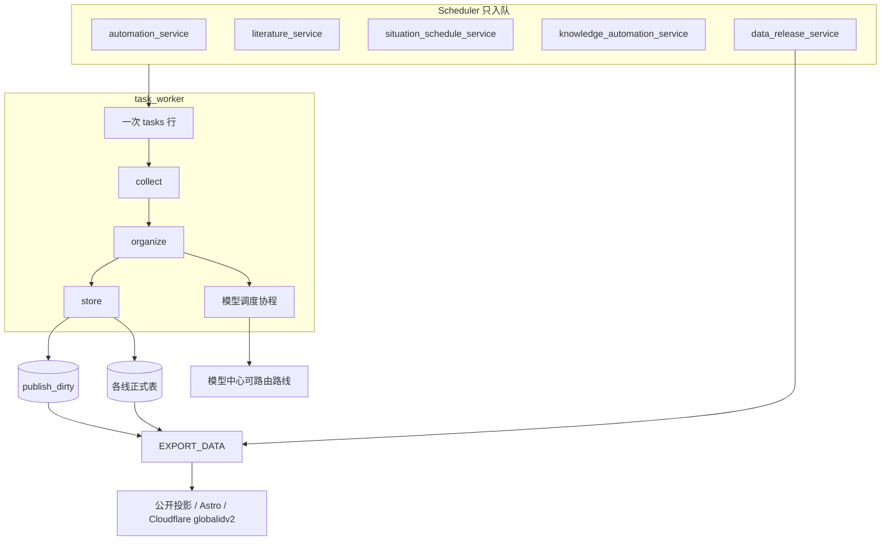

# 数据线、模型池与控制面重构方案

| 字段 | 值 |
| --- | --- |
| 日期 | 2026-10-30 |
| 状态 | 实施中：代码迁移已接通，集成与真实运行验收进行中 |
| 范围 | `/home/likangguo/globalID/globalID2` 生产系统 |
| 读者 | 按 PR 实施的工程师 |
| Alembic 头 | `0021_situation_alerts`（`down_revision = 0020_drop_legacy_situation`） |

本文是实施说明。公开站页面结构、Postgres / Redis / systemd 进程模型、疾病本体和 mapping v3 的产品规则保持不动。过时文档 `docs/REFACTORING_PLAN.md`、`docs/ARCHITECTURE_V2.md`、`src/data/README.md` 只作历史，不按它们实施。

## 1. 要改成什么样

四条数据主线使用同一步骤：定时入队、收集原始字节、整理、写入各自的正式表。发布是另一次任务，只读取已经入库的增量，更新公开投影、下载包和站点。

模型调用从业务任务里拆出来，进入统一工作队列。调度器按优先级把工作项分给仍有容量的模型路线。路线冷却时，工作项留在队列里。

控制面板和 `/api/v1` 按日常使用顺序排列：总览、收集、模型、发布、设置。



## 2. 现状里已经成立的部分

这些部分继续使用，实施时不要另起一套。

| 部件 | 位置 | 现在的行为 |
| --- | --- | --- |
| API | `dashboard/api/main.py`，systemd `globalid-dashboard-api.service`，`:8000` | 校验 `X-Dashboard-API-Key`，入队，读模型 |
| 面板 BFF | `dashboard/src/app/api/v1/[...path]/route.ts`，`:3000` | `validateMutationOrigin`，注入 `DASHBOARD_API_KEY`，转发到 `API_PROXY_TARGET` |
| Scheduler | `src/control_plane/scheduler.py` | 启动 automation、data release、mapping automation、literature、knowledge autopilot、idle backlog、situation schedule。本身不抓取 |
| Worker | `src/services/task_worker.py` | 按优先级领取 `tasks`。不热加载 |
| 重启 | `scripts/restart_task_runtime.py` | 先停 scheduler，排空 worker，再启动。`--include-api` 才重启 API。不重启 web 单元 |
| 监测编排 | `src/services/crawl_service.py` `CrawlService.execute()` | `_PIPELINES` 按国家调用 `_execute_*`。`process=True` 时末尾调用 `_publish_country_series()` |
| 公开曲线 | `src/generation/public_series_store.py` `refresh_public_disease_series()` | 按国家重写投影。`force=False` 时，投影版本未变的国家会跳过 |
| 发布增量 | `src/services/data_release_service.py` `_enqueue_release_task()` | 手动发布会收集「上次成功 `EXPORT_DATA` 之后完成的 `CRAWL_DATA`」的国家码，写入 `input_data.incremental_country_codes` |
| 站点生成 | `scripts/generate_site_data.py`、`src/generation/site_data_export.py` | 已接受 `incremental_country_codes` 和 `incremental_site` |
| 态势任务 | `src/services/task_executor.py` `_run_situation_sources_refresh()` | 默认 `export=False`，只写数据库 |
| 态势发布命令 | `src/services/data_release/commands.py` `build_update_situation_notices_command()` | 已是 `scripts/run_situation_notices.py --export-only` |
| 模型准入 | `src/ai/model_center.py` | 按模型限流冷却、失败冷却、可路由判断 |
| AI 槽位 | `task_worker.AdaptiveAIConcurrencyController` | 槽位数等于可路由路线的 `runtime_model_capacity` 之和。没有可路由路线时槽位为 0 |
| 任务优先级 | `src/domain/task.py` `TaskPriority` | `urgent`、`high`、`normal`、`low`。领取顺序见 `_claim_next_task_uuid()` |
| 评审选路 | `src/ai/peer_review_completer.py` `ReviewRoutePool` | 按空闲额度和近期成功率挑路线，目前只存在于单次运行内部 |

Scheduler 的 schedule 适配器只有四类：`ingestion`、`release`、`literature`、`situation`。id 形式是 `{kind}:{job_id}`。知识 autopilot、mapping automation、idle backlog 由 scheduler 自己循环，不出现在 `GET /schedules`。

Worker 单元限制：`MemoryHigh=28G`，`MemoryMax=32G`，`RestartPreventExitStatus=75`，`TimeoutStopSec=900`。`EXPORT_DATA` 与文献同步、AI、知识源任务互斥，常量是 `RELEASE_EXCLUSIVE_TASK_TYPES` 和 `RELEASE_SHARED_BLOCKED_TASK_TYPES`。

## 3. 现在乱在哪里

1. 国家监测的收集、整理、入库和公开投影绑在同一次 `CRAWL_DATA` 里。`execute()` 在 handler 成功且 `process=True` 时调用 `_publish_country_series()`，对本次国家执行 `refresh_public_disease_series(..., force=True)`。
2. 国家实现分成四套：`src/data/crawlers/`、`src/data/processors/`、`src/services/crawl_pipelines/`、`CrawlService._PIPELINES`。`BaseCrawler.crawl()` / `parse()` 对多数国家是空壳。美国的 `crawl()` 返回空列表，真正入口是线程里的 `fetch_latest`，且不把 `save_raw` 传进去。日本的 `JapanIDWRCrawler.crawl` 是 `async def`，函数体抛 `NotImplementedError`。中国走 `DataProcessor`，按报告提交，不走 `_import_rows_with_series`。
3. 文献在 `LiteraturePipeline.execute()` 里自行抓取、分类、分批入库。态势在 `run_situation()` 里抓取、抽取、重建暴发簇。知识来源和简报是另外两种任务。阶段名只存在于 workbook 自由文本，面板无法并排比较。
4. `scripts/run_situation_notices.py` 在不带 `--export-only` 时调用 `run_situation()`，而该函数的默认 `export=True`。任务路径已经关掉导出，命令行直接跑仍会导出。
5. 模型容量按整段 AI 任务占用。`AI_TASK_TYPES` 包括 `GENERATE_REPORT`、`GENERATE_SECTION`、`REVIEW_SECTION`、`UPDATE_DISEASE_KNOWLEDGE`、`AGENT_WORKFLOW`、`ENRICH_LITERATURE`、`DISCOVER_LITERATURE_GAPS`。一个长任务占住槽位时，其他空闲路线吃不到这次任务内部的单次调用。
6. 面板五段导航在 `dashboard/src/shared/navigation/route-registry.ts`。生成、文献、站点发布捆在 “AI & Reports”。运行详情是 `/operations/tasks?task=`，没有阶段和原始文件。同一操作拆在 `tasks`、`sources`、`operations`、`control_plane`、`overview`、`release`。`dashboard/api/routers/crawl.py` 没有挂到 `main.py`，其中的冰岛校验仍被测试 import。

## 4. 目标与非目标

### 4.1 目标

- 四条主线每次运行都留下 `collect`、`organize`、`store` 三段记录。
- 原始字节在解析前落盘，并记录 sha256。
- 正式表保持现有的表。观察键在国家切换前后一致。
- 收集成功只写 `publish_dirty`。公开投影、站点数据和部署只在 `EXPORT_DATA` 里发生。
- 模型调用变成 `ai_work_items`。调度只看路线剩余容量和优先级。
- 面板能从总览进入一次失败运行，并看到三个阶段；发布页能看到未发布范围。

### 4.2 非目标

- 不改 Astro 信息架构和视觉。投影字段形状保持不变。
- 不引入 Celery、Mongo、新消息总线，不新建疾病事实表，不增加 `/api/v2`。
- 不修改 mapping v3 的产品规则，不在国家切换时改变未映射行的命运。
- 中国省级本轮不进调度，不写国家 `disease_records`。地理键保持 `country:CN-*`。
- 人口和区划的 systemd oneshot（`globalid-br-subdivisions.service`、`globalid-population-refresh.service`）本轮不改 `ExecStart`。
- 运行详情不提供原始字节下载。
- 知识、mapping、idle-backlog 循环本轮不进入 `GET /schedules`。

## 5. 阶段合同

一次业务运行仍然是 `tasks` 的一行。新入队才分配新的 `task_uuid`。操作员 retry 复用该行，不增加 `retry_count`。`CRAWL_DATA` 的 worker 启动恢复维持现状：取消，不重入队。文献和知识的可恢复类型维持现状：同一 uuid 重入队并增加 `retry_count`。

一次执行开始时计算 `attempt`：该 `task_uuid` 没有 `run_stages` 行则为 1，否则为已有 `attempt` 的最大值加 1。这一次执行的所有阶段共用该 attempt。终态是 `UPDATE`，不是再 `INSERT` 一行。

| stage | 谁来写 | 允许 | 禁止 |
| --- | --- | --- | --- |
| `collect` | 该线的连接器 | HTTP、FTP、Playwright。字节写入 `data/raw/<line>/<task_uuid>/`。插入 `source_artifacts`。sha256 在解析前对字节计算。同步 I/O 用 `asyncio.to_thread` | 解析业务行、映射、写正式表、调用模型 |
| `organize` | 该线的解析器 | 只读 artifact 路径。产出源行：源名称、源时间、源地理、显式零、缺失、抑制。需要模型时只插入 `ai_work_items` | 再请求来源网站；把源疾病名换成标准名；丢掉未映射行 |
| `store` | 该线的提交策略 | 写入第 6 节的正式表。成功后插入 `publish_dirty` | 生成网站、发布下载包、部署 Cloudflare；在 store 里再抓 URL |

`metrics.fused = true` 表示旧 handler 仍把三步做在 `collect` 里，`organize` 和 `store` 记为 `skipped`。这是迁移标记。该国家的契约测试变绿后，这个标记必须消失。

阶段写入失败只记日志 `collection stage write failed`，然后吞掉，不改变 handler 的成功或失败。这条豁免只适用于还没有切到三阶段的 fused 国家。已经切到三阶段的国家，`store` 失败就是任务失败。

取消仍走 `task_manager.is_cancel_requested`。

## 6. 四条线

| 线 `line` | 定时入口 | 任务类型 | `collect` | `organize` | `store` | 正式表 | 脏标记 `scope_key` |
| --- | --- | --- | --- | --- | --- | --- | --- |
| `surveillance` | `automation_service` | `CRAWL_DATA` | 国家连接器 | 解析、现有 mapping、该国质量策略 | 该国 `CommitStrategy` | `disease_series_observations`，双写 `disease_records` | 国家码，如 `US` |
| `literature` | `literature_service` | `SYNC_LITERATURE` | Crossref，失败时 PubMed，受控发现 | 去重、`classify_candidate` | `persist_batch`、`_finish_run` | `literature_*` | `*` |
| `situation` | `situation_schedule_service` | `REFRESH_SITUATION_SOURCES` | `collect()`、`store_notices()`、`fetch_pending_documents()` | `extract_pending()`，后改为工作项 | `rebuild_outbreaks()` | `situation_*` | `*` |
| `knowledge` | `knowledge_automation_service` | `REFRESH_DISEASE_KNOWLEDGE_SOURCES` 与 `UPDATE_DISEASE_KNOWLEDGE` | 来源刷新任务 | 简报任务里的模型工作 | 来源行或简报行 | `disease_knowledge_*` | 疾病 id；来源刷新用 `sources` |

`ENRICH_LITERATURE`、`DISCOVER_LITERATURE_GAPS`、`AGENT_WORKFLOW`、报告三类任务不是新的数据主线。它们继续作为任务存在。其中的模型调用在里程碑 D 变成工作项。

`missing_value_status` 不是 `disease_series_observations` 的列。显式缺失在 metadata JSON 里，检查约束读 `metadata->>'missing_value_status' = 'source_missing'`。契约比较从这个键读。

### 6.1 国家监测的提交策略

国家差异留在连接器、解析器和提交策略。编排、阶段记录、artifact、脏标记共用。

| 策略 | 使用国家 | 行为 |
| --- | --- | --- |
| `FusedLegacy` | 尚未切换的 `_PIPELINES` 键 | 调用今天的 `_execute_*`。三阶段记录用 `fused=true` |
| `UpdaterCommitStrategy` | 美国，以及后来使用 `_import_rows_with_series` 的国家 | 同一 session 里加锁、`import_rows`、`save_rows`。不删除窗口 |
| `ChinaReportCommitStrategy` | 中国国家 CDC | 每份报告一个事务。`partial_failure=continue`。`registry_coverage` 保持 `auto` 或 `legacy_only`。`mode` 保持默认 `quarantine` |
| `EcdcWindowCommitStrategy` | ECDC 年报基线 | 只在这个类里调用 ECDC 的 `delete_authoritative_window` |
| `CanadaCndssWindowCommitStrategy` | 加拿大国家年报 | 只在这个类里调用 CNDSS 的窗口删除。不碰 `CA-ON` |

`src/services/ingestion/runner.py` 在美国切换 PR 里第一次出现。它按阶段调用连接器、解析器和传入的策略对象。runner 的函数签名里没有 `delete_window`。

质量策略继续按国家取现有值。美国保持 `required`。中国保持内联的 `auto` / `legacy_only`，不要读不存在的 `updater.series_quality_guard`。

### 6.2 切换顺序和不能并错的键

每个 `_PIPELINES` 键默认仍是 `FusedLegacy`。有该键自己的契约 fixture 才把默认值改成三阶段。

| 顺序 | 键 | 注意 |
| --- | --- | --- |
| 1 | `US`，有 fixture 的 `US-*` | 原始文件是当前 CSV 页、archive JSON、NHSS xlsx。合计行继续排除 |
| 2 | `CN` | 保留 `fetch_list`、`_select_preferred_period_results`、`check_new_data`。不动 `cn_provinces.py` |
| 3 | 停写 `crawl_raw_pages` | 仅在中国契约变绿之后。历史行保留 |
| 4 | `JP`，有 fixture 的 `JP-*` | `SurveillanceType` 含 `unspecified`。`async def crawl` 继续抛 `NotImplementedError` |
| 5 | ECDC 基线国家，以及 source 为 `ecdc` / `atlas` / `ecdc_atlas_annual` 的任务 | 一个国家可以同时有自己的高频流水线。精确 `source_key` 决定走 ECDC |
| 6 | `AU`，有 fixture 的 `AU-*` | 月报模板里先切这一国 |
| 7 | NZ、TW、HK、FI、CA-ON、SE、AT | 走 `_execute_configured_monthly`。`SE-*` 随 SE 的契约 |
| 8 | 爱尔兰三个 source | `hpsc` 当前周报、`hpsc_annual`、`hpsc_weekly_archive`。`public_release_enabled` 保持 false |
| 9 | 加拿大国家年报 | 与 ECDC 分开。`CA-ON` 已在月报模板里 |
| 10 | `DE`、`DE-*`、`SG` | `UpdaterCommitStrategy` |
| 11 | `BR` | `start_year` 留在连接器边界 |
| 12 | 冰岛 | 多个 `SRC_IS_DOH_*`。`fill_missing` 继续拒绝。历史源继续拒绝 `start_year` |
| 13 | NZ DHB | 不继承 NZ 月报 |
| 14 | `KR`、`CH`、`CH-*`、`NO` | 挪威留在 `execute_no_pipeline`，不改用月报模板 |

生产上第一次跑 ECDC 或加拿大国家年报的三阶段时，使用有界 `start_year`。窗口删除不能自动反向。`scripts/import_ecdc_baselines.py` 继续调用 ECDC deleter。

注册查找顺序：任务 `input_data["pipeline_impl"]`，然后精确 `source_key`，然后 `*`，然后代码默认。`pipeline_impl` 经 `enqueue_crawl_task(..., metadata=...)` 进入 `input_data`。选中的实现类无法 import 时，该任务失败，不写观察。

## 7. 数据模型

迁移文件：`migrations/versions/0022_collection_stages.py`，`down_revision = "0021_situation_alerts"`。

部署时先升级迁移，再重启会写这些表的 worker。

### 7.1 `run_stages`

```sql
CREATE TABLE run_stages (
    id            bigserial PRIMARY KEY,
    task_uuid     varchar(36)  NOT NULL,
    stage         varchar(32)  NOT NULL,
    attempt       integer      NOT NULL DEFAULT 1,
    status        varchar(16)  NOT NULL,
    metrics       jsonb        NOT NULL DEFAULT '{}'::jsonb,
    error         text,
    started_at    timestamptz  NOT NULL,
    finished_at   timestamptz,
    CONSTRAINT uq_run_stages_attempt UNIQUE (task_uuid, stage, attempt),
    CONSTRAINT ck_run_stages_status CHECK (
        status IN ('running', 'completed', 'failed', 'skipped')
    ),
    CONSTRAINT ck_run_stages_name CHECK (
        stage IN ('collect', 'organize', 'store')
    )
);
CREATE INDEX ix_run_stages_task ON run_stages (task_uuid, attempt);
```

`stage` 先限制为这三值。文献和态势的内部步骤写进 `metrics.step`，例如 `crossref`、`pubmed_fallback`、`classify`、`persist_batch`、`documents`、`extract`。不把这些名字升成列上的枚举，避免每条线各做一张阶段表。

### 7.2 `source_artifacts`

```sql
CREATE TABLE source_artifacts (
    id             bigserial PRIMARY KEY,
    task_uuid      varchar(36)  NOT NULL,
    attempt        integer      NOT NULL,
    stage          varchar(32)  NOT NULL DEFAULT 'collect',
    relative_path  text         NOT NULL,
    sha256         char(64)     NOT NULL,
    byte_size      bigint       NOT NULL,
    source_url     text,
    kind           varchar(64)  NOT NULL,
    metadata       jsonb        NOT NULL DEFAULT '{}'::jsonb,
    created_at     timestamptz  NOT NULL
);
CREATE INDEX ix_source_artifacts_task ON source_artifacts (task_uuid, attempt);
```

ORM 属性名用 `metadata_`，列名仍是 `metadata`。相对路径限制在 `data/raw/` 之下。API 返回路径、sha256、大小、来源 URL 和 kind，不返回文件字节。

kind 的第一批取值：`csv_page`、`archive_json`、`nhss_xlsx`、`html_report`、`weekly_csv`、`literature_payload`、`situation_feed`。

### 7.3 `publish_dirty`

```sql
CREATE TABLE publish_dirty (
    id                   bigserial PRIMARY KEY,
    line                 varchar(32)  NOT NULL,
    scope_key            varchar(64)  NOT NULL,
    source_task_uuid     varchar(36)  NOT NULL,
    marked_at            timestamptz  NOT NULL,
    published_task_uuid  varchar(36),
    published_at         timestamptz,
    CONSTRAINT ck_publish_dirty_line CHECK (
        line IN ('surveillance', 'literature', 'situation', 'knowledge')
    )
);
CREATE INDEX ix_publish_dirty_pending
    ON publish_dirty (line, scope_key, marked_at)
    WHERE published_at IS NULL;
```

同一范围可以有多行未发布记录。发布读取时按 `(line, scope_key)` 去重。成功后只回写本轮选中的行。失败不写 `published_at`。

`store` 与脏标记放在同一个数据库事务里。正式表写入提交了，脏标记也在。正式表回滚了，脏标记也没有。

### 7.4 `ai_work_items`

在里程碑 D 的迁移 `0023_ai_work_items.py` 里加，不跟 `0022` 绑在一起。

```sql
CREATE TABLE ai_work_items (
    id                 bigserial PRIMARY KEY,
    parent_task_uuid   varchar(36)  NOT NULL,
    line               varchar(64)  NOT NULL,
    priority           varchar(16)  NOT NULL,
    capability         varchar(64)  NOT NULL DEFAULT 'text',
    status             varchar(16)  NOT NULL,
    payload            jsonb        NOT NULL,
    result             jsonb,
    route_key          varchar(200),
    attempt            integer      NOT NULL DEFAULT 1,
    error              text,
    available_at       timestamptz  NOT NULL,
    lease_expires_at   timestamptz,
    created_at         timestamptz  NOT NULL,
    finished_at        timestamptz,
    CONSTRAINT ck_ai_work_items_status CHECK (
        status IN ('queued', 'leased', 'succeeded', 'failed', 'cancelled')
    ),
    CONSTRAINT ck_ai_work_items_priority CHECK (
        priority IN ('urgent', 'high', 'normal', 'low')
    )
);
CREATE INDEX ix_ai_work_items_claim
    ON ai_work_items (priority, created_at)
    WHERE status = 'queued';
CREATE INDEX ix_ai_work_items_parent
    ON ai_work_items (parent_task_uuid, status);
```

`payload` 保存提示词引用、疾病 id、文章 id 或章节 id，加上生成所需的最小输入。原始网页和态势全文留在各自的正式表里，不复制进 `payload`。

不新增 `TaskStatus`。父任务保持 `running`，`input_data["ai_waiting"] = true`。等待中的父任务不占用 `AI_TASK_TYPES` 槽位，也不占用普通任务并发位。完成扫描看到子项全部终态后，把父任务写成 `completed` 或 `failed`。

## 8. 发布

发布任务类型仍是 `EXPORT_DATA`。入口仍是 `POST /api/v1/releases/{job_id}/runs`，生产 job id 为 `site-release`。执行体仍是 `execute_release_task()`。

### 8.1 收集侧

`CrawlService.execute()` 删除对 `_publish_country_series()` 的调用。`store` 成功后插入 `publish_dirty`。公开曲线在下一次成功发布之前保持上一次投影。控制面板若直接查询 `disease_series_observations`，采集结束后就能看到新数。

文献同步成功插入 `line='literature'`。态势 `store` 成功插入 `line='situation'`。知识简报或来源入库成功插入 `line='knowledge'`。

### 8.2 发布侧

`_enqueue_release_task()` 今天用「上次成功发布之后完成的采集任务」推断 `incremental_country_codes`。C1 改成读取 `publish_dirty`：

1. 未发布的 `surveillance.scope_key` 经 `expand_country_scopes()` 后写入 `incremental_country_codes`。
2. 存在未发布的 `literature`、`situation` 或 `knowledge` 时，把 `incremental_site` 设为 true，让站点生成重建对应数据段。
3. `input_data.full = true` 时忽略脏标记，按全量生成。这个开关给投影格式变更用。
4. 不保留按已完成采集任务推断范围的回退。没有脏标记时国家范围为空，不重新计算国家曲线；需要全量时显式设置 `full=true`。

`execute_release_task()` 的步骤顺序保持：

| 顺序 | 现有 workbook 标题 | `metadata.event` | 本方案 |
| --- | --- | --- | --- |
| 1 | Release Preflight | `release_preflight` | 保持 |
| 2 | Refresh Situation Room | `refresh_situation_notices` | 命令已经是 `--export-only`。标题改为 `Export Situation` |
| 3 | Generate Site Data | `generate_site_data` | 使用上一节算好的增量参数，从观察事实生成本次候选站点数据；此时不修改公开投影表 |
| 4 | Build Astro Site | `astro_build` | 保持 |
| 5 | Validate Situation Release Gate | `situation_release_gate` | 保持 |
| 6 | Site Release Identity | `site_release_identity` | 保持 |
| 7 | Archive Raw Crawler Data | `raw_git_archive_publish` | 保持现有开关 |
| 8 | 下载包发布 | 现有事件 | 保持 |
| 9 | Deploy Cloudflare Pages | 现有事件 | 项目仍是 `globalidv2` |
| 10 | Production Release Verified | 现有事件 | 保持 |

只有第 10 步成功，才在同一事务提交本次国家公开投影和选中脏标记的 `published_task_uuid`、`published_at`。构建失败、部署失败时公开投影不变、脏行保留，下一次发布会再读到；本地候选站点文件恢复到任务开始前的快照。

最终投影通过 `commit_release_projection()` 调用单国家投影逻辑。非脏国家不进入增量投影；`full=true` 显式重算全量。原直接批量写投影的维护入口已删除，回填命令也只能入队全量发布。发布与正式数据写入互斥，确保站点生成和最终公开投影使用相同事实。部署重试只有构建内容摘要一致时才复用检查点，生产验证同样核对摘要。

文献触发的增量发布已经会设置 `incremental_site`。C1 之后以脏标记为准，触发任务 uuid 仍写入 `input_data.trigger_task_uuid` 供排查。

### 8.3 命令行态势

`scripts/run_situation_notices.py` 的默认路径改为 `export=False`。只有 `--export-only` 调用 `export_situation()`。避免操作员直接跑脚本时把导出和收集做在一起。

## 9. 模型池

### 9.1 调度循环

调度协程放在 `task_worker` 主循环里，不新增进程，不新增 Redis 队列。每一轮：

1. 调用 `get_runtime_routes()`。`available_for_routing` 为假的路线不领工作。没有任何可路由路线时，本轮不领取，工作项保持 `queued`。
2. 路线空位 = `runtime_model_capacity` 减去本进程已租用且未过期的数量。
3. 领取语句使用 `FOR UPDATE SKIP LOCKED`，过滤 `status = 'queued'` 且 `available_at <= now()`，排序为优先级（urgent、high、normal、low）然后 `created_at`。
4. 能力不匹配的路线跳过该工作项，继续看下一条。第一版能力只有 `text`。报告、简报、文献补全、态势抽取都用 `text`。
5. 租约时长 15 分钟，写入 `lease_expires_at`。进程死亡后，恢复扫描把过期租约改回 `queued`，`attempt` 加 1。同一工作项最多 3 次。第 3 次仍失败则 `failed`。
6. 调用 `src/ai/agents/base.py` 的 `complete()`。成功写 `result` 和 `route_key`。429 或模型中心冷却时，工作项回到 `queued`，`available_at` 设为该路线冷却结束时间，这次不增加失败次数。
7. 路线选择使用 `ReviewRoutePool` 的权重：空闲额度乘以近 50 次成功率的平方。把这段计算提成 `src/ai/route_selection.py`，态势和内容治理改为调用它。

父任务入队后设置 `input_data["ai_waiting"] = true`，worker 结束这次执行位，任务状态保持 `running`。它不计入 `AI_TASK_TYPES` 并发，也不计入 `MAX_CONCURRENT_TASKS`。恢复扫描每个 `RECOVERY_SCAN_SECONDS` 看一次：子项都成功则父任务 `completed`；失败子项超过该 line 的阈值则父任务 `failed`。

默认阈值：态势抽取允许单篇失败，失败篇数写入 `organize.metrics`，父任务仍成功。知识简报、文献补全、报告章节任一失败则父任务失败。阈值放在 `src/ai/work_queue.py` 的常量里，不做成面板配置。

优先级约定：

| 生产者 | 工作项 `line` | 默认优先级 |
| --- | --- | --- |
| 操作员触发的报告 | `report_section`、`report_review` | `high`。任务本身是 `urgent` 时跟随任务 |
| 态势抽取 | `situation_notice` | `normal` |
| 文献补全 | `literature_enrich` | `normal` |
| 知识 autopilot | `knowledge_brief` | `low` |
| 操作员手动知识任务 | `knowledge_brief` | 跟随任务优先级 |

### 9.2 接入顺序

1. 表、调度器、恢复扫描。用一个测试 double 代替 `complete()`，证明优先级和冷却。
2. `extract_pending()` 改为插入 `situation_notice` 工作项。`rebuild_outbreaks()` 改到子项全部终态之后，避免发布读到半成品暴发簇。
3. `UPDATE_DISEASE_KNOWLEDGE` 一个疾病一条 `knowledge_brief`。
4. `ENRICH_LITERATURE` 一篇文章一条 `literature_enrich`。
5. `GENERATE_SECTION` 与 `REVIEW_SECTION` 一节一条。`GENERATE_REPORT` 负责创建这些子项。
6. `DISCOVER_LITERATURE_GAPS` 和疾病映射建议留到上述五步稳定之后，本文件不把它们列入必须完成的 PR。

`ReviewRoutePool.from_model_center()` 在态势接入后不再由 `run_situation()` 直接调用。类可以留到调用方清零再删。

## 10. 控制面板

导航仍由 `dashboard/src/shared/navigation/route-registry.ts` 声明五段。`route-registry.test.ts` 继续断言恰好五段、href 唯一、不以 `/sources/` 或 `/ai/` 开头。新文案加到 `dashboard/src/lib/i18n.ts` 的 `LangKey`。这些改动放在同一个 PR。

| 段 | 路由 | 页面要显示的内容 |
| --- | --- | --- |
| 总览 | `/overview` | 四条线里错过计划时间的定时；最近失败的 `run_stages`；`ai_work_items` 中 `queued` 与 `leased` 的数量；`publish_dirty` 未发布分组计数 |
| 总览 | `/overview/runtime` | 从 `/operations/runtime` 移入。API、scheduler、worker 心跳 |
| 总览 | `/overview/events` | 保持态势告警和操作事件 |
| 收集 | `/collection` | 四条线、下一次计划时间、最近一次运行、未发布数量。时间表仍区分 ingestion、release、literature、situation |
| 收集 | `/collection/runs/[taskUuid]` | 三个阶段的状态、耗时、metrics、error；artifact 列表；脏标记是否已发布 |
| 模型 | `/models` | 每条路线的容量、在途、冷却结束时间；工作项队列，可改优先级 |
| 发布 | `/publish` | 未发布的 line 和 scope；预检；触发 `site-release`。页面上没有重新抓取按钮 |
| 设置 | `/settings/integrations`、`/settings/models` | 保持。模型容量继续写在模型中心 |

治理页保持原位：`/data/analytics`、`/data/quality`、`/data/mappings`、`/data/audit`、`/data/diseases`、`/data/explorer`、`/data/knowledge`。Analytics 的 `labelKey` 仍是 `dashboard`。

重定向保留查询参数 `task` 和 `kind`：

| 旧路由 | 新路由 |
| --- | --- |
| `/operations/tasks` | `/collection/runs` |
| `/operations/sources`、`/operations/schedules` | `/collection` |
| `/operations/runtime` | `/overview/runtime` |
| `/production/releases` | `/publish` |
| `/production/research` | `/collection`，查询 `line=literature` |
| `/production/ai`、`/production/runs` | `/models`，保留 `task` |
| `/production/reports` | `/publish` 下的报告列表，路由 `/publish/reports` |

已经是 `permanentRedirect` 的更旧路径保持原重定向。调度触发按钮在兼容期内仍可调用旧 API。任务 href `/operations/tasks?task=` 由重定向接住。

知识、mapping、idle-backlog 在收集页用一段静态说明标出：它们由 scheduler 运行，不在 `GET /schedules` 返回。

## 11. API

路径仍在 `/api/v1`。新路由使用现有 `DataResponse`。旧路由在两个生产 site-release 周期内保持路径、状态码和响应模型。不往旧 `response_model` 追加字段。

`npm run openapi:generate` 同时写出 `dashboard/openapi.json` 和 `dashboard/src/generated/api.d.ts`。`npm run openapi:check` 对这两个文件做 `git diff --exit-code`。新增路由的 PR 必须两个文件一起提交。

### 11.1 收集

`GET /collection/lines`

```json
{
  "data": [
    {
      "line": "surveillance",
      "schedule_ids": ["ingestion:us-weekly"],
      "next_run_at": "2026-10-31T00:00:00Z",
      "latest_task_uuid": "…",
      "latest_stage": "store",
      "latest_stage_status": "completed",
      "pending_publish_count": 3
    }
  ]
}
```

`GET /collection/runs/{task_uuid}`

```json
{
  "data": {
    "task_uuid": "…",
    "task_type": "crawl_data",
    "line": "surveillance",
    "status": "completed",
    "attempt": 1,
    "country_code": "US",
    "source": "nndss_api",
    "stages": [
      {
        "stage": "collect",
        "attempt": 1,
        "status": "completed",
        "metrics": {"artifact_count": 4, "artifact_bytes": 120034},
        "error": null
      }
    ],
    "artifacts": [
      {
        "relative_path": "data/raw/us/…/page-1.csv",
        "sha256": "…",
        "byte_size": 1000,
        "source_url": "https://…",
        "kind": "csv_page"
      }
    ]
  }
}
```

`POST /collection/runs` 按 `line` 调用现有入队函数，不写第二套 INSERT。

监测体等于 `SourceRunCreate` 加 `country_code`。字段必须出现 `fill_missing`，默认 `false`。省略该键会让 `_run_crawl` 在键不存在时按 true 处理。同国已有 `RUNNING`、`QUEUED` 或 `RETRYING` 的 `CRAWL_DATA` 时返回 409，与 `enqueue_crawl_task()` 的 `created=False` 一致。

美国 `source` 继续只接受现有规范化结果：`all`、`nndss_api`、`nhss_hiv`，别名 `nndss`、`nhss`、`hiv`、`hiv_nhss` 走 `USWeeklyUpdater`。冰岛继续拒绝 `fill_missing`；`is_doh_history` 与 `is_doh_legacy_icd` 继续拒绝 `start_year`。校验函数从 `dashboard/api/routers/crawl.py` 挪到 `src/core/source_scopes.py`，与 `canonicalize_task_source` 放在一起。测试 `dashboard/api/routers/test_sources_iceland.py` 改 import 之后，再删除未挂载的 `crawl.py`。不为这个文件增加重定向。

`GET /sources/config` 继续先于 `GET /sources/{country_code}` 注册。

文献、态势、知识的 POST 分别调用现在的 sync、refresh、knowledge start。请求体保持各路由今天的模型，只是多一个 `"line"` 字段供门面选择。

### 11.2 模型

`GET /models/routes` 返回 `get_runtime_routes()` 的公开字段：`model_key`、`available_for_routing`、`runtime_model_capacity`、在途数、限流冷却结束时间、失败冷却结束时间。不返回 API key。

`GET /models/queue?status=queued&limit=100` 返回工作项 id、父任务、line、优先级、状态、`available_at`、`attempt`。不返回完整 `payload`。详情 `GET /models/queue/{id}` 返回 payload。

`POST /models/queue/{id}/priority`  body 为 `{ "priority": "high" }`。只更新尚未 `leased` 的行。已租用返回 409。

### 11.3 发布

`GET /publish/pending`

```json
{
  "data": {
    "surveillance": ["US", "JP"],
    "literature": true,
    "situation": false,
    "knowledge": ["D001"]
  }
}
```

`POST /publish/runs` body 为 `{ "job_id": "site-release", "full": false }`。实现调用现有 release 入队。`full: true` 写入 `input_data.full`。

旧的 `POST /releases/site-release/runs`、`POST /reports/runs`、`POST /sources/{country}/runs` 保持可用。

## 12. 实施 PR

每个 PR 单独可合并。含新 Python 的 PR 合并进正在运行的工作区后，用 `venv/bin/python scripts/restart_task_runtime.py` 加载。改了 API 路由则加 `--include-api`。只改面板则重启 `globalid-dashboard-web.service`。重启前确认没有 `running` 的 `EXPORT_DATA`。不要对 worker 发 SIGKILL。

代码在 `development` 上改。质量门通过后再进 `master`。

### PR A1 — 阶段表和脏标记表

- 文件：`migrations/versions/0022_collection_stages.py`，`src/domain/collection.py`。
- 依赖：无。
- 行为：只建表。没有写入代码。
- 验收：升级到 `0022_collection_stages` 后，现有采集测试仍通过，三张表为空。
- 回滚：`alembic downgrade 0021_situation_alerts`。

### PR A2 — 监测记录阶段，并停止顺手投影

- 文件：`src/services/crawl_service.py`，新的 `src/services/ingestion/stages.py`。
- 依赖：A1。
- 行为：`execute()` 在现有 handler 外记录三个阶段。未切换国家 `metrics.fused=true`，`organize` 与 `store` 为 `skipped`。删除 `_publish_country_series()` 调用。handler 成功后插入 `publish_dirty`。阶段行写入失败只记日志。
- 验收：跑一国采集后观察表有新行，`public_disease_series` 不变，`publish_dirty` 有未发布行。retry 同一 uuid 后存在 `attempt=2`，旧行还在。`CRAWL_DATA` 启动恢复仍是取消，不新增 attempt。
- 回滚：恢复 `_publish_country_series()` 调用。表保留。

这一 PR 之后，公开站曲线要等站点发布才更新。

### PR A3 — 契约比较器

- 文件：`tests/contract/compare.py`，`tests/fixtures/ingestion/README.md`。
- 依赖：A1。可与 A2 并行开发，合并在 A2 之后。
- 行为：比较观察自然键、metadata 里的 `missing_value_status`、遗留 `disease_records` 键。用一个内存 fixture 证明差一行会失败。不切换国家。
- 验收：故意改一行时期望测试失败。

### PR A4 — 美国三阶段

- 文件：`src/services/ingestion/runner.py`，`src/services/ingestion/strategies.py` 里的 `UpdaterCommitStrategy`，`src/services/ingestion/countries/us.py`，`src/data/crawlers/us.py`，`src/data/processors/us.py`，`src/services/crawl_pipelines/us.py`，`tests/contract/test_us_observations.py`。
- 依赖：A2、A3。
- 行为：按第 6.2 节拆开。`US` 默认走 runner。没有 fixture 的 `US-*` 保持 fused。
- 验收：契约差集为空。archive JSON 里的国家合计行被排除。`RuntimeError` 与 `ValueError` 各有一条失败用例。sha256 在解析前写入 `source_artifacts`。
- 回滚：该键默认改回 `FusedLegacy`。已落盘文件可留在 `data/raw/us/`。

### PR A5 — 中国国家三阶段

- 文件：`src/data/crawlers/cn.py`，`src/data/processors/cn.py`，`src/services/crawl_pipelines/cn.py`，`src/services/ingestion/countries/cn.py`，`ChinaReportCommitStrategy`，中国契约 fixture。
- 依赖：A4 的 runner 已在树上。中国代码不 import 美国解析器。
- 行为：按报告提交。较早月份被 `check_new_data` 丢掉时不得被解析。`discover_rows` 若多出 mapping 候选，写进该 PR 的 `ALLOWED_DIFFS`，观察键仍必须一致。`crawl_raw_pages` 继续双写。省级不动。
- 验收：两月索引 fixture 中，数据库已有较新月份时，较早月份的观察键不出现。
- 回滚：`CN` 默认改回 fused。

### PR A6 — 停止新的 `crawl_raw_pages` 插入

- 文件：`src/data/processors/cn.py` 的 `_save_raw_content` / `save_raw_pages` 调用点。
- 依赖：A5 契约在目标环境变绿。
- 行为：新运行不再插入 `crawl_raw_pages`。不 DROP 表，不回填历史行。
- 回滚：恢复调用。

### PR A7 至 A16 — 其余国家

每个 PR 只包含第 6.2 节表格中的下一组键。文件是该组的 crawler、processor、`crawl_pipelines` 模块和 `tests/contract/test_<键>_observations.py`。没有 fixture 的键不改默认值。现有 `tests/test_*.py` 继续 import 原符号；原符号变成对新解析器的薄包装。删除旧符号不在本方案的 PR 内。

特别验收：

- ECDC 与加拿大：契约断言窗口内旧权威行被删除，且另一个策略类没有被调用。
- 爱尔兰：`public_release_enabled` 仍为 false。三个现有测试 `tests/test_ie_hpsc.py`、`tests/test_ie_hpsc_annual.py`、`tests/test_ie_hpsc_weekly_archive.py` 通过。
- 挪威：闭月和未来零的用例与切换前一致，且不调用 `_execute_configured_monthly`。

### PR B1 — 文献三阶段

- 文件：`src/literature/pipeline.py`。
- 依赖：A2 的 `stages.py`。
- 行为：在 `_create_run` 之后的抓取、分类、`persist_batch` 上记录三个阶段。成功后写 `publish_dirty(line='literature', scope_key='*')`。游标仍来自已提交 ingest 行。
- 验收：现有文献流水线测试通过。一次成功同步产生三个阶段和一条未发布脏标记。Crossref 失败走 PubMed 时，`collect.metrics.step` 含 `pubmed_fallback`。

### PR B2 — 态势三阶段，命令行不再默认导出

- 文件：`src/services/task_executor.py`，`src/services/situation_notices/runner.py`，`scripts/run_situation_notices.py`。
- 依赖：A2。
- 行为：任务路径记录三个阶段。`export` 在任务和命令行默认路径都是 false。`--export-only` 保持。`store` 成功写 `publish_dirty(line='situation', scope_key='*')`。
- 验收：任务运行不调用 `export_site`。`--export-only` 不调用 `collect()`。

### PR B3 — 知识任务三阶段

- 文件：知识来源刷新和 `UPDATE_DISEASE_KNOWLEDGE` 的执行函数。
- 依赖：A2。
- 行为：来源刷新和简报任务每次运行都记录同一 attempt 的 `collect`、`organize`、`store`。简报的 `collect` 可以只读取已有数据库输入，不请求来源，因此允许没有新增原始 artifact。成功写 `publish_dirty(line='knowledge', scope_key=疾病 id 或 sources)`。autopilot 仍不进入 `GET /schedules`。
- 验收：成功任务最新 attempt 的三个阶段各有一条且均为 `completed`，不能缺阶段或以 `skipped` 代替。历史失败 attempt 的 `failed`、`skipped` 行保留。一次简报入库产生脏标记，不调用站点生成。此三阶段要求以用户最终验收为准，替代原先知识两段任务约定。
- 只读核对：`venv/bin/python scripts/verify_data_line_acceptance.py --task-uuid UUID --json`。所有主线任务都按上述三阶段规则检查；知识简报零新增原始 artifact 不影响通过，来源刷新仍须有 artifact。工具仅查询数据库和校验已有本地文件，不抓取、重试或发布。

### PR C1 — 发布消费脏标记

- 文件：`src/services/data_release_service.py` `_enqueue_release_task()`，`src/services/data_release/pipeline.py`，发布成功收尾处。
- 依赖：A2。B1 至 B3 可以后到；它们没合并时，对应 line 没有脏行。
- 行为：按第 8.2 节选择增量范围。全量只在 `input_data.full=true`。成功部署后回写脏标记。态势步骤标题改为 `Export Situation`。
- 验收：只把美国标脏后触发发布，`incremental_country_codes` 含 `US`，生成范围不含其他未脏国家。发布在 Astro 构建失败时不回写脏标记。`full=true` 不读取脏范围。
- 回滚：`_enqueue_release_task()` 恢复只扫描上次发布后的 `CRAWL_DATA`。

### PR D1 — 工作项表和调度器

- 文件：`migrations/versions/0023_ai_work_items.py`，`src/ai/work_queue.py`，`src/ai/route_selection.py`，`src/services/task_worker.py`。
- 依赖：无代码依赖。迁移号接在当时的头之后；若 C 的迁移占了 `0023`，顺延编号，本 PR 描述里的行为不变。
- 行为：调度循环按第 9.1 节领取。测试里用 fake `complete()`。父任务 `ai_waiting` 不占 AI 槽位。
- 验收：urgent 项先于 low 项。一条路线冷却时项保持 `queued` 并被另一条可路由路线领走。零条可路由路线时不把项写成 `failed`。租约过期后 `attempt` 增加。
- 回滚：停调度协程。表可留。

### PR D2 — 态势抽取入队

- 文件：`src/services/situation_notices/pipeline.py` 的 `extract_pending()`，`runner.py`。
- 依赖：D1。
- 行为：每篇待提取报告一条 `situation_notice`。`rebuild_outbreaks()` 在子项终态之后。`run_situation()` 不再调用 `ReviewRoutePool.from_model_center`。
- 验收：模型调用只出现在调度器。单篇抽取失败时父任务仍完成，metrics 记下失败篇数。抽取未完成时不写暴发簇。

### PR D3 — 知识、文献补全、报告

- 文件：知识简报执行路径、`ENRICH_LITERATURE` 执行路径、报告 section 生成路径。
- 依赖：D1。可与 D2 并行开发，合并顺序在 D1 之后。
- 行为：按第 9.2 节拆项。这些任务类型从「自己调用模型并占用 AI 槽」改为入队等待。
- 验收：积压的 `low` 知识项不会排在 `high` 报告项前面。一条路线冷却时另一条路线继续消费 `text` 工作项。
- 回滚：对应 line 改回进程内直接 `complete()`。

### PR E1 — 读 API

- 文件：`dashboard/api/routers/collection.py`，`models.py`，`publish.py`，`dashboard/api/main.py`，`dashboard/openapi.json`，`dashboard/src/generated/api.d.ts`。
- 依赖：A2 的阶段数据。模型队列在 D1 之后才有行；E1 可以先返回空队列。
- 行为：实现第 11 节的 GET。POST 门面调用现有入队函数。冰岛校验搬家并删除 `crawl.py`。
- 验收：`openapi:check` 通过。同国第二次监测入队返回 409。`GET /sources/config` 不被国家码路由吞掉。没有 artifact 字节下载路由。

### PR E2 — 面板五段

- 文件：`dashboard/src/shared/navigation/route-registry.ts`，`route-registry.test.ts`，`dashboard/src/lib/i18n.ts`，`dashboard/src/app/collection/**`，`dashboard/src/app/models/**`，`dashboard/src/app/publish/**`，`dashboard/src/app/overview/runtime`。
- 依赖：E1。
- 行为：按第 10 节重排。旧路由重定向并保留 `task`、`kind`。
- 验收：注册表测试通过。从总览能打开一次失败运行并看到三个阶段。发布页列出未发布 scope，且没有抓取按钮。web 单元单独重启后，旧书签 `/operations/tasks?task=` 落到新运行页。

## 13. 测试映射

保持原入口的测试：

- 爬虫：`tests/test_us_hiv_nhss.py`，`tests/test_jp_idwr.py`，`tests/test_ecdc_atlas.py`，`tests/test_ie_hpsc.py`，`tests/test_ie_hpsc_annual.py`，`tests/test_ie_hpsc_weekly_archive.py`，`tests/test_br_sinan.py`，`tests/test_ca_cndss.py`，`tests/test_ca_ontario.py`，`tests/test_at_de_sources.py`，`tests/test_ch_idd.py`，`tests/test_fi_thl.py`，`tests/test_hk_chp.py`，`tests/test_is_doh.py`，`tests/test_kr_kdca.py`，`tests/test_no_fhi_msis.py`，`tests/test_nz_crawler.py`，`tests/test_se_fhm.py`，`tests/test_sg_cda.py`，`tests/test_tw_nidss.py`，`tests/test_crawlers.py`，`tests/unit/test_cn_provinces.py`。
- 编排和发布：`tests/test_pipeline.py`，`tests/test_force_crawl.py`，`tests/unit/test_data_release_pipeline.py`，`tests/unit/test_data_release_service.py`，`tests/unit/test_site_data_orchestration.py`。

新增：

- `tests/contract/test_us_observations.py` 起，每个切换键一个文件。
- `tests/unit/test_collection_stages.py`：retry 产生新 attempt，fused 写入失败不改变任务终态。
- `tests/unit/test_publish_dirty.py`：store 回滚时没有脏行；发布失败不回写；成功后第二次发布看不到该 scope。
- `tests/unit/test_ai_work_queue.py`：优先级、冷却、租约过期、零路线暂停。
- 面板 `route-registry.test.ts` 随 E2 更新。

契约 fixture 放在 `tests/fixtures/ingestion/<键>/`，不访问外网。比较集合：

- 观察：`(time, series_code, geography_key, dimension_key, value, suppressed, quality_status)` 加上 metadata 的 `missing_value_status`。
- 遗留记录：`(time, disease_id, country_id, cases, deaths)`。

默认允许差集为空。非空差集必须列在该 PR 的 `ALLOWED_DIFFS`，并说明是哪一个字段。

美国 fixture 至少包含 RESIDENTS、TOTAL、一个州、NHSS `Table A1a`、一张含国家合计行的 archive JSON。中国 fixture 至少包含两个月索引、会丢掉较早月份的数据库 stub、一份含显式 0 和空单元格的 HTML。

## 14. 上线顺序

1. 合并 A1、A2。升级迁移，避开 site-release 重启 worker。确认一次手动采集写出脏标记且没有改写 `public_disease_series`。
2. 合并 C1。用这次脏标记跑一次 `site-release`，确认只重算对应国家，部署成功后脏标记被回写。
3. 按 A4 起逐国切换。每国先用 `pipeline_impl=v2` 手动跑一次，比对观察键，再改该键默认值。出问题把该键默认改回 fused，不靠改环境变量。
4. 合并 B1、B2、B3，让另外三条线也写脏标记。
5. 合并 D1 至 D3。先在只有测试 double 的提交里看调度，再接入态势。
6. 合并 E1、E2。重启 API 和 web 单元。

A2 与 C1 应在同一次维护窗口里紧挨着上。中间隔太久，公开站会停在 A2 之前的投影。若 C1 必须延后，A2 不要单独进生产。

重启规则：

- 新 Python：`venv/bin/python scripts/restart_task_runtime.py`。
- 新 API：同一命令加 `--include-api`。
- 新面板：重启 `globalid-dashboard-web.service`。
- 有 `running` 的 `EXPORT_DATA` 时不重启。
- worker 忽略 SIGTERM 时等待单元的 `TimeoutStopSec=900`，不手工 SIGKILL。若最终被 systemd 杀掉，再跑一次重启脚本，让它释放 Redis 租约并恢复任务。

## 15. 风险

| 风险 | 处理 |
| --- | --- |
| A2 已上、C1 未上，公开站停更 | 两个 PR 放在同一次维护窗口 |
| 阶段唯一键和 retry 冲突 | attempt 在执行开始时算一次；终态用 UPDATE；A2 的 retry 测试是合并门 |
| 用美国的整段提交去切中国 | 中国使用 `ChinaReportCommitStrategy`。A4 的描述里写明它不证明中国 |
| ECDC 或加拿大丢掉窗口删除 | 删除只存在于各自策略类。契约断言删除发生，生产第一次用有界 `start_year` |
| 挪威被月报模板带走 | A 组 PR 的文件列表不含 `execute_no_pipeline` 的替换，直到挪威自己的 PR |
| 子键没有 fixture 却跟着父键切换 | 注册默认值按键设置。没有契约的键保持 fused |
| 美国原始文件把磁盘和 32G cgroup 打满 | 按页落盘后释放响应体。不在 JSON 里再存一份 CSV。本方案不加清理器 |
| 维护脚本插入 `queued` 的 `CRAWL_DATA` 导致双写 | 本方案不改这些脚本的入队方式。它们继续自己执行导入。不要在脚本里再插一条待领取的采集任务 |
| 工作项租约过期后重复调用模型 | 最多 3 次。提示词要求写同一自然键，正式表 upsert。态势抽取以报告 id 为幂等键 |
| `GET /sources/{country_code}` 吞掉 `/sources/config` | 静态路由保持先注册，E1 加一条请求 `/sources/config` 的回归测试 |
| OpenAPI 客户端过期 | `openapi.json` 与 `api.d.ts` 同一提交 |
| 重启撞上 site-release | 只使用 `restart_task_runtime.py`，并先看 `EXPORT_DATA` 是否在跑 |

## 16. 已经定下的决定

1. 先分开收集和发布，再拆国家内部实现，再做模型队列，最后改面板。
2. 四条线共用阶段名和脏标记，正式表不合并。
3. `tasks.task_uuid` 就是一次运行。retry 不换 uuid。
4. 未切换国家用 `fused=true` 过渡，契约变绿后该标记消失。
5. 发布增量只以 `publish_dirty` 为准；空范围不计算国家曲线，不保留旧任务扫描回退。
6. 站点发布里的态势步骤保持 `--export-only`。
7. 模型池是 worker 内的调度协程加 Postgres 工作项，不新开进程。
8. 父任务等待子项时不占用 AI 槽位，用 `input_data.ai_waiting` 标记，不新增任务状态枚举。
9. API 留在 `/api/v1`。原始字节不从 API 下载。
10. 国家切换不改变未映射行的处理方式。观察差集默认必须为空。
11. 冰岛未公开周报的 `public_release_enabled` 保持 false。
12. 中国省级、人口 oneshot、巴西州 oneshot 本轮不进这条调度。

## 17. 当前实施状态（2026-10-30）

以下记录代码实施进度，不代表已完成生产验收。

验收范围更新（用户于 2026-10-30 明确）：不需要全量采集或重新抓取历史数据，重点是迁移已有数据库并测试所有功能。正在进行的美国全来源抓取已请求取消，自动 retry 验收也已停止；保留已登记原始文件和真实阶段记录，不据此伪造采集成功。后续使用已有数据、离线契约和隔离数据库验证三阶段、重试及发布行为。

运行策略继续以增量更新为默认：只处理新增或修订窗口的数据，发布范围只来自脏标记；生成器复用未变化国家、疾病及下载分区，知识等独立更新不触发国家曲线重算。全量开关仅保留为显式操作和隔离测试能力，不作为迁移或日常更新前提。

- `0022_collection_stages`、`0023_ai_work_items`、`0024_collection_jsonb` 已升级到当前数据库；实际 PostgreSQL schema 检查无差异。
- 全部 237 个国家/地区注册入口已接三阶段 runner；采集编排中的 fused 回退已移除。
- 窗口删除保留在 ECDC 和加拿大国家提交策略；挪威保留独立闭月规划；爱尔兰来源仍禁公开。
- 最新 `tests/unit` 与 `tests/contract` 回归合计 2414 通过、1 跳过。此前完整 `tests` 回归为 2576 通过、26 跳过、4 失败；4 项为文献事务变更期间的测试适配问题，修复后相关 57 项已通过。最终整合后仍须覆盖后续新增改动。
- 面板/API 和 OpenAPI 生成文件已实现，最终生成、同批提交及 `openapi:check` 尚待集成完成后执行。
- 原始文件并发写入、模型排队及等待期间释放数据库连接、通知翻译、只读验收工具已补齐相应测试。控制中心基础页面通过 lint、单元测试、生产构建及桌面/平板/手机共 27 项浏览器测试；新版 UI 统一设计另行推进。
- 美国全来源任务已按用户最新要求取消，未开始 retry；保留三阶段实际状态与 83 份原始文件，没有入库或新增脏标记。1959 条美国及子地区公开曲线的内容和更新时间聚合哈希与采集前完全相同。同国重复入队的真实 API 返回 409。
- 文献、态势、知识来源三个真实任务均已成功，同 attempt 三阶段完成，446 份原始文件已逐一核对大小与 SHA-256，各自保留未发布标记；态势本次明确跳过模型。详见 `docs/acceptance/DATA_LINE_RUNTIME_20261030.md`。
- 既有数据库的默认只读迁移审计覆盖 295 个国家/地区公开范围：状态版本、公开行聚合哈希、序列/点数与观察水位一致，检测到需补脏范围为 0、需补发布状态为 0。该检查不等于重新从事实计算完整曲线，人口/映射/策略历史指纹不足等不确定性在报告中保留；未强制标全量 dirty，也未重算现有曲线。
- 生产发布失败/成功和第二次无脏标记发布均尚待验收。发布门槛要求工作区干净，不能以跳过该门槛代替最终集成提交。

契约默认 `ALLOWED_DIFFS = []`。不得将离线 fixture 测试、编译通过或阶段标签存在等同于真实采集/部署验收通过。
