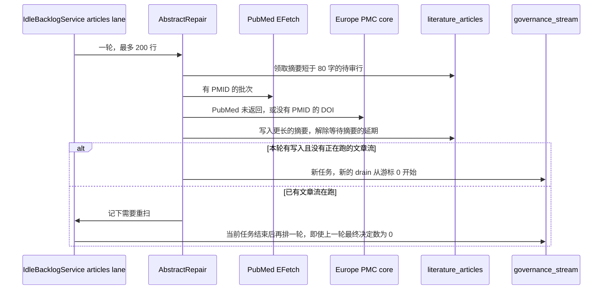

# 缺失摘要修复并重新进入 AI 评审

状态：设计，待实现。日期：2026-11-11。

## 概述

待审文献里有一批记录没有摘要，AI 评审因此不会领取它们。Elsevier 入库故意不保存出版社摘要，现有的 PubMed 回补脚本又不查 Europe PMC，也不解除“等待摘要”的延期，也不启动新的评审代际。

修复流程插在现有的空闲积压调度里：每一轮先用 PubMed 和 Europe PMC 补摘要，再让现有的 `governance_stream` 文章评审重新扫描。不抓 Lancet 网页，不新增第二套模型。

## 背景

`normalize_elsevier` 把 `abstract_text` 写成空。`ElsevierClient` 使用 Scopus 的 `STANDARD` 视图，不请求摘要或全文。新入库时 `LiteraturePipeline._enrich_candidates` 会调用 `EuropePmcClient.enrich_by_dois` 和 `PubMedClient.fetch_abstracts`，分别经 `apply_europe_pmc`、`apply_pubmed_abstract` 写入候选对象，但只覆盖这一轮新抓到的记录，并且有 `max_europe_pmc_records` 和 `max_pubmed_records` 上限。已经落库、摘要仍为空的行不会再走这段逻辑。

评审侧的门槛：

- `initial_screen`：摘要规范化后不足 80 字为 `needs_more_evidence`。
- `AIContentGovernanceService._article_review_query`：只领取 `review`、完整性 `current`、同行评议、未编辑锁定、摘要至少 80 字的行。
- `decision_is_grounded`：发布或排除必须引用摘要原句，否则改成暂扣。
- `_article_fingerprint` 含 `_literature_article_item`，其中有摘要。`_held` 只在决策为 `hold`、已有 `second_opinion`、且 `held_fingerprint` 与当前指纹相同才跳过。摘要一变，旧暂扣不再挡住。
- `scripts/rescreen_excluded_literature.py` 把历史排除打回 `review` 后，没有摘要的行写成 `autopilot.decision = defer`，原因是 `awaiting abstract context`，并清掉 `ai_content_governance`。
- `scripts/backfill_pubmed_abstracts.py` 只按 PMID 调 EFetch。它不查 Europe PMC，不解除延期，不排队评审。

2026-11-11 对 The Lancet Infectious Diseases 和 The Lancet Microbe 的只读测量：待审且摘要为空、有 DOI 的 1,959 篇。

| 标识 | 篇数 | 能补到至少 80 字的摘要 |
| --- | ---: | ---: |
| 已有 PMID | 1,160 | 66，PubMed 与 Europe PMC 相同 |
| 只有 DOI | 799 | 318，只来自 Europe PMC，且都带回了 PMID |
| 合计 | 1,959 | 384，长度都至少 180 字 |

其余 1,575 篇两边都没有摘要，主要是 Letter、Comment、News、Editorial，另有约 353 篇在 Europe PMC 标成 Journal Article 但仍无摘要。没有写入数据库，也没有请求 thelancet.com。

## 目标

- 定时补齐待审记录上、来自 PubMed 或 Europe PMC 的摘要。
- 摘要写入后，该行自动进入现有文章评审流。
- 没有合法摘要的行继续延期，不因缺摘要被排除。
- 任务可重复执行，默认干跑，日志只有计数。

## 非目标

- 不抓出版社 HTML、PDF 或全文，不改 Elsevier 的 `STANDARD` 视图。
- 不把已排除的约 15 万篇打回待审。第一轮也不改已发布记录，避免无故重审。
- 不修改 `LITERATURE_ARTICLE_REVIEW_RULES`。专科刊里“不是监测研究就被排除”的问题另案处理。
- 不把缺摘要的通讯、新闻编进网站证据页。

## 流程

调度器里的空闲积压循环已经按车道运行。文章车道在排队 `governance_stream` 之前先做一轮摘要修复。



### 领取

条件与 `_article_review_query` 对齐，但摘要长度改为小于 80，并且 `doi` 或 `pmid` 至少有一个：

- `publication_status = review`
- `integrity_status = current`
- `peer_review_status = peer_reviewed`
- `editorial_locked` 不为真

排序：先取 `autopilot` 原因为 `awaiting abstract context` 的行，再按 `updated_at` 升序。每轮最多 200 行，与现有 `max_pubmed_records` 同量级。

已检查过、两个来源都没有摘要的行，在 `metadata.abstract_repair.checked_at` 之后 7 天内不再领取。

### 检索

1. 有 PMID 的行调用现有 `PubMedClient.fetch_abstracts`。间隔用 `pubmed_min_interval_seconds`。
2. 仍然不足 80 字、且有 DOI 的行调用现有 `EuropePmcClient.enrich_by_dois`，`resultType=core`。批次 20，批次之间至少间隔 0.35 秒。
3. 不调用 `ElsevierClient`，不请求 thelancet.com。

### 写入

只有新文本经 `compact_text` 之后不少于 80 字，且长于现有 `abstract_text`，才写入。

- PubMed：沿用 `_apply_pubmed_payload`。许可证保持 `PubMed abstract metadata`。
- Europe PMC：写入 `abstract_text`。许可证写 `Europe PMC abstract metadata`。`pmid`、`pmcid` 只在本行对应字段为空、且不与其他行的唯一约束冲突时补上。冲突时只留摘要，不改标识。
- `source_urls` 补上 PubMed 或 PMC 链接。`source_payload` 只合并压缩后的来源标记，不把 `abstractText` 再存一遍。`_compact_europe_pmc` 本来就会丢掉摘要，摘要的唯一存放处是 `abstract_text`。
- `metadata.abstract_repair` 记录 `source`、`filled_at`、`abstract_characters`。不记录原文。
- 增加一条 `literature_status_events`：`event_type = abstract_filled`，`source = literature-abstract-repair`，`previous_status` 和 `current_status` 都是 `review`。事件元数据只有来源和长度。

若 `autopilot.decision` 是 `defer` 且首条原因是 `awaiting abstract context`，删掉这个 `autopilot` 决定。不改 `editorial_locked`。不改 `publication_status`。

摘要变化会改变 `_article_fingerprint`，因此不必手改 `held_fingerprint`。旧的暂扣记录留在元数据里，下一次 `feed` 因指纹不同而重新领取。

两个来源都没有合格摘要时：保持 `review`，把 `autopilot` 设为 `defer` / `awaiting abstract context`（与历史重筛相同），并写下 `abstract_repair.checked_at`。不排除。

### 重新进入 AI 路径

文章评审的 drain 挂在任务 UUID 上。新的 `governance_stream` 任务会新建 `ai_review_drains` 行，游标从 0、水位是当时的最大 id。`feed` 会再次走过全部 id，跳过指纹仍匹配的暂扣，领取摘要已变长的行。

因此修复不能只依赖正在跑的那一趟。那一趟的游标可能已经越过这些 id。

- 本轮写入篇数大于 0，且没有活动中的文章 `governance_stream`：用现有 `enqueue_model_operation("governance_stream", {"kind": "articles", "buffer_size": ...})` 排一个低优先级任务。
- 已有活动任务：在空闲积压的文章车道上记 `abstract_repair_pending_rescan`。该任务结束时，即使 `published + archived + rejected` 为 0，也再排一轮。现在的 `IdleBacklogService` 在最终决定数为 0 时会休息，这个分支必须改掉，否则刚补上的摘要不会被看到。
- 不在修复事务里调用模型。评审仍由现有 worker 执行。

模型若再次暂扣，新指纹会重新停放该行，直到摘要或评审输入再变。模型若排除，行离开待审。这两种结果都沿用当前规则，本设计不另加专科刊豁免。

## 接口

CLI 扩展 `scripts/backfill_pubmed_abstracts.py`，避免两套命令：

```text
venv/bin/python scripts/backfill_pubmed_abstracts.py
venv/bin/python scripts/backfill_pubmed_abstracts.py --apply --limit 200
venv/bin/python scripts/backfill_pubmed_abstracts.py --apply --limit 200 --enqueue-review
```

默认仍是干跑。`--apply` 才写库。`--enqueue-review` 才排队评审。调度器调用同一函数，并固定带上写入和排队。

核心函数放在 `src/literature/abstract_repair.py`，CLI 和 `IdleBacklogService` 共用。返回计数：`examined`、`pubmed_usable`、`europe_pmc_usable`、`filled`、`pmid_added`、`still_missing`、`review_enqueued`。

配置加在现有 AI 或 literature 配置上：

- `abstract_repair_enabled`，默认与 `idle_backlog_enabled` 相同。
- `abstract_repair_batch_size`，默认 200。
- `abstract_repair_retry_after_hours`，默认 168。

## 数据

不新增表，不新增迁移。使用已有列：

- `literature_articles.abstract_text`、`abstract_license`、`pmid`、`pmcid`、`source_urls`、`source_payload`、`metadata`
- `literature_status_events` 的新事件类型 `abstract_filled` 是普通字符串，没有枚举要改。

`pmid` 的唯一约束在写入前检查。冲突记入 `pmid_conflict` 计数，不抛出整批失败。

## 已考虑的其他做法

只反复运行现有 PubMed 脚本。实现最小，但测到的 318 篇只有 DOI 的记录它一条都补不到，也不会重新排队评审。

在入库管道里对全库再跑一遍 `_enrich_candidates`。会把已发布、已排除和未改变的行都打进外部 API，并且和当次采集的上限缠在一起。修复对象应是已经落库的短摘要待审行。

抓 thelancet.com。页面上看得见摘要，但现有客户端明确不取出版社内容。Europe PMC 已经覆盖这次测量里能合法拿到的 384 篇。

## 安全与授权

只使用已经接入的 PubMed E-utilities 和 Europe PMC REST。请求带现有联系邮箱和工具名。不保存出版社页面，不把摘要写进日志、任务输出或状态事件。Europe PMC 带回的 PMID 只作为标识，不作为抓取全文的入口。

## 观测

每轮一条结构化日志，只有上面的计数和耗时。连续三轮 `examined > 0` 且 `filled = 0` 且 `still_missing` 不再增加时，视为这批已经查完，不告警。外部 API 连续失败把本轮标成 `degraded`，不改数据库，下一轮再试。

干跑和正式跑都报告 `would_fill` 或 `filled`。验收时，两本 Lancet 专科刊的待审空摘要里，大约 384 篇应变为不少于 180 字，并在随后的文章流里被领取。其余继续是 `defer / awaiting abstract context`。

## 推出与回滚

先对两本专科刊干跑，核对 `would_fill` 接近 384，且没有标识、题名或摘要出现在输出里。再 `--apply --limit 200` 分批写入。确认指纹变化后的行能被新 drain 领取，然后打开调度器开关。

回滚是关掉 `abstract_repair_enabled`。已写入的摘要保留，不自动清空。误排队的评审任务按现有任务取消路径处理。

## 风险

模型会再次暂扣或排除刚补上摘要的专科刊论文。本次测量之外的已知例子是儿童尿路感染诊断被排除，理由是它不是监测研究。本流程把行送回现有规则，不保证发布。若要改规则，单独开变更，不和补摘要放在一起。

Europe PMC 与 PubMed 都没有摘要的 Journal Article 会一直延期。7 天重试一次即可，不能为了它们改去抓官网。

补 PMID 可能撞上唯一约束。单行跳过标识、保留摘要，整批继续。

正在运行的 drain 看不到游标后面的新摘要。必须靠新的 `governance_stream` 任务重扫，不能只更新行然后等待当前游标。

## 关键决定

1. 来源只使用 PubMed 和 Europe PMC。有 PMID 先问 PubMed；没有，或 PubMed 没有摘要，再用 DOI 问 Europe PMC。不抓官网。
2. 修复放在空闲积压的文章车道前面，而不是新的采集阶段。这样补到的行紧接着进入现有评审。
3. 第一轮只处理 `review`。已发布记录缺摘要不触发重审，已排除记录不打回。
4. 不手改暂扣指纹。摘要在 `_article_fingerprint` 里，写完摘要旧暂扣自然失效。
5. 没有摘要就维持 `awaiting abstract context`，并 7 天内不重复请求。
6. 当前评审流还在跑时，不并行再开一条。当前任务结束后强制再开一轮，即使上一轮最终决定数是 0。
7. 不在这个变更里改评审提示词。

## 未决问题

无。批次大小、重试间隔和第一轮范围按上面的默认值实现。若要连已发布的短摘要一起补，但不重审，可以在第一轮上线后再加一个只写摘要的开关。

## PR 计划

### PR 1：摘要修复函数与干跑 CLI

- 标题：Add legal-source abstract repair for review rows
- 影响：`src/literature/abstract_repair.py`，`scripts/backfill_pubmed_abstracts.py`，对应单元测试
- 依赖：无
- 内容：领取、PubMed、Europe PMC、写入、延期解除、无摘要标记、计数。默认干跑。不排队评审。

### PR 2：接入空闲积压并重开文章评审

- 标题：Run abstract repair before the article governance stream
- 影响：`src/services/idle_backlog_service.py`，`src/core/config.py`，调度测试
- 依赖：PR 1
- 内容：文章车道先修复再排队。活动流存在时记下重扫，结束后即使最终决定数为 0 也再排一轮。配置开关和批次大小。

### PR 3：两本专科刊的验收记录

- 标题：Record the Lancet abstract-repair acceptance check
- 影响：本文件的验收数字，或 `docs/` 下一次只读结果短记
- 依赖：PR 1 干跑
- 内容：干跑计数与 384 这个测量对照。不把题名、DOI 或摘要写进文档。
