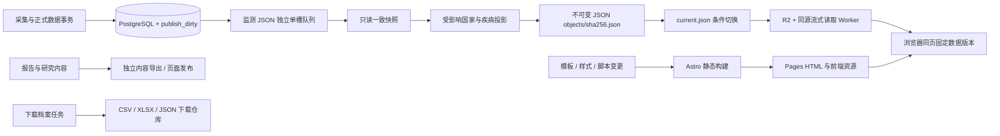

# 静态站点与动态数据发布架构

国家数据更新不应启动 Astro、重建文章页面、重新生成图片或重新部署 Pages。
站点模板、监测数据、报告/研究内容、下载档案是四个独立生命周期。

## 发布边界

投影本身的最新分析与优化见 [PROJECTION_PERFORMANCE.md](PROJECTION_PERFORMANCE.md)：
完整国家查询已去除逐观测重复类别解析，8 地区全量投影阶段由 70.5 秒降到 19.7 秒；
空目录完整本地 JSON 导出为 27.682 秒。日常修订仍走精确增量路径。



| 通道 | 触发条件 | 产物 | 完成标志 |
| --- | --- | --- | --- |
| 监测数据 | 正式观测语义发生变更 | 浏览器曲线、来源序列、小摘要、meta | R2 `current.json` 条件写成功，再确认精确 dirty IDs |
| 站点代码 | 模板、样式、交互或路由结构改变 | HTML、JS、CSS | Pages 部署成功 |
| 内容 | 已审核报告、知识或研究内容改变 | 内容 JSON、静态文章及图片 | 对应内容发布完成，确认相应内容标记 |
| 下载与原始归档 | 独立周期或明确请求 | CSV/XLSX/来源档案 | 对应仓库或归档收据 |

## 数据合约

`GET /site-data/current.json` 返回 schema、release_id、generated_at 和逻辑文件映射：

```json
{
  "schema_version": 1,
  "release_id": "data-task-uuid",
  "generated_at": "2026-11-07T00:00:00Z",
  "files": {
    "countries/jp.json": {
      "url": "objects/<sha256>.json",
      "sha256": "<sha256>",
      "bytes": 1234
    }
  }
}
```

逻辑文件包含国家/疾病曲线、国家来源详情、国家/疾病小摘要、meta 和站点数据状态。
摘要与曲线属于同一个版本，不需要为了显示一个计数而下载完整历史。
一个浏览器文档只读取一次 current，后续摘要、图表、筛选和列表都解析为该版本的不可变 URL。
新打开的页面取得新 current；已打开的页面保持自洽。浏览器验证长度和 SHA-256。
存在 manifest 但对象缺失或校验失败时显示数据不可用，不能混入另一版本的旧文件。
current 尚未初始化的 404 仅为迁移兼容旧曲线；新模板应在数据初始化后上线。

current 使用 `no-store`，对象使用长缓存与 `immutable`。
大型 JSON 使用确定性的 gzip HTTP 表示上传；对象名称和 manifest 校验值仍对应浏览器解码后的
JSON，减少网络字节而不改变版本合约。Worker 保留 Content-Encoding 并流式返回。
同源 Worker 通过 R2 binding 读取并流式返回 JSON，不在内存中解析或生成数据。
入口为 `/site-data/current.json` 与 `/site-data/objects/<sha>.json`；兼容的国家/疾病逻辑 JSON URL
和 meta/status URL 使用不可缓存重定向解析 current，避免旧下载链接继续读取 Pages 中的过期 JSON。
它不依赖 Papers 公开域名的跨域访问、CORS 或交互式挑战。

## 一致性与恢复

1. 数据事务与 dirty 标记同事务提交；无语义变化不会制造发布工作。
2. 入队固定 country scopes、精确 dirty IDs 与版本化 change_set，不用时间戳猜确认范围。
3. 导出期间持有 PostgreSQL READ ONLY 导出快照，完成后立即关闭，网络上传不持有快照。
4. 完整私有投影保存在 `exports/surveillance-state`，浏览器逻辑文件和不可变对象保存在
   `exports/surveillance-data`，独立于 Astro 的源码、public 和 dist。
5. 每任务把 manifest、共享不可变对象的内容引用和冻结公开曲线保存到 `exports/surveillance-runs/<uuid>`。
   上传失败重试使用同一候选，不能重新读取新数据库数据冒充旧版本。
6. 先上传不可变对象，再上传历史 manifest，最后用 `If-Match` / `If-None-Match` 原子切换 current。
   另一发布者已推进 current 时旧任务失败，不覆盖新版本；不确定成功的网络重试可核对相同字节后恢复。
   首次发布前把原基线绑定到本地收据及 R2 intent；即使本地缓存丢失，旧候选也不能在重试时
   把较新版本认作自己的新基线并倒退。current 固定使用未压缩 single-PUT 表示，以匹配其条件 ETag。
7. 指针上传成功后，从冻结曲线更新公开投影并确认选中的 surveillance IDs。
   导出/上传期间新出现的 ID 留给下一轮。静态内容任务不能确认 surveillance。

CLI 与 worker 共享同一输出文件锁，覆盖基线校验、导出和候选冻结；上传阶段不占此锁。
独立 CLI 不能在 worker 冻结期间替换 current 或私有曲线，生成锁等待可取消且不留下后台线程。

历史对象暂不自动删除。后续 GC 必须在独立低优先级任务中保留一段历史 manifest，
计算这些 manifest 的引用并集，再删除不再引用的对象；不能只保留 current 的对象。
任务候选投影也需要独立保留策略，不能将清理放在可见数据切换之前。

## 调度与采集

`DATA_RELEASE__SURVEILLANCE_JSON_ENABLED=true` 后，scheduler 按 poll 独立发现监测变更，
不依赖每天一次的站点发布时间或 `auto_after_crawls`。同 JSON 通道串行；JSON 与新静态内容任务
各自拥有 active reservation、重试、冷却和 worker 槽位，能够并行。
启动前固定 `content_only` 的任务契约，避免重试期间配置改变导致处理范围改变。
旧版会读写监测投影的发布任务与新 JSON 通道保持过渡互斥。

采集使用“全局 shared 维护闸门 + 国家父级 exclusive 锁”。US 与 SE 可并行，US 与 US-AK
保持串行；ontology/restore/跨国家维护继续取全局 exclusive。
事务内的 registry、holding、正式事实、修订和 dirty 一起提交。
详见 [INGESTION_CONCURRENCY.md](INGESTION_CONCURRENCY.md) 与
[SURVEILLANCE_PUBLISH_QUEUE.md](SURVEILLANCE_PUBLISH_QUEUE.md)。

## 首次迁移与回退

配置开关默认关闭。首次初始化独立 JSON 基线、部署读取 Worker 并验证 current/对象，
然后开启 JSON 通道并排空/重启旧运行进程，再部署支持动态摘要与曲线的模板。
托管模板构建要求 `GIDS_RUNTIME_DATA_READY=1`，由已启用 JSON 通道的新版 worker 传入；
旧 worker 或未初始化通道的模板发布会在构建前拒绝执行，避免摘要不可用的部署空窗。
以上是一次迁移；此后普通数据更新不构建或部署 HTML/Worker。

```bash
venv/bin/python scripts/generate_site_data.py --data-only --data-release-id initial-json
venv/bin/python scripts/publish_surveillance_data.py
cd cloudflare/surveillance-data
npm ci
npm run types
npm test
npm run typecheck
npm run build
# 审核后执行 wrangler deploy；npm run build 仅做 dry-run。
```

初始化 CLI 自动创建只读数据库快照。排队的增量入口为
`venv/bin/python scripts/queue_surveillance_data.py --job-id site-release`。
初始化的全历史生成允许较慢，它不应成为每次增量更新的固定成本。
回退可关闭独立调度并保留已有 current；模板与数据应按兼容 schema 回退，不能删除旧版本对象。
实际生产域名/路由和 R2 prefix 必须与 `cloudflare/surveillance-data/wrangler.jsonc` 一致。

## 性能验收

常规精确变更先按来源序列识别受影响疾病，只读这些疾病的历史，保留其他疾病的完整已完成基线。
SQL 先物化请求疾病的有效映射候选，再执行原有最佳分类和有效期校验，避免逐观测重复关联。
整国初始化/保守回退可按国家分成独立 Python 进程，共享同一只读数据库快照；每进程自己管理
数据库连接，只返回投影和小摘要。进程数按 CPU 和 cgroup 内存限制选择，未知预算退回单进程，
也可用 `--surveillance-workers 1–8` 显式控制。取消时必须先终止/回收子进程再关闭快照。

以一次已准备的真实八地区基线为例，JP-25 的 D038 单条本地合成修订完成 JSON 导出用时
**3.903 秒**，来源查询与解码 **0.951 秒**，只处理 **493** 条来源观测；504 个逻辑文件仅5项变化。
该结果通过与完整国投影逐字段等价检查，不写生产数据库、不上传，尚不包含网络与最终DB确认。
同一批5项逻辑变化的本地对象存储模拟，10,863,904字节JSON压缩为609,662字节对象传输，
控制文件204,251字节，本地校验/压缩/模拟写入0.786秒；这也不是生产网络测速。

- 国家观测更新不得启动 npm、Astro、图片生成、Papers/Reports 拆分或 Pages 部署。
- 普通监测更新不生成 CSV/XLSX，不将下载档案重标为当前观测版本。
- 增量工作量应随受影响疾病/国家增长，完整初始化和模板变更单独计时。
- 记录 queue wait、快照投影、对象生成/复用、实际上传 bytes、指针切换与确认耗时。
- 浏览器验收：只切换 JSON manifest，HTML 文件摘要不变，统计与图表更新为相同新版本。
- 失败验收：任一对象未完成时 current 不变；并发新 dirty 不被旧发布确认；旧对象仍可读取。

本轮局部测量与剩余边界记在 [DATA_EXPORT_INCREMENTAL.md](DATA_EXPORT_INCREMENTAL.md)。
本地生成或假对象存储测试不代表生产网络、CDN 和排队延迟已经达到目标。

实现依据：R2 支持原子的条件 PUT 与直接 binding 的一致读取，公开自定义域名的 CDN 缓存
具有不同的可见性语义，因此指针走 Worker 直接读，内容走不可变地址。
参见 [R2 consistency](https://developers.cloudflare.com/r2/reference/consistency/) 与
[S3 conditional operations](https://developers.cloudflare.com/r2/api/s3/api/)。
