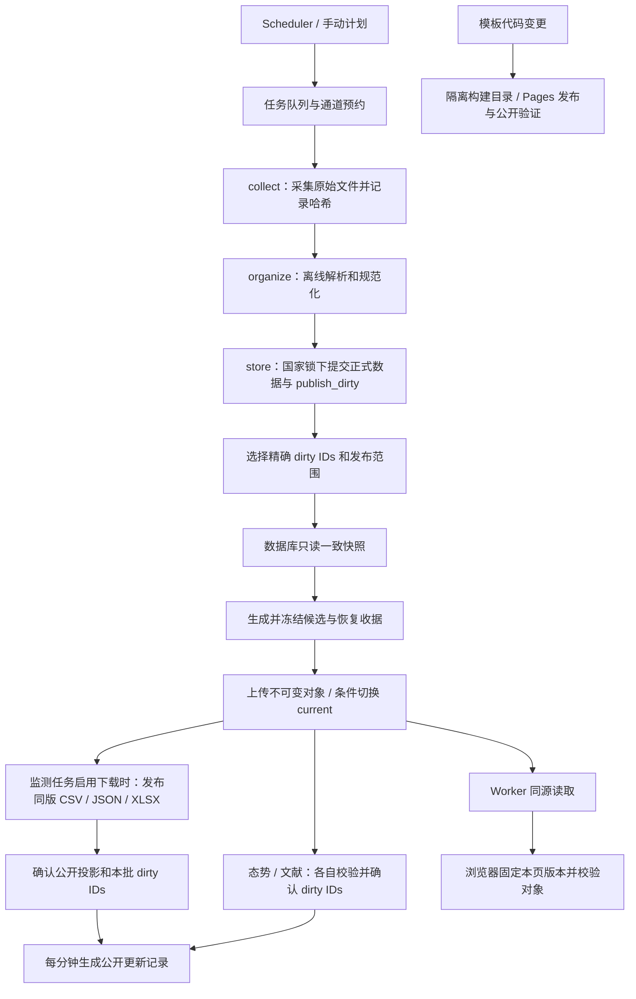

# 网站数据更新链路与优化审查（2026-11-14）

审查基线：`2dd342f`；运行统计采样时间约为上海时间 17:33–17:37。本次检查关键调度、采集入库、增量选择、快照导出、发布确认、公开读取及更新记录代码，辅以现有专项测试、边界复现和真实数据库只读统计。代表性采集源包括 ECDC、CA、US；不等同于逐一验收所有国家解析器或全站所有页面。

结论：现有增量发布和版本一致性机制值得保留。优先减少相同内容反复入库和发布，其次处理三处可复现的可靠性边界，再优化文献构建和公开投影写入。当前耗时不能简单归因于 Cloudflare 上传。

审查证据与原执行方案保留供对照；11 月 14 日的代码修改、测试和当时未上线范围见末尾[实施结果与交付状态](#实施结果与交付状态)。11 月 15 日用户授权加载这些代码并上线，结果见[2026-11-15 运行时加载](#2026-11-15-运行时加载)。

## 当前实际更新流程



- 监测：国家/疾病投影、摘要及不可变 JSON；不触发 Astro 主站构建。但**当前生产任务启用了同版下载发布**，不能再按旧架构文档理解为完全独立于下载仓库。
- 态势：独立快照、JSON 和发布指针；调度与监测存在共享通道和公平轮转。
- 文献：独立数据快照、研究页面构建、Papers v3 投影及公开验证，不要求主站 Pages 部署；仍有 HTML 中间产物。
- 知识及其他静态内容：经内容/站点发布路径确认；本次库中未发现 knowledge 的 dirty 历史，无法据此验证其生产自动发布闭环。
- 模板：复用已发布数据快照，在隔离目录构建；不能为提速绕过候选、路由完整性和公开验证。

主要入口：[scheduler.py](../../src/control_plane/scheduler.py)、[runner.py](../../src/services/ingestion/runner.py)、[data_release_service.py](../../src/services/data_release_service.py)、[data_pipeline.py](../../src/services/data_release/data_pipeline.py)、[surveillance_publish.py](../../src/services/data_release/surveillance_publish.py)。

## 真实运行证据

取 `created_at` 位于最近 24 小时且已经完成的任务，按 `started_at → completed_at` 统计执行时长：

| 通道 | 成功次数 | 平均秒数 | 最长秒数 |
| --- | ---: | ---: | ---: |
| 监测 JSON | 433 | 150.61 | 1,293.64 |
| 态势 JSON | 6 | 179.26 | 557.69 |
| 文献 | 9 | 1,911.73 | 2,746.12 |
| code-only | 2 | 1,044.60 | 1,355.14 |
| 其他站点发布 | 1 | 2,300.60 | 2,300.60 |

此窗口包含维护及不同工作量，不是稳定压测，也不是当前提交单独产生的性能结果。任务时长不含开始执行之前的排队时间。

稍后的阶段统计已增加为 434 个成功监测任务，全部 `include_git_push=true`；其输出中的平均 export 为 71.85 秒，publish-and-ack 为 47.30 秒。后者同时包含 JSON 发布、下载仓库发布和数据库确认，不能称作纯上传耗时。两个统计采用不同时间字段和采样时刻，不直接做差归因。

首次采样的 dirty 状态：监测总计 10,746 / 待发布 17；态势 191 / 待发布 0；文献 108,806 / 待发布 393。后台持续运行，数量只代表采样时刻。文献有独立发布周期，393 个待发布标记本身不证明故障。

## 优先优化：重复采集制造整国发布工作

位置：[strategies.py](../../src/services/ingestion/strategies.py) 的 `EcdcWindowCommitStrategy`、`CanadaCndssWindowCommitStrategy`；[ecdc.py](../../src/data/processors/ecdc.py) 和 [ca_national.py](../../src/data/processors/ca_national.py) 的 `delete_authoritative_window()`。

这两条路径先删除来源时间窗口，再重导。只要删除过旧行，就将 `publication_window_replaced` 设为 true，随后强制写入粗粒度 dirty。即使上游内容完全相同，普通观测存储中的语义 no-op 检测也不能阻止这次发布。

真实证据：加拿大在 UTC 08:23:59、08:54:22、09:24:23 的三次采集，每次均为两个原始文件、合计 523,672 字节；三轮 `(kind, sha256)` 集合完全相同，却都有新的整国 dirty。最近 24 小时 CA 有 48 个标记、48 个不同关联发布任务。多个 ECDC 国家也每半小时生成标记；比利时三次文件大小相同但哈希集合不同，因此没有把比利时也认定为原始字节完全一致。

建议在国家锁与同一事务内，对比规范化后的旧、新来源窗口：按观测主键识别新增、真实变化和撤回；仅对变化写入，并保留撤回的精确变更范围。也可增加包含来源哈希、解析器版本、映射/本体版本的完整输入指纹作快速路径。不能仅看来源文件哈希，因为映射修正仍可能改变正式语义。

验收：相同输入重复执行不新增 dirty、不触发发布；上游撤回一个单元仍能删除对应旧事实并发布；来源归属、修订历史、空响应质量门禁保持有效。这项优化同时降低数据库写入、投影、下载和发布队列占用，应优先实施。

## 可靠性问题一：不可发布的态势标记仍参与轮转

位置：[data_release_service.py](../../src/services/data_release_service.py)，`_yield_json_turn()` 约 1138 行，与 `_enqueue_release_task()` 的 scope 筛选约 1295 行。

让步判断读取另一通道全部 pending 行；只有另一通道为 surveillance 时才检查其可发布性。Situation 真正入队却只接受 `scope_key='*'`。因此，若只有遗留/异常 Situation scope，且最新 JSON 任务为 surveillance，监测会让步，Situation 又因没有可发布数据而跳过。该状态可持续到相关任务或标记状态改变。

本地合成复现：一个 `scope_key='legacy-invalid'` 的 Situation 标记使 `surveillance_yields=true`，但实际可发布 Situation 行数为 0。采样时线上 Situation pending 为 0；没有证据表明当前线上正卡在这个分支。

建议复用与入队相同的 eligibility 查询；Situation 用 `EXISTS` 检查合法 scope，surveillance 按有效国家选择。保留异常标记供排障，不能让它阻止其他通道。补充“异常 scope + 有效监测 pending”的完整调度回归。

## 可靠性问题二：前端超时未覆盖版本清单

位置：[surveillance-data.ts](../../astro-site/src/lib/surveillance-data.ts) 约 41、43、65、75 行；[countryDataset.ts](../../astro-site/src/components/charts/countryDataset.ts) 约 321、350 行。

国家曲线加载器创建超时 AbortController，但共享客户端只将 signal 传给最终数据对象请求。bootstrap、回退 current 和完整 manifest 请求都没有该 signal，也没有自己的超时。`read()` 卡在 `await manifest()` 时，调用方的超时不会结束等待。

本地复现：冻结 bootstrap 响应，立即取消 signal，40 毫秒后 read 仍 pending；只有释放 bootstrap 后才返回 AbortError。这里验证的是取消传播缺失，并非线上延迟测量。

建议给共享清单请求设置有界超时，并允许每位调用者独立取消等待；不能简单让某个图表的取消信号杀死其他图表共享的请求。失败后清理对应 Promise，允许重试，同时保留同页版本固定与哈希校验。

## 可靠性问题三：监测发布大批 ID 未分批

位置：[data_selection.py](../../src/services/data_release/data_selection.py) 约 29 行；[projection.py](../../src/services/data_release/projection.py) 的确认 UPDATE；[data_release_service.py](../../src/services/data_release_service.py) 的 pending-ID/plan 校验。

国家预算限制国家数量，并未限制同一国家累积的 dirty 数量。监测路径仍一次性使用 `id.in_(dirty_ids)`；已有的 [global_selection.py](../../src/services/data_release/global_selection.py) 则为态势/文献采用每批 5,000 IDs。

本地 planner 用一个国家的 32,768 个标记产生 32,768 个查询参数。随后用生产驱动执行只读、全负数 ID 的同形查询，实际返回：`the number of query arguments cannot exceed 32767`。没有写入任何标记；正常 pending 数量目前远低于此阈值。

建议统一使用分批选择/校验/确认 helper，所有批次保持同一事务和精确 ID 语义；同步覆盖计划校验、continuation 和静态内容确认。不要简单截断一个原本需要原子处理的来源范围。另将轮转检查改为 EXISTS，避免每次加载完整 change_set。

## 性能优化：文献仍经过文章 HTML 中间转换

位置：[literature_data_pipeline.py](../../src/services/data_release/literature_data_pipeline.py) 约 88 行；[build-research.mjs](../../astro-site/scripts/build-research.mjs)；[publish_research_candidate.py](../../scripts/publish_research_candidate.py) 的 `_project_stage()`。

普通文献发布仍调用默认 full 研究构建，生成或恢复文章 HTML，再从这些页面抽取模板、slug，结合结构化文章 JSON 生成 v3 投影。已有文章缓存会减少重渲染，不能描述为每次都全量渲染全部文章；但 HTML 复制、检查和转换仍在路径中。24 小时样本文献平均约 31.86 分钟，是值得独立分阶段剖析的通道。

建议让日常文章数据更新直接使用冻结文章 JSON、已验证模板描述及资源清单生成 v3 候选；集合页保留独立构建，并按集合成员变化判定失效。模板变更或历史迁移才走完整抽取路径。当前 `_project_stage()` 要求文章页面，不能只将 scope 改为 collections 就认为优化完成。

验收必须覆盖三语文章、全部集合路由、索引成员变化、SEO、资源闭包、正文/模板哈希及公开 canary。先记录导出、集合渲染、文章复用、投影、上传、验证各阶段耗时，再评价实际收益。

## 性能优化：确认阶段仍整国删除重写公开曲线

位置：[projection.py](../../src/services/data_release/projection.py) 的 `commit_release_projection()`；[public_series_store.py](../../src/generation/public_series_store.py) 约 269 行。

虽然前面的导出已支持疾病级增量，确认阶段仍读取每个入选国家的全部冻结疾病曲线，然后 DELETE 该国所有 PublicDiseaseSeries，再 INSERT 全部曲线，并重设 created_at/updated_at。即使只修订一种疾病，其他疾病也被重写。

建议利用已有 content_hash 与完整冻结疾病 ID 集合，仅 upsert 新增/变化曲线、删除消失曲线。`source_high_water`、国家发布状态和无内容变化时的观测元数据更新要单独定义，不能因内容哈希相同丢失这些信息。整批投影与 dirty 确认仍必须同一事务完成。

这是代码已确认的写放大；尚未做生产 WAL 或单独确认阶段压测，不给出未经测量的提速比例。

## 较低优先级：公开更新记录每分钟回扫全部历史

位置：[public_updates.py](../../src/services/data_release/public_updates.py) 约 65 行；[publish_public_updates.py](../../scripts/publish_public_updates.py) 约 45 行；[定时器](../../deploy/systemd/globalid-public-updates.timer)。

每分钟聚合全部已确认标记，重新序列化全部月份，再逐个从 R2 GET 远端文件比较。已有“字节相同不 PUT”，所以并非每分钟都重新上传全部文件。

实测当前一次 SELECT 为 0.390 秒，连同投影为 0.430 秒，返回 7,315 个聚合行、三个文件、共 241,152 字节；尚不含网络。当前绝对成本较低，但随历史长度线性增长，且脚本 SQL 超时固定为 5 秒。

建议在发布确认后产生可重放的公开事件投影，只重建受影响月份；使用本地已验证内容哈希/远端 ETag 收据避免无变化月份的 GET；保留低频全量核对修复路径。游标必须覆盖晚完成任务和并发事务，不能仅以最大 dirty ID 推进，否则可能漏掉早分配 ID、晚确认的记录。

## 发布契约和后续实施顺序

当前监测任务在切换 JSON 指针后，还要等待匹配版本的 Git 下载包成功，才确认数据库 dirty。下载失败会让公开 JSON 已推进但任务仍未完成，并占用后续发布的预约。这是现有同版下载契约的代价，不能直接删除等待逻辑。

应先消除无语义变化的发布，再优化投影写入和下载分区复用。如果产品接受下载单独滞后，可另设计独立下载任务、版本指针和清晰的完成状态；这属于发布契约调整。旧文档中“普通监测更新不生成 CSV/XLSX”的描述也需要与当前配置及代码统一。

建议拆为三个可独立验收的批次：

1. 修复 eligibility、前端清单超时、ID 分批三个边界，补充对应异常回归。
2. 改造 ECDC/CA 窗口差异检测和公开曲线差异写入，以重复输入、修订、撤回、回滚为验收重点。
3. 分阶段测量并优化文献构建；最后处理更新 feed 增量投影。保留快照、CAS、防旧候选回退和公开验证。

## 本轮验证与范围

- Python 发布/采集专项：176 passed，13.87 秒。覆盖精确变更、dirty、数据选择、监测导出/发布/恢复、更新 feed、阶段收据、通道控制、发布韧性和数据库快照。
- Astro 相关 Node 测试：15 passed。覆盖同页固定版本、完整清单懒加载、缺失/损坏对象、失败重试、gzip 校验、日期归组及数据加载。
- surveillance Worker：23 passed，TypeScript 类型检查通过。
- 线上只读 GET：监测 `data-26ad5b42-1e64-4818-9a3e-ff675781151e`、态势 `situation-17f74904-eb3a-4511-962c-ca9ee6235986` 的 bootstrap、其引用的不可变完整 manifest 和摘要均验证通过，版本一致、SHA-256 匹配；指针实际返回 no-store，对象返回一年 immutable。每条链路各采样一次，耗时 1.34 / 1.54 秒，不作为站点性能基准。
- 三项边界复现分别使用合成调度上下文、受控 fetch、实际 asyncpg 只读查询。它们不在原有成功测试的覆盖范围内。
- 数据库统计使用 READ ONLY 事务、5–8 秒 statement_timeout，结束时 rollback。未触发采集、发布、服务重启或订阅投递。
- Cloudflare 读取层依据当前官方 [Workers Best Practices](https://developers.cloudflare.com/workers/best-practices/workers-best-practices/) 和 `@cloudflare/workers-types` 5.20261114.1 核对。对象流式返回、不可变对象长缓存、可变指针 no-store 和公开错误脱敏在当前代码中已有实现。

本次交付为审查报告，没有修改业务代码，也没有将既有架构测试通过解释为所有上游源、知识发布和通知投递已全面验收。

## 可执行优化方案与文件清单

以下保留审查时制定的执行方案；实际完成状态以末尾实施记录为准，不能把计划当作已完成事项。前文的测试通过数只对应审查时已有实现。文件按符号名定位，行号仅供参考。表中“修改”表示该批次的主要实现位置，“核对”表示检查调用契约、必要时同步修改；“拟新增”文件尚不存在。

下文命令默认从仓库根目录 `/home/likangguo/globalID/globalID2` 执行，前端命令已用子 shell 切换目录。使用项目现有 venv 和 node_modules；任一必需检查失败先修复，不继续把该批次记为完成。实施前重新查看工作区，保留其他正在进行的页面/配置修改。

### 执行顺序和完成条件

| 批次 | 目标 | 前置依赖 | 完成条件 | 数据库迁移 |
| --- | --- | --- | --- | --- |
| P0 | 固定输入与阶段指标 | 无 | 保存源码、配置摘要、样本和基线数据 | 无 |
| P1 | 修复通道让步 | P0 | 异常 scope 不阻挡有效通道，公平性保留 | 无 |
| P2 | 清单请求超时与独立取消 | P0 | bootstrap / current / full manifest / 对象均可有界等待，互不误取消 | 无 |
| P3 | 全链路 ID 分批 | P0 | 32,768 和 100,000 IDs 的选择、计划校验、确认及回滚正确 | 无 |
| P4a | 相同来源窗口不再产生发布 | P3 | 同一完整输入重复执行，第二次 dirty 为 0 | 无 |
| P4b | 来源窗口差异写入 | P4a | 不再整窗删除；修订和撤回与原行为等价 | 默认无；不在本批改变历史撤回表示 |
| P5 | 公开曲线差异写入 | P3 | 只写变化曲线，删除准确，确认事务原子 | 无 |
| P6 | 文献直接生成完整 v3 候选 | P0、P3 | 普通数据更新不依赖文章 HTML，三语与集合完整 | 无 |
| P7a | feed 无变化时减少远端读取 | P0 | 无变化文件不 GET / PUT，定期核对可恢复 | 无 |
| P7b | feed 历史聚合增量化 | P7a | 晚提交、晚完成、失败重试、跨月均不漏事件 | 新增投影表及 Alembic 迁移 |
| P8 | 集成、文档和生产观察 | 对应批次完成 | 真正入库—发布—公开读取闭环及回退证据 | 仅包含已实施批次所需迁移 |

推荐逐批提交，顺序为 P0 → P1/P2/P3 → P4a → P4b/P5 → P6 → P7a → P8。P7b 是完整方案中的后续扩展，当前 0.43 秒的 feed 成本不构成引入新表的紧急理由；只有实际执行 P7b 时才增加迁移。P1/P2/P3 可以各自发布，不必等所有性能优化完成。

默认保留“监测 JSON 与同版下载共同完成”的契约。本计划不把下载拆为最终一致通道，也不更改采集频率、审核门槛或发布成功定义。

### 所有批次必须保持的约束

1. 正式事实、修订、holding/registry 变化和 dirty 仍由原事务所有者提交；helper 不自行 commit。
2. 来源写入保持国家锁、父子国家互斥和全局维护闸门；不能以 Python 进程锁替代跨进程数据库锁。
3. 固定精确 dirty IDs；批处理不能丢 ID、改变国家范围或将处理期间新到的标记提前确认。
4. 发布使用被冻结的数据库快照和候选，重试不能读取新事实冒充旧候选；网络上传不持有导出快照。
5. 不可变对象先完成，再条件切换指针；发生基线冲突时不强推覆盖，不删除旧代对象来解决冲突。
6. 公开投影与 dirty 确认同事务；发布完成还须满足相应下载、公开验证及任务终态契约。
7. 浏览器成功取得版本后，摘要、曲线和详情保持同代；重试某个对象不能偷偷重新读取最新 current 混用。
8. 数据时间、采集时间、发布确认时间分开记录。相同数据不重复发布后，`generated_at` 不每天变化属于正常情况，不能为制造新鲜度而改时间戳。

### P0：建立可比较的基线和阶段指标

**实施步骤：**

1. 记录实际实施时的 `git rev-parse HEAD`、工作区差异、通道开关、下载开关、worker 数量和数据库 Alembic head；不要输出 token、数据库密码或完整 `.env`。`weekly_ai_reviews.json` 是已有运行时变化，单独保留。
2. 准备固定样本：CA 两个相同原始文件；一个 ECDC 完整来源窗口；一个国家的单疾病修订和撤回；文献的无变化、正文变化、新增、删除、标题/疾病归属变化各一例。原始文件来自现有 SourceArtifact，校验 sha256 后在临时库/私有输出目录回放。
3. 给现有任务 output/workbook 增加可选阶段指标，保留旧字段：`selection_seconds`、`export_seconds`、`freeze_seconds`、`object_upload_seconds`、`pointer_commit_seconds`、`downloads_seconds`、`projection_ack_seconds`、`public_verify_seconds`。文献另记录导出、集合构建、文章投影时间及实际渲染/复用数量。只添加真实测量值，不将无法拆分的时间填 0。
4. 计数优先于耗时：来源输入行、语义新增/修改/删除/不变行、dirty 数、公开曲线新增/修改/删除/仅水位更新数、生成/上传对象数和字节数。
5. 同一冻结输入前后各测 3–5 次，报告中位值、最大值和缓存冷热状态；任务排队另计。生产 p95 需要足够样本和相同窗口，不以两次不同发布任务直接证明提速比例。

| 类型 | 文件 | 修改或核对点 |
| --- | --- | --- |
| 修改 | [data_pipeline.py](../../src/services/data_release/data_pipeline.py)、[literature_data_pipeline.py](../../src/services/data_release/literature_data_pipeline.py) | 分阶段计时，保留旧 `release_timing` 字段 |
| 核对 | [surveillance_publish.py](../../src/services/data_release/surveillance_publish.py)、[process_runner.py](../../src/services/data_release/process_runner.py) | 使用现有上传统计和子进程收据，不从自由文本猜耗时 |
| 核对 | [realtime_monitor.py](../../src/services/data_release/realtime_monitor.py)、[research_monitor.py](../../src/services/data_release/research_monitor.py) | 新指标兼容旧任务；无观测变化不误报发布停滞 |
| 核对 | [publication_usage.py](../../src/services/data_release/publication_usage.py)、[monitor_realtime_data.py](../../scripts/monitor_realtime_data.py) | 观察数据与构建耗时分离 |

证据统一保存到 `exports/website-data-update-optimization/<批次>/`，至少包含 `baseline.json`、`after.json`、测试日志和差异摘要；这些是私有本地产物，不进入公开站点。

```bash
git rev-parse HEAD
git status --short
venv/bin/alembic heads
venv/bin/python scripts/check_task_runtime.py
```

`alembic heads` 只列源码迁移头；实际数据库 revision 在实施时另以只读查询 `alembic_version` 核对。上述命令不启动重建、迁移或发布。

### P1：统一调度可发布性判断

**实现：**

1. 在现有规划模块中提取可复用的范围规则：Situation/Literature 为 `scope_key='*'`；Surveillance 为已注册、active 且启用公开发布的国家。沿用 bootstrap 的公开范围设置。
2. `_yield_json_turn()` 只询问另一通道是否存在可发布工作。Situation 用 `SELECT EXISTS`；Surveillance 先求有效国家集合，再做存在性查询，不读取每条 change_set。
3. 保留暂停、失败冷却、已有通道预约和最终入队校验。存在性检查只决定是否让步，不能替代事务内的选择验证，也不静默删除异常标记。
4. 核对监控的 `publishable_pending` 与调度使用同一规则；`blocked_pending` 继续展示。国家 scope 错误的已有显式报错策略不得被顺带改为静默忽略。

| 类型 | 文件 / 符号 |
| --- | --- |
| 修改 | [data_release_service.py](../../src/services/data_release_service.py)：`_yield_json_turn`、`_reconcile_pending_json`、`_enqueue_release_task` |
| 修改 | [planning.py](../../src/services/data_release/planning.py)：复用范围规则，保持 `plan_changes` 国家预算和 legacy 父范围原子性 |
| 核对 | [realtime_monitor.py](../../src/services/data_release/realtime_monitor.py)：`classify_pending`；[channel_control.py](../../src/services/data_release/channel_control.py) |
| 扩展测试 | [test_realtime_channel_control.py](../../tests/unit/test_realtime_channel_control.py)、[test_data_release_service.py](../../tests/unit/test_data_release_service.py)、[test_release_dirty_selection.py](../../tests/unit/test_release_dirty_selection.py)、[test_realtime_data_monitor.py](../../tests/unit/test_realtime_data_monitor.py) |

**验收用例：**仅异常态势 scope；合法与异常 scope 混合；另一通道暂停/冷却；全部国家停用；两通道同时有工作；上一 JSON 为 literature；轮转检查后标记被其他任务消费。预期有效监测可以入队，合法态势不会饥饿，重复预约仍被拒绝。

```bash
venv/bin/python -m pytest -q \
  tests/unit/test_realtime_channel_control.py \
  tests/unit/test_data_release_service.py \
  tests/unit/test_release_dirty_selection.py \
  tests/unit/test_realtime_data_monitor.py
```

### P2：覆盖整个读取链路的超时和取消

**实现：**

1. 为 `createSurveillanceDataClient` 增加可注入的请求超时参数；共享 bootstrap/current/full-manifest/对象请求拥有自己的 AbortController，定时器持续到响应体读完，finally 清理。
2. 每个 `read()` 调用的 signal 仅取消该调用者的等待；不能直接绑定到多人共享的底层请求。已取消的 signal 立即拒绝，成功/失败/取消都移除监听器。
3. 请求条目维护完成状态及必要的订阅/保留信息：一个 `retain:false` 调用者退出时，不能提前删除仍被其他调用者使用的在途 Promise；失败时只删除自身对应的缓存条目，避免旧失败清掉新重试。
4. 清单未成功取得时，网络失败允许重试；成功固定版本后，对象失败仍重试该版本。404 迁移回退、解码后的长度/SHA 校验、gzip 行为保持。
5. 国家曲线、疾病曲线、态势和摘要调用方均核对；网络等待有界不代表能中断同步 `JSON.parse`，大对象解析优化不混入本批。

| 类型 | 文件 / 符号 |
| --- | --- |
| 修改 | [surveillance-data.ts](../../astro-site/src/lib/surveillance-data.ts)：`createSurveillanceDataClient`、`manifest`、`read` |
| 核对 | [countryDataset.ts](../../astro-site/src/components/charts/countryDataset.ts)、[diseaseDataset.ts](../../astro-site/src/components/charts/diseaseDataset.ts)：缓存、timeout、`retain:false` |
| 核对 | [situation-data.ts](../../astro-site/src/lib/situation-data.ts)、[useSurveillanceSummary.ts](../../astro-site/src/components/public/useSurveillanceSummary.ts)、[useCountryDataset.ts](../../astro-site/src/components/charts/useCountryDataset.ts)、[useCatalog.ts](../../astro-site/src/components/charts/surveillance/data/useCatalog.ts) |
| 扩展测试 | [surveillance-data.test.ts](../../astro-site/src/lib/surveillance-data.test.ts)、[surveillance-publication.spec.ts](../../astro-site/e2e/surveillance-publication.spec.ts)、[situation-publication.spec.ts](../../astro-site/e2e/situation-publication.spec.ts) |

**验收用例：**四个网络阶段分别永不返回；响应头已到但 body 卡住；调用者 A 取消而 B 成功；所有调用者取消后资源最终释放；超时后重试；不同逻辑 key 共享 full manifest；清单在远端更新但本页仍同代；`retain:false` 与重试交错。测试用受控 fetch/定时器，避免依赖真实网络偶发超时。

```bash
(
  cd astro-site
  node --experimental-strip-types --test src/lib/surveillance-data.test.ts src/lib/site-data-loaders.test.ts
  npm run check
  npx playwright test e2e/surveillance-publication.spec.ts e2e/situation-publication.spec.ts \
    --project=chromium-360 --project=chromium-1280
)
```

### P3：覆盖所有未分批的 dirty-ID 查询

**实现：**

1. 复用 `global_selection.selection_batches()` 的 5,000 ID 批次，不另造不同阈值；先验证正整数、唯一性及总集合，稳定排序后分批。
2. 分批 SELECT 的结果最终再按 ID 排序交给 `plan_changes`。不能让批次边界改变原来以最早 dirty 排序的国家/来源组顺序。
3. 分批确认 UPDATE 共享同一个 `published_at` 和同一事务；保留既有 `published_at IS NULL`、line/scope、任务归属校验及必要的行锁。任意后续批失败，前面批次也必须回滚。
4. `_enqueue_release_task` 中 pending_ids 过滤、reviewed plan 的 frozen_ids 校验、continuation 和 full/content-only 路径全部覆盖。约 1495 行的 data-only 预约后二次校验已经分批，应复用，不重复改写。
5. 本批只解决参数上限和不必要的全对象存在性查询；超大积压的总内存分页可另测。不要简单给选择 SQL 加 LIMIT 导致 legacy 父范围或审核计划漏标记。

| 类型 | 文件 / 具体检查点 |
| --- | --- |
| 修改 | [data_selection.py](../../src/services/data_release/data_selection.py)：`validate_data_selection` |
| 修改 | [projection.py](../../src/services/data_release/projection.py)：dirty 确认 UPDATE |
| 修改 | [data_release_service.py](../../src/services/data_release_service.py)：`pending_ids`、`frozen_ids`、continuation 查询 |
| 修改 | [pipeline.py](../../src/services/data_release/pipeline.py)：content-only 确认 UPDATE |
| 核对 | [global_selection.py](../../src/services/data_release/global_selection.py)、[publication_execution.py](../../src/services/data_release/publication_execution.py)、[publication_planning.py](../../src/services/data_release/publication_planning.py)、[publish.py](../../dashboard/api/routers/publish.py) |
| 扩展测试 | [test_data_selection.py](../../tests/unit/test_data_selection.py)、[test_release_dirty_selection.py](../../tests/unit/test_release_dirty_selection.py)、[test_publication_planning.py](../../tests/unit/test_publication_planning.py)、[test_surveillance_data_pipeline.py](../../tests/unit/test_surveillance_data_pipeline.py)、[test_publish_dirty.py](../../tests/unit/test_publish_dirty.py) |
| 拟新增测试 | `tests/integration/test_postgres_publication_optimizations.py`：临时 schema，实际 asyncpg 参数与多批事务验证 |

**验收矩阵：**0、1、4,999、5,000、5,001、32,768、100,000 IDs；重复/非法/缺失 ID；最后一批已被别的任务消费；本任务自己确认过的重试；混入其他通道；第二批异常；同时新建 dirty。必须验证最后数据库状态，不只断言生成了几条 SQL。

```bash
venv/bin/python -m pytest -q \
  tests/unit/test_data_selection.py tests/unit/test_release_dirty_selection.py \
  tests/unit/test_publication_planning.py tests/unit/test_surveillance_data_pipeline.py \
  tests/unit/test_publish_dirty.py tests/unit/test_data_release_pipeline.py \
  tests/unit/test_literature_data_pipeline.py tests/unit/test_situation_json_publication.py
```

新增 PostgreSQL 测试沿用 [快照集成测试](../../tests/integration/test_postgres_release_snapshot.py) 的临时 schema 隔离方式，使用 `TEST_SNAPSHOT_DATABASE_URL` 指向可丢弃测试数据库。实施后执行：

```bash
: "${TEST_SNAPSHOT_DATABASE_URL:?请先配置独立 PostgreSQL 测试数据库连接}"
venv/bin/python -m pytest -q tests/integration/test_postgres_publication_optimizations.py
```

该文件为本计划要求新增的测试，创建后再执行；测试数据库缺失导致 skip 时，不得把参数上限/事务验收记为通过。

### P4：来源窗口的语义差异检测与差异写入

**P4a 先消除重复发布，P4b 再消除数据库重写。**两步拆开，便于独立比较结果和回退。保留当前来源的完整性校验与权威替换语义。

**P4a 实现：**在现有国家锁及事务内，删除前读取来源窗口的规范化旧状态，执行当前导入策略后读取实际接受的新状态。按自然观测键及语义字段对比；仅当覆盖完整、无未解释的 registry/mapping 变化且前后相同时，返回空 `publication_changes`，不写 dirty。真实变化和删除仍采用当前保守整国标记。这样第一步不改变事实最终结果，也不提前引入删除协议扩展。

**P4b 实现：**

1. 在存储模块内拆出“准备候选/质量验证”和“持久化实际接受结果”，复用现有 ontology、holding、revision 和质量等级逻辑。holder 准备可能写 registry，所有步骤仍留在同一事务，不能当成无副作用函数缓存。
2. 对比键采用现有 `_revision_identity` 的 `(series_code, geography_key, dimension_key, time)`；语义比较复用 `_revision_state`。排除抓取时间、原始文件路径等运输元数据，但仍保存来源溯源信息；发布差异与溯源元数据更新分别计数。
3. 只对获准的新增/变化行执行 upsert。删除仅针对“本次已完整覆盖的 source + country/geography + window”内旧键与完整新来源键的差集。质量隔离、映射不明、下载不完整不能解释为上游撤回。
4. 旧实现通过删除再导入表达权威来源修订；取消整窗删除后，明确核对 `authoritative_revision` / `allow_equal_quality_overwrite`，保证合法同等级修订仍接受、非权威来源不能覆盖 final 数据。不要全局放松现有质量比较条件。
5. 实际接受的 upsert 与删除前保存的身份一起生成 change_set。精确删除使用原 series/geography/time；若新 series 无法从旧投影定位疾病、coverage 不完整或删除影响无法证明，则继续整国保守发布。现有 `_precise_disease_scope()` 接受 `delete`，但必须验证疾病曲线与下载分区确实删掉旧点。
6. 保留现有修订历史语义；本批不承诺让旧历史表新增“撤回事件”能力。若发现取消整窗删除会破坏既有历史查询，先保留 P4a，上线前补齐所需表示和测试，不能宣称 P4b 完成。

| 类型 | 文件 / 职责 |
| --- | --- |
| 修改 | [strategies.py](../../src/services/ingestion/strategies.py)：ECDC/CA 窗口策略与 no-op/dirty 结果 |
| 修改 | [series_observation_store.py](../../src/data/storage/series_observation_store.py)：准备、质量、实际接受状态及差异持久化 |
| 修改 | [ecdc.py](../../src/data/processors/ecdc.py)、[ca_national.py](../../src/data/processors/ca_national.py)：显式来源窗口边界，逐步退役无条件删除入口 |
| 核对 | [crawl_service.py](../../src/services/crawl_service.py)：`_import_rows_with_series` 和两个来源调用点；[stages.py](../../src/services/ingestion/stages.py)：dirty 同事务 |
| 核对 | [采集 ECDC](../../src/services/ingestion/countries/ecdc.py)、[采集 CA](../../src/services/ingestion/countries/ca_national.py)：完整覆盖与空响应判定 |
| 核对 | [country_projection_inputs.py](../../src/generation/country_projection_inputs.py)、[site_data_export.py](../../src/generation/site_data_export.py)、[surveillance_downloads.py](../../src/generation/surveillance_downloads.py)、[direct_download_files.py](../../src/generation/direct_download_files.py) |
| 核对 | [disease_mutation_lock.py](../../src/core/disease_mutation_lock.py)、[映射发布失效测试](../../tests/unit/test_mapping_release_projection_invalidation.py) |
| 扩展测试 | [test_precise_ingestion_changes.py](../../tests/unit/test_precise_ingestion_changes.py)、[test_series_observation_store.py](../../tests/unit/test_series_observation_store.py)、[test_series_quality_history_projection.py](../../tests/unit/test_series_quality_history_projection.py)、[test_manual_ingestion_runs.py](../../tests/unit/test_manual_ingestion_runs.py)；P3 新增的 PostgreSQL 测试 |
| 同步契约测试 | [test_ecdc_observations.py](../../tests/contract/test_ecdc_observations.py)、[test_ca_observations.py](../../tests/contract/test_ca_observations.py)：现有“必须调用整窗删除”断言改为来源隔离、最终事实及撤回结果断言，不能简单删测试 |
| 复用离线样本 | [ECDC fixtures](../../tests/fixtures/ingestion/ECDC)、[CA fixtures](../../tests/fixtures/ingestion/CA)；增加相同输入、修订和撤回变体 |

**必须通过：**重复同一来源窗口；仅抓取时间/路径变化；单点修订；来源撤回；合法空窗口与异常空响应；同一时间其他来源的数据不受影响；holding/映射变化；数据质量拒绝；final/provisional 保护；第二批 SQL 失败全回滚；同国并发；新旧算法最终事实与公开曲线等价。

```bash
venv/bin/python -m pytest -q \
  tests/unit/test_precise_ingestion_changes.py tests/unit/test_series_observation_store.py \
  tests/unit/test_series_quality_history_projection.py tests/unit/test_manual_ingestion_runs.py \
  tests/unit/test_country_projection_inputs.py tests/unit/test_surveillance_data_export.py \
  tests/unit/test_direct_download_files.py tests/unit/test_mapping_release_projection_invalidation.py \
  tests/contract/test_ecdc_observations.py tests/contract/test_ca_observations.py
```

**量化验收：**固定 CA/ECDC 样本重复执行，第二次语义变化数=0、dirty=0；P4b 还要求事实内容 INSERT/UPDATE/DELETE=0，允许单独记录运输/溯源元数据。单点变化只影响相应事实和必要发布范围。抽查至少一个 CA 和一个 ECDC 国家后，再观察两轮正常采集；不要在生产造假观测测撤回。

### P5：公开曲线按内容哈希增删改

**实现：**

1. `_replace_country_rows` 保持接收一个国家的**完整冻结结果**，先验证疾病注册、数组长度和候选范围，再读取现有疾病 ID、content_hash、projection_version、水位等小列，不加载旧数组。
2. `new_ids - old_ids` 插入；交集内哈希/投影版本变化的行更新；`old_ids - new_ids` 删除。显式完整空结果才允许删空该国；损坏或不完整候选不能按空结果处理。
3. 更新保留原 created_at；updated_at 对实际内容或元数据写入仍遵循数据库现有审计语义。内容相同但 `source_high_water` 变化时，单独更新必要水位列，不重新发送整条数组。
4. `CountryPublishState` 使用完整候选所有哈希重新计算、写入本次有效发布状态；同任务重试已有确认时维持幂等，不仅因为重试重新刷新发布时刻。
5. 保留 `_retire_disabled_publications`、完整候选校验、国家串行及整个发布确认事务。所有调用者仍可继续调用原函数，避免为了优化产生第二套公开表写入路径。

| 类型 | 文件 / 职责 |
| --- | --- |
| 修改 | [public_series_store.py](../../src/generation/public_series_store.py)：`_replace_country_rows`，更新/删除分批及统计 |
| 核对并按需修改 | [projection.py](../../src/services/data_release/projection.py)：候选完整性、确认幂等、禁用国家退役 |
| 核对 | [public_series.py](../../src/domain/public_series.py)、[release_projection_snapshot.py](../../src/generation/release_projection_snapshot.py)、[data_pipeline.py](../../src/services/data_release/data_pipeline.py) |
| 扩展测试 | [test_public_series_store.py](../../tests/unit/test_public_series_store.py)、[test_publish_dirty.py](../../tests/unit/test_publish_dirty.py)、[test_release_projection_snapshot.py](../../tests/unit/test_release_projection_snapshot.py)、[test_public_series_backfill_release.py](../../tests/unit/test_public_series_backfill_release.py)；P3 新增的 PostgreSQL 测试 |

**验收：**一个国家 N 条曲线只改一条时，内容写入数=1；整国内容相同为 0；删除一个疾病只删除该疾病；空国家、禁用国家、投影版本变化、仅水位变化、第二国失败回滚、任务自己的确认重试全部正确。最终表的内容哈希与同一冻结候选完整重建结果一致。

```bash
venv/bin/python -m pytest -q \
  tests/unit/test_public_series_store.py tests/unit/test_publish_dirty.py \
  tests/unit/test_release_projection_snapshot.py tests/unit/test_public_series_backfill_release.py \
  tests/unit/test_surveillance_data_pipeline.py tests/unit/test_data_release_resilience.py
```

### P6：普通文献发布直接组装完整 v3 候选

**不能直接复用现有 body-only 入口当作完整方案：**`prepare_projection_candidate()` 当前拒绝新 slug，并限制除 summary/updated_at 之外的内容变化；`publish_research_candidate.py` 的 direct-update 分支又要求目录/index 描述完全不变。应保留这些旧入口限制，增加显式“完整快照投影”路径。

**实现分三步：**

1. **准备模板基线。**从经过验证的当前 v3 候选固定三语模板描述、资源闭包、来源 generation 和兼容性指纹。模板指纹不兼容时，仍走现有完整模板准备流程。任何缓存缺失只能重建，不能绕过验证。
2. **完整快照组装。**从冻结 `snapshot/build/research/articles` 与 routes/index 枚举完整文章集合，以结构化记录哈希识别新增、变化、删除和不变文章；每篇生成 en/zh/fr 三条描述符。删除仅针对新完整快照明确缺失的文章。保留独立内容、模板、资源哈希协议，不把旧 HTML 哈希当作新正文证明。
3. **集合构建与统一提交。**先使用已有 `collections` 构建范围生成全部当前集合，合并其路由与资源到同一个候选，并更新 index/catalogue/shards。候选冻结后沿用现有 baseline、fence、authority/current、公开 canary 和 `published.json` 流程。只有正确性通过后，再给集合添加“模板 + 本集合成员/显示内容 + 共享目录依赖”指纹，复用未失效集合；不以成员 ID 不变直接认定 HTML 不变。

| 类型 | 文件 / 职责 |
| --- | --- |
| 修改 | [literature_data_pipeline.py](../../src/services/data_release/literature_data_pipeline.py)：选择完整快照投影/模板重建模式并冻结到任务/收据 |
| 修改 | [publish_research_candidate.py](../../scripts/publish_research_candidate.py)：增加完整快照入口，保留 body-only 门禁 |
| 修改 | [papers_projection.py](../../src/services/data_release/papers_projection.py)：完整文章集合、增删改路由、三语模板和资源验证 |
| 修改 | [literature_artifacts.py](../../src/services/data_release/literature_artifacts.py)：集合 HTML 与结构化文章候选统一清单 |
| 修改 | [build-research.mjs](../../astro-site/scripts/build-research.mjs)、[research-isolated-cache.mjs](../../astro-site/scripts/research-isolated-cache.mjs)：collections 构建收据；后续集合依赖缓存 |
| 核对 | [site_research_collections.py](../../src/services/data_release/site_research_collections.py)、[site_research_publish.py](../../src/services/data_release/site_research_publish.py)、[site_research_baseline.py](../../src/services/data_release/site_research_baseline.py)：普通文献与模板发布最终路由契约一致 |
| 核对 | [literature_publication.py](../../src/generation/literature_publication.py)、[site_data_literature.py](../../src/generation/site_data_literature.py)、[research_shards.py](../../src/generation/research_shards.py)：目录及推荐关联依赖，无变化内容可复用 |
| 核对 | [literature_publish.py](../../src/services/data_release/literature_publish.py)、[publication_fence.py](../../src/services/data_release/publication_fence.py)、[research_publication_receipt.py](../../src/services/data_release/research_publication_receipt.py)、[papers_gc.py](../../src/services/data_release/papers_gc.py)：提交、恢复、保留闭包 |
| 核对 | [Worker paper-projection.ts](../../cloudflare/surveillance-data/src/paper-projection.ts)、[papers-content-route.ts](../../cloudflare/surveillance-data/src/papers-content-route.ts)：沿用现有 v3 描述符时无需部署 Worker；协议确有变化才联动 |
| 扩展测试 | [test_papers_projection.py](../../tests/unit/test_papers_projection.py)、[test_literature_artifacts.py](../../tests/unit/test_literature_artifacts.py)、[test_literature_publish.py](../../tests/unit/test_literature_publish.py)、[test_literature_data_pipeline.py](../../tests/unit/test_literature_data_pipeline.py)、[test_site_research_publish.py](../../tests/unit/test_site_research_publish.py)、[test_research_publication_verifier.py](../../tests/unit/test_research_publication_verifier.py) |

**验收矩阵：**新增/删除文章、改标题、改疾病/国家/主题/周归属、正文变化、取消公开资格、空集合删除、首篇文章/最后一篇文章、模板更新、缺资源、重复 slug、错误基线、上传中断、CAS 后验证失败重试。三语实际路由集合应由本次冻结输入计算，不能硬编码历史 4,782/26,310 等数量。

**量化目标：**模板未变的普通数据更新 `article_pages_rendered=0`；HTML 文章恢复/抽取数量=0；集合与索引仍反映当前数据；每个阶段实际耗时留据。新旧候选比较结构化文章、三语链接、集合成员、关键正文/SEO 和资源引用；不能以不同协议的字节不等作为唯一判据。

```bash
venv/bin/python -m pytest -q \
  tests/unit/test_papers_projection.py tests/unit/test_literature_artifacts.py \
  tests/unit/test_literature_publish.py tests/unit/test_literature_data_pipeline.py \
  tests/unit/test_site_research_publish.py tests/unit/test_research_publication_verifier.py \
  tests/unit/test_publication_fence.py tests/unit/test_publication_recovery.py
(
  cd astro-site
  node --test scripts/build-research.test.mjs scripts/research-isolated-cache.test.mjs scripts/build-site-research-collections.test.mjs
  npm run check
)
(
  cd cloudflare/surveillance-data
  npm test
  npm run typecheck
)
```

用临时研究候选完成三语浏览器 canary、全部路由差集和对象闭包验证后，才进入正式发布。若修改 Worker 运行逻辑，再运行该包 `npm run test:runtime` 验证实际 Workers 行为；这一命令包含 dry-run 打包，不是生产部署。

### P7：公开更新 feed 分阶段增量化

**P7a：不改数据库，先消除无变化对象的远端比较。**

1. 保留现有全量查询和确定性 `project_updates()` 作为正确性基线；对每个文件计算本地内容 SHA，并维护目标桶/前缀绑定的私有发布收据。
2. 本地产物与已确认收据哈希相同时，日常轮次跳过该文件 GET/PUT。首次、收据缺失/损坏或到达核对周期时重新读取远端；不能凭本地文件存在就认定远端正确。
3. 写入变化文件前仍取得远端基线并做条件 PUT；月文件先于 latest。只有 PUT 成功或已验证远端字节相同才更新收据，超时不假定成功。文件锁沿用现有实现。
4. 增加显式完整核对模式和可配置核对周期；检查远端文件删除/被改、脚本崩溃、收据迁移到另一目标等情况。changelog 与数据 feed 保持独立失败隔离。

**P7b：数据量增长后使用可重建的数据库事件投影。**

1. 新增私有事件投影，唯一键 `(published_task_uuid, line)`，保存规范化 scopes、`published_at`、UTC 月份、源内容指纹。另保存每月 `desired_revision`、`published_revision` 与已发布文件哈希；这些内部 ID 不进入公开 JSON。
2. 事件只能来自已确认 marker **且任务为 COMPLETED/EXPORT_DATA**。通过完成任务与事件的 anti-join 找缺失事件，不依赖最大 dirty ID 或单个时间戳高水位。初次按月份回填，重复执行幂等；缺失事件的可重放扫描必须存在，完成回调只能作为加速信号。
3. 事件插入/变化与受影响月份 revision 增加同事务；若事件从旧月移动到新月，两个月均标记。事件修正/撤销由低频完整核对恢复，不能无限保留已不符合源契约的事件。
4. 从一致读取视图取得月份 revision 和完整月内容，生成月份及 latest。网络上传不持有数据库事务。确认只推进本次已上传 revision；期间新事件形成更高 revision，保留待处理。
5. 每月文件先上传，再更新 latest，最后确认此次已提交版本；重试沿用内容哈希。不能因为新月文件存在就把其他未上传月份或全局 counts 标为完成。定期以现有全量函数逐文件比对，差异可重建。
6. Alembic 迁移使用实施时的真实 head 分配新 revision，只新增表/索引。索引按 eligible-task anti-join、marker 的 published task/line 关联及月份查询的真实 EXPLAIN 结果决定；不要直接修改历史 migration 或删除原始 dirty。

| 类型 | 文件 / 职责 |
| --- | --- |
| P7a 修改 | [publish_public_updates.py](../../scripts/publish_public_updates.py)：收据、核对模式、失败恢复；[test_public_updates.py](../../tests/unit/test_public_updates.py) |
| P7b 修改 | [public_updates.py](../../src/services/data_release/public_updates.py)：事件发现与按月投影；[publish_public_updates.py](../../scripts/publish_public_updates.py)：revision 驱动发布 |
| P7b 拟新增 | `src/domain/public_update_event.py`：事件/月状态模型；`migrations/versions/<新revision>_public_update_projection.py`：附加表及索引 |
| P7b 联动 | [domain/__init__.py](../../src/domain/__init__.py)、[migrations/env.py](../../migrations/env.py)、[schema.sql](../../schema.sql) 和 [generate_schema.py](../../scripts/generate_schema.py)：模型注册及 schema 产物 |
| 核对 | [task_manager.py](../../src/core/task_manager.py)：任务 COMPLETED 的事务边界；不要在 dirty 确认但任务仍运行时提前发布事件 |
| 核对 | [globalid-public-updates.service](../../deploy/systemd/globalid-public-updates.service)、[定时器](../../deploy/systemd/globalid-public-updates.timer)：保持每分钟刷新，新增模式写入配置后再更新运行单元 |
| 核对 | [data-updates.ts](../../astro-site/src/lib/data-updates.ts)、[DataUpdates.tsx](../../astro-site/src/components/public/DataUpdates.tsx)、[Worker index.ts](../../cloudflare/surveillance-data/src/index.ts)：保持公开 schema/排序/UTC/错误展示契约 |
| 扩展测试 | [test_public_updates.py](../../tests/unit/test_public_updates.py)、[test_public_changelog.py](../../tests/unit/test_public_changelog.py)、[data-updates.test.ts](../../astro-site/src/lib/data-updates.test.ts)、[data-updates.spec.ts](../../astro-site/e2e/data-updates.spec.ts)；P3 新增的 PostgreSQL 测试 |

**验收：**相同输入无远端写；收据正常时 P7a 无变化文件 GET=0；完整核对发现远端丢失后修复；marker 先分配 ID 后晚提交；dirty 已确认但任务尚未完成；任务晚完成跨 UTC 月；上传过程中新增事件；月份 PUT/最新索引 PUT/DB 确认各点失败；事件去重与更正；全量和增量产物字节一致。

```bash
venv/bin/python -m pytest -q tests/unit/test_public_updates.py tests/unit/test_public_changelog.py
(
  cd astro-site
  node --experimental-strip-types --test src/lib/data-updates.test.ts
  npx playwright test e2e/data-updates.spec.ts --project=chromium-360 --project=chromium-1280
)
```

### P8：集成核对、上线观察与回退

**文档和外围文件核对清单：**

| 文件 | 核对内容 |
| --- | --- |
| [STATIC_SITE_AND_DYNAMIC_DATA.md](../architecture/STATIC_SITE_AND_DYNAMIC_DATA.md) | 明确当前同版下载开关；删除“普通监测一定不生成下载”的无条件描述，保留模板独立性 |
| [DATA_EXPORT_INCREMENTAL.md](../publishing/DATA_EXPORT_INCREMENTAL.md)、[PROJECTION_PERFORMANCE.md](../publishing/PROJECTION_PERFORMANCE.md) | 增量删除、no-op、差异确认及同输入测量结果 |
| [INGESTION_CONCURRENCY.md](../operations/INGESTION_CONCURRENCY.md)、[INGESTION_RESILIENCE.md](../operations/INGESTION_RESILIENCE.md) | 国家锁、窗口完整性、质量拒绝与回滚 |
| [PUBLIC_DATA_UPDATES.md](../publishing/PUBLIC_DATA_UPDATES.md) | 成功任务口径、收据与完整核对；P7b 实施后补事件投影恢复 |
| [PAPERS_HOSTING.md](../publishing/PAPERS_HOSTING.md)、[PAPERS_TEMPLATE_MIGRATION.md](../publishing/PAPERS_TEMPLATE_MIGRATION.md)、[PAPERS_RELEASE_IDENTITY.md](../publishing/PAPERS_RELEASE_IDENTITY.md) | 普通数据快照投影与模板发布两种模式，三语集合/文章闭包 |
| [REALTIME_DATA_MONITORING.md](../operations/REALTIME_DATA_MONITORING.md) | 采集成功无新事实的健康口径；阶段耗时与排队时间 |
| [check_dashboard_openapi.py](../../scripts/check_dashboard_openapi.py) | 本计划默认不改变公共 API；若添加强类型响应字段，重新生成并核对契约 |

**跨通道核对：**本次无 knowledge 生产发布证据，实施结束也不能自动声称其已验收。改动公共选择/确认逻辑后，在隔离数据中验证知识标记只被内容任务确认，报告发布与监测/文献互不消费标记；验证订阅抑制和既有投递重试逻辑，但不发送验收邮件。关联文件为 [disease_knowledge_service.py](../../src/services/disease_knowledge_service.py)、[knowledge_automation_service.py](../../src/services/knowledge_automation_service.py)、[reports_pipeline.py](../../src/services/data_release/reports_pipeline.py)、[subscription_reconciliation.py](../../src/services/data_release/subscription_reconciliation.py)；只有发现契约受影响时才修改。

**集成回归：**完成相应批次的专项后，涉及事务和候选恢复的变更再运行下面的交叉测试；同一提交无新变更且已通过的专项无需反复重跑。

```bash
git diff --check
venv/bin/python -m pytest -q \
  tests/unit/test_database_snapshot.py tests/unit/test_surveillance_lock.py \
  tests/unit/test_surveillance_publish.py tests/unit/test_release_stage_integration.py \
  tests/unit/test_data_release_stage_receipts.py tests/unit/test_publication_recovery.py \
  tests/unit/test_publication_run_admission.py tests/unit/test_release_dirty_selection.py \
  tests/unit/test_knowledge_stage_boundaries.py tests/unit/test_reports_release_pipeline.py \
  tests/unit/test_subscription_reconciliation.py
venv/bin/python scripts/check_dashboard_openapi.py
```

**后续上线步骤：**

1. 保留已成功发布的候选与旧不可变对象，记录部署前任务、dirty 和通道状态；存在正在发布的候选时先排空。P4/P5 后端改动需加载新 worker/scheduler；P1/P3 还涉及 API 入队逻辑，API 同步加载。
2. 后端使用现有 [restart_task_runtime.py](../../scripts/restart_task_runtime.py) 的排空/恢复流程；它会实际停止调度并重启运行进程，不是检查命令。后续实施阶段需要加载这些后端改动时执行 `venv/bin/python scripts/restart_task_runtime.py --include-api`；排空失败先处理运行任务，不改为强制杀进程或批量重写任务状态。
3. P2 前端通过正式模板发布计划上线。P6 通过正式文献内容计划上线。现有入口为 `/api/v1/publish/plans` → `/api/v1/publish/runs` → `/api/v1/publish/plans/{plan_id}/receipt`；以实施时 schema/capabilities 选择参数，不复用已过期计划。维护验收计划设置 `suppress_subscription_dispatch=true`，不以发送真实订阅通知验证数据优化。
4. P7a 只需让定时任务执行新脚本；只有 service/timer 配置实际变化才重载单元。P7b 先应用附加迁移、完成历史回填和全量产物比对，再切换增量读取；保留完整重建模式。
5. 每批确认对应任务最终 completed，并检查其权威提交、公开验证及数据库确认收据。只读观察至少两轮正常 CA/ECDC 采集及后续有效发布；无新事实时不强行生成 dirty 以满足“出现新版本”。

只读检查命令可用于实施前后；第一条是运行时健康，第二条检查三个公开数据通道并保存本地证据：

```bash
venv/bin/python scripts/check_task_runtime.py
venv/bin/python scripts/monitor_realtime_data.py \
  --channel surveillance --channel situation --channel literature \
  --samples 1 --pretty --archive-dir exports/website-data-update-optimization/acceptance
```

浏览器验证要分别检查新打开页面取得新代，以及已打开页面继续保持旧代自洽。核对对象 SHA、summary/curve 的 release 身份、同版下载 manifest、更新页真实成功批次数；全量路由差集使用本次候选清单，不以首页或三条 canary 代替全部路由检查。

**回退条件及动作：**

| 触发情况 | 动作 |
| --- | --- |
| P1/P2/P3 出现任务饥饿、共享请求误取消或批次部分确认 | 回退对应代码提交，保持原任务/dirty，修复后重试有效候选 |
| P4 出现旧、新算法事实差异、撤回遗漏或质量规则改变 | 停用 P4b 差异写入，恢复 P4a/原策略；保留原始 artifacts，按正式采集/发布路径修复，不删除审计历史 |
| P5 出现公开表与冻结候选不一致 | 恢复完整公开曲线写入函数，从经过验证的冻结候选修复；dirty/确认仍同事务 |
| P6 路由缺失、资源闭包失败或三语正文不一致 | 在远端切换前拒绝候选；已切换则保留真实收据，通过正式修复发布生成新有效代，不能把旧候选当新基线强推 |
| P7a 收据错误或 P7b 增量/全量 feed 不一致 | 恢复全量 `project_updates` + 远端比较，重建投影；附加表可保留，不需删原始标记或回退公开历史 |

候选格式、执行模式或算法变更应纳入本地候选/缓存版本判定。旧 ready receipt 只能按其原模式恢复；不兼容时走现有退役/重新计划流程，不能直接修改旧 ready 或 published 收据。

### 最终交付检查表

- [ ] 每个已实施批次有独立代码差异、实际测试命令、输出和未覆盖项。
- [ ] 所有修改/核对文件已逐项确认；拟新增测试及可选迁移明确标注实际是否完成。
- [ ] P1 无异常 scope 阻塞；P2 全链路有界等待且共享请求互不误取消；P3 大批量完整确认和失败回滚通过。
- [ ] P4 重复输入 dirty=0，修订/撤回/质量门禁正确；P5 仅变化曲线重写，完整候选与数据库一致。
- [ ] P6 新增、删除、元数据变化均通过完整 v3 路径，三语文章、集合、目录和资源闭包齐全。
- [ ] P7a/P7b 的实际实施范围、远端核对周期、失败恢复和全量等价证据已记录。
- [ ] 实际下载契约、运行时采集/发布时间口径和文档一致；没有通过修改日期或清空 dirty 制造性能成绩。
- [ ] 记录真实上线代码、计划 ID、任务 UUID、各通道 release、公开校验及数据库确认时间；构建完成和任务入队不当作上线完成。
- [ ] 将同输入前后性能结果追加到本文；未达到目标的阶段继续列出，不用不同负载的历史任务差值代替验证。


## 实施结果与交付状态

本轮使用三个 subagent，分别负责队列/批量查询与文献、客户端读取与更新 feed、来源窗口；主 agent 负责公开曲线、阶段指标、Node 文献构建、交叉审阅和集成。基线仍为 `2dd342fd0d1ea452714d80c06f65f3db948b42c4`，源码与数据库迁移头均为 `0031_ai_success_log_index`，**没有新增数据库迁移**。

11 月 14 日用户要求本次只完成代码和验证、暂不上线。当时未重启 API/worker/scheduler、未创建正式发布计划、未部署 Pages/Worker、未提交 Git，也未更改三个既有自动发布暂停开关。已有 `DataUpdates` 页面、相关测试和 `weekly_ai_reviews.json` 变动保留，不计入该轮交付。11 月 15 日的加载记录见文末。

仓库同时是运行目录：P7a 脚本改好后，现有每分钟 timer 自动读取了新代码；这部分已自然生效，不能声称完全没有运行影响。已记录 21:44:13、21:46:18（上海时间）无变化轮次的 `remote_reads=0 / remote_writes=0 / receipt_skips=4`，以及 21:45:18 真实更新时的 `2 / 2 / 2`。本组未手动触发远端发布，其他批次不以此作为上线或生产闭环验收证据。

### 本轮实现范围

| 批次 | 代码结果 | 验收及边界 |
| --- | --- | --- |
| P0 | 保留旧耗时字段，新增真实测量阶段、上传/曲线/来源窗口计数，固定本地基线 | 未测量阶段不伪填 0；公开曲线/dirty SQL 计时不含最终 commit。只有 P5 完成固定输入前后 5 轮比较，尚无生产 p95 结论 |
| P1 | 用同一 scope 规则判断队列让步、选择和监控；存在性查询不加载完整变更对象 | 异常 Situation scope 不阻挡有效监测；暂停、冷却、预约和事务内复核保持 |
| P2 | bootstrap/current/full manifest/对象请求各自覆盖 body/校验的 15 秒上限；共享读取独立取消 | 页面固定版本、迁移 404、SHA 校验与混合 retain 保持；调用方旧失败不会删掉新请求 |
| P3 | 全链路 dirty IDs 按 5,000 分批，统一验证正整数和唯一性；内容确认保留通道隔离 | 真正 PostgreSQL 32,768/100,000 IDs、reviewed enqueue、跨批回滚、并发消费与父范围选择通过 |
| P4a/P4b | 合并落地为完整来源窗口的语义差量持久化；不再在线整窗删除重插 | CA/ECDC 相同输入不写事实/修订/dirty；真实修订、撤回、重新出现、holding 和国家锁已测；保留既有历史账本表示 |
| P5 | 按内容哈希/版本写公开曲线，单独处理水位和消失疾病；返回按国写入计数 | 完整冻结候选与 dirty 同事务；无变化不刷新行/国家状态时间，变更保留 created_at；PG 回滚及空国家通过 |
| P6 | 完整 JSON 快照直接组装 v3 文章，集合页面继续构建；基线和模式冻结，保留原 body-only 保护 | 新增/删除/元数据变化与三语覆盖；首个新指纹基线或模板不兼容时仍需 full build。最终闭包回归记录见下文 |
| P7a | 私有目标绑定收据，默认 24 小时远端核对，支持强制核对/失败恢复 | 无变化跳过 GET/PUT；月份先于索引；缺收据/损坏/换目标自动比较；现有 timer 已观察生效 |
| P7b | **未实施，保留为可选后续扩展** | 未增加事件/月投影表；feed 历史聚合仍使用完整 project_updates |
| P8 | 交叉回归、OpenAPI 契约、浏览器和文档已核对；交付本地证据 | 正式发布、排空重启和生产两轮 CA/ECDC 观察按用户要求不执行 |

### 实际测试与证据

下表是不同专项的实际结果，部分测试文件重叠，**不可直接相加为总测试数**。日志位于 `exports/website-data-update-optimization/`，属于私有本地产物。

| 范围 | 结果 | 证据 |
| --- | --- | --- |
| P1/P3 Python 专项 | 289 passed | `P3/unit-tests.txt` |
| P3 实际 PostgreSQL | 15 passed，含 100,000 IDs | `P3/postgres-tests.txt` |
| P2 Node 读取/取消 | 29 passed | `P2/unit-tests.log` |
| P2 浏览器 | 监测 10 项、态势 6 项分别最终通过，360/1280 两尺寸 | `P2/playwright-final.log` 中的监测结果、`P2/playwright-situation-final.log`；前者保留修正前态势失败，不当作单轮 16/16 |
| Astro / 样式 | 498 文件，0 errors、0 warnings；14 条既有 hints；样式边界通过 | 工具终端结果，未另存日志 |
| P4 单元/契约与服务边界 | 177 + 16 项通过 | `P4/unit-contract.log`、`P4/dual-write.log` |
| P4 实际 PostgreSQL | 10 passed | `P4/postgres-source-windows.log` |
| P5 + 相邻监测发布 | 64 passed，其中 3 项实际 PostgreSQL | `P5/tests.txt` |
| P6 Node 隔离构建与兼容 | 6 passed | `P6/node-tests.txt` |
| Worker 读取协议 | 23 passed，typecheck 通过 | `P6/worker-tests.txt`、`P6/worker-typecheck.txt` |
| P7a feed/变更历史 | 38 passed / 6.22 秒 | 工具终端结果，未另存日志 |
| 跨通道/恢复/订阅边界 | 首轮 131 passed + 1 条旧 SQL 形式断言失败；修正为 NOT IN 并核对精确 IDs 后该文件 26 passed | `P0/cross-channel-tests.txt`、`P0/cross-channel-recheck.txt`；静态内容不会确认监测标记 |
| OpenAPI | 与现有 schema/生成 TypeScript 一致 | `P0/openapi.txt` |

浏览器初轮还暴露已有开发环境测试条件：Astro `server-render-time` 不应参与静态 HTML 哈希、开发工具条遮挡移动端点击、首页摘要已改为 `client:visible` 但旧测试缺摘要与滚动。已用旧 HEAD 客户端复现基线问题，再修正测试 fixture/开发属性处理，保留数据、哈希、固定版本断言和原超时，没有以放宽断言掩盖业务错误。

### 固定输入结果与限制

真实 CA 两份捕获文件共 523,672 字节，默认起点 1924、覆盖至 2024，规范化 3,732 行且无映射错误。在独立 PostgreSQL 库中导入后，以不同抓取元数据重复同一输入：事实 DML=0、修订新增=0、dirty 新增=0。真实来源路径、SHA256 与详细断言见 `P4/ca-default-window-input.json`、`P4/README.md`。ECDC 使用固定 FR 样本数据库回放，其他配置国家由来源契约测试覆盖，不宣称所有国家均完成生产回放。

P5 使用同一份 100 条 × 260 点的完整候选，独立 PostgreSQL 15（1 CPU、768 MiB）各预热一次后测 5 轮：原整国替换中位 **0.067974 秒**、最大 0.102149 秒；差量确认中位 **0.013197 秒**、最大 0.037479 秒，每轮 100 条曲线全部未变、0 条重写。证据在 `P5/benchmark.json`，包含每轮原始数据。这是合成数据库阶段对照，不是端到端发布或生产网络提速比例。

文献完整快照模式要求已验证且指纹兼容的三语 v3 模板基线。首次部署本次算法、模板代码或 `meta.json` / `diseases/index.json` / `reports/index.json` 改变、模板缓存丢失时，回退现有 full build；不冒称所有任务立即跳过文章 HTML。兼容基线下支持最后文章删除和空目录后的首次新增。**完全空目录同时缺失兼容模板时仍拒绝发布**，不能从不存在的文章 HTML 提取 shell；这是明确保留的失败关闭边界。

未执行正式计划、生产入库验收、候选公网全量路由差集或两轮生产采集观察；知识通道只有隔离契约验收，没有生产 knowledge 闭环结论。没有新增撤回 tombstone/as-of 协议，没有拆开同版下载，也没有改变采集频率或人为刷新数据时间。

### 后续由用户安排的上线入口

完成当前外部站点发布并固定拟上线源码后，按前文 P8 的正式排空/重启与发布计划流程执行；保留现有暂停开关，由实际上线决定何时恢复。维护发布需抑制订阅投递。上线时文献首轮 full build 用来建立新模板兼容收据，下一次完整数据变更才验证 collections/直接文章投影路径。不要修改旧 ready/published 收据或强推旧指针。


### 实际新增文件及复核位置

原方案文件表仍对应实际修改点；另外新增并已纳入检查的文件如下：

| 文件 | 用途 |
| --- | --- |
| [literature_projection.py](../../src/services/data_release/literature_projection.py) | 冻结模板基线、验证完整快照和集合输入 |
| [papers_asset_closure.py](../../src/services/data_release/papers_asset_closure.py) | 核对集合 HTML、hydration/JS、CSS 到字体的资源依赖及哈希 |
| [test_literature_full_snapshot.py](../../tests/unit/test_literature_full_snapshot.py) | 完整增删改、三语、空目录、快照漂移、资源缺失和错代恢复 |
| [test_postgres_publication_optimizations.py](../../tests/integration/test_postgres_publication_optimizations.py) | 实际 asyncpg 大参数分批和事务确认 |
| [test_postgres_source_windows.py](../../tests/integration/test_postgres_source_windows.py) | 实际 CA/ECDC 窗口、holding、撤回与事务/锁回归 |
| [test_postgres_public_series_delta.py](../../tests/integration/test_postgres_public_series_delta.py) | 公开数组差量持久化、时间戳和回滚 |

本次精确修改路径及 SHA256 保存在 `exports/website-data-update-optimization/delivery-files.json`，相应差异在 `implementation.patch`；排除了本轮开始前已有的页面与运行配置变动。文件清单与补丁属于本地交付证据，不替代正式发布计划的源码指纹检查。临时 PostgreSQL 容器和本次浏览器测试服务在验证后回收，重跑集成测试时须重新提供独立测试库连接。

## 2026-11-15 运行时加载

用户授权更新代码并上线。源码仍在 `development` 的 `2dd342fd0d1ea452714d80c06f65f3db948b42c4` 工作区，未另提交。加载前没有进行中的 `EXPORT_DATA`。三个自动发布暂停开关未改。没有新建发布计划，也没有发送订阅。

站点前端已在前一次正式发布里：`exports/successful-site-release.json` 的 `20261114T144112Z-2dd342fd0d1e`（任务 `c66ef5bb-9348-484d-a5bd-1fa495312700`，构建时间 2026-11-14T14:41:12Z）晚于 `surveillance-data.ts` 与 `DataUpdates.tsx` 的修改。线上包 `surveillance-sources.4Ygf35ax.js` 含请求超时文案，`DataUpdates.DUa63JgR.js` 含 12,000 日活动图。因此这次没有再做整站模板发布。

P7a 仍按 11 月 14 日的 timer 观察生效。文献任务 `5bc4b6dd-d31c-445f-a76b-398585c79dca` 在 2026-11-14 15:52 UTC 失败：`chartPreferences` 脚本里的 `` `${a}.png` `` 被资源闭包当成静态文件。`papers_asset_closure.py` 已跳过含 `$`、`{`、`}` 的引用。重启前重跑三条闭包测试，5 项通过。随后的文献任务 `d146d0ba-8dca-4f2d-abcd-062185739206` 走了完整页面构建并完成，不能当作快照路径已经在生产验证。

`venv/bin/python scripts/restart_task_runtime.py --include-api` 在约 147 秒内排空并完成。2026-11-15 00:54 CST 的新进程为 API `882192`、worker `882211`、AI worker `882210`、scheduler `883742`。`/health/ready` 返回 `status=ok`。当时运行中的是文献同步 `d1f058bf-1ed0-4956-acc7-d200cd8c19e1`、一篇文献充实和两条治理流，没有采集任务。P4 来源窗口差量和 P5 公开曲线差量从这次 worker 启动后的下一次采集与监测确认开始生效，这两轮生产观察尚未发生。
