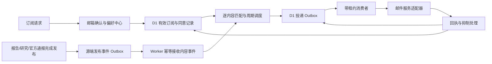

# GIDS 订阅系统审计与重构方案

审计日期：2026-11-04（Asia/Shanghai）。代码基线：`a633f4d`。

结论：目前具备邮箱登记、确认、人工群发和部分投递基础设施，但尚未形成“用户选择 → 已发布内容 → 按偏好调度 → 可靠投递 → 回执与自助管理”的完整服务。最关键的断点是新版 Situation 与旧订阅分发脱节、频率承诺没有对应执行器，以及订阅状态和普通群发缺乏一致性保障。

本次完成代码审查、线上只读检查、现有测试和隔离故障复现。没有修改业务代码、生产配置或生产订阅，没有发送真实邮件。报告中的代码缺陷针对本地基线；没有对线上执行故障复现。线上响应与本地实现存在差异，不能直接把所有本地缺陷认定为当前线上行为。

## 1. 线上事实与证据边界

2026-11-04 15:10 左右，通过现有服务的 GET 接口取得以下聚合结果；未在报告中保存收件人地址、令牌或密钥。

| 检查项 | 结果 | 含义 |
| --- | --- | --- |
| `/health`、`/api/subscriptions/options` | 均 HTTP 200；主站 Origin 的 CORS 正常 | API 可访问，不代表邮件链路健康 |
| 订阅总量 | 15 条：active 12、pending 1、expired 2 | 订阅条数不等于人数 |
| 邮箱联系记录 | active 7、pending 1、expired 2 | 当前有效邮箱规模很小 |
| 有效重点提醒 | instant 1 条，weekly 2 条 | 2/3 不符合现有提醒发送器的 `frequency=instant` 条件 |
| 有效报告更新 | weekly 6 条，instant 1 条 | 已存在不同频率的实际用户选择 |
| 有效每周摘要 | weekly 2 条 | 需要真正的每周生产、调度与发送链路 |
| Research Radar 订阅 | 当前返回记录中没有 | 功能上线需完整验收后再推广 |
| 最近 7 天事务邮件记录 | 空对象 | 当前接口没有报告这一周期的发送记录；不能据此断言外部邮件服务完全没有发送 |
| 普通群发历史 | 1 个，创建于 2026-05-24，状态 sent，1 条投递 | 不足以证明周期订阅在运行，sent 也不等于收件箱送达 |
| Situation 提醒历史 | 0 个 | 当前接口未展示已入库提醒 |
| `/api/admin/stats` 字段 | 缺少本地已实现的 campaign、provider feedback 等统计字段 | 存在运行版本/响应契约差异，需核对部署版本和迁移状态 |

本地 `.env` 仅检查配置是否存在：SMTP 所需项和管理/签名密钥存在；Turnstile、邮件回执 ingest token、可选 Queue 名、`RESEARCH_DIGEST_WORKER_URL` 未配置。**本地配置不是线上 secret 状态的证明**；Queue 在现有设计中本来就是可选加速，未配置本身不是故障。

尚未验证：Cloudflare 当前部署 SHA 和迁移清单、平台 Cron 的实际执行记录、SMTP 实际接受/退信、DNS 邮件认证、站外定时任务。下一轮实施首先补齐这些部署事实。

## 2. 现有能力与根本断点

现有基础可保留：Astro 前台、Worker API、D1 联系人/订阅/筛选模型、签名链接、管理后台、研究周报生成器、Situation outbox 的部分领取/重试机制、回执适配接口和脱敏管理查询。无需为当前规模引入会员、支付或大型营销平台。

| 用户看到的产品 | 代码实际能力 | 断点 |
| --- | --- | --- |
| 报告更新 `reports` | 可登记、确认、通过管理端群发 | 未找到发布事件驱动的完整报告订阅调度器；普通群发可忽略用户频率 |
| 重点提醒 `alerts` | 旧版统计信号验证、D1 outbox、可选 Queue、Cron | 网站已迁移至官方通报；发布流程明确停止旧版 dispatcher，新通报未接入 |
| 每周摘要 `weekly_digest` | 列表、偏好和通用群发能力 | 未找到对应周周期自动组装和投递闭环 |
| 研究摘要 `research_digest` | 有质量门禁、双语周报、幂等 campaign 的 CLI | 仓库中未找到该 CLI 被发布流程或定时工作流调用；只发送 weekly |
| 月度频率、多语言、时区 | 可写入数据库或展示 | 未找到通用月度/时区调度；研究周报仅准备中英文内容 |

最值得优先处理的历史原因：`CHANGELOG.md:151` 记载 2026-10-28 退休旧 Situation 统计模块及 alert dispatch；`src/services/data_release/pipeline.py:707` 明确不再运行提醒发布步骤；但 Worker 的 `situation-alert.v1` 仍要求旧 `signal`、统计/审核字段。当前通报导出已经使用 `gids.situation_alerts.v1` 及 `alert_id`、`notice_id`、`outbreak_id`。两者必须建立新的业务契约，不能简单重新打开旧 dispatcher。

## 3. 必须先修复的缺陷

P0 表示会破坏订阅意愿、错误发送或关键状态的缺陷，应在扩大投递前修复；P1 表示形成可运行订阅服务的必要能力；P2 表示后续体验与规模优化。

### P0-1：只知道邮箱即可覆盖已有订阅

`cloudflare/subscriptions/src/index.ts:191` 的公开创建接口，对已有邮箱直接修改全局语言、时区；对已有列表设置 `pending` 并删除重建筛选，随后才发送确认邮件。重新发送按钮也调用同一个创建接口。

**已复现：** active/en/CN 的记录，经未验证邮箱所有权的重提交，变成 pending/fr/US。影响包括原订阅停止收信、偏好被覆盖，以及修改一个列表时改变其他列表共用的语言。

修复：创建独立 `subscription_request` 保存待确认变更；验证通过前不改有效订阅。将重发、创建、管理偏好拆成不同动作。已有订阅提交成功也不能覆盖退订/抑制状态。

### P0-2：旧确认链接可以撤销退订或抑制

`index.ts:506` 的确认处理只验证签名/有效期，随后无条件将 subscription 与 contact 设置 active。令牌没有绑定待确认请求版本，也没有一次性消费记录。

**已复现：** 原确认链接在其有效期内，能重新激活已退订订阅及 suppressed 联系记录。

修复：令牌绑定 `request_id + version + purpose + expires_at`，服务端存储令牌摘要和 `consumed_at`；只有匹配且未过期的 pending 请求能提交变更。退订使相关待确认授权失效；suppressed 联系人需要独立、审计明确的恢复流程。不要借此次改造强制所有正常用户重确认。

### P0-3：普通群发在用户退订后仍会发送

`handlers/campaigns.ts:184` 的消费查询只判断投递 queued，没有重新检查 subscription/contact/subscriber 是否 active。`index.ts:542` 的退订只取消 Situation 待投递记录。

**已复现：** 先建立群发，再退订，消费时仍调用一次模拟 SMTP。

修复：退订同步取消所有尚未发送的相关投递；消费者领取后、实际发送前再次验证有效订阅与抑制状态。多个列表合并为同一封邮件时保留全部匹配订阅关系，不能只用 `MIN(subscription_id)` 代表退订范围。明确“退订当前内容”与“退订全部”。已经被邮件服务接受的邮件无法撤回，状态页面应据实说明。

### P0-4：并发消费重复发送，群发创建也有部分成功风险

普通群发先查询 queued，发送成功后才更新状态，没有原子领取、租约或 fencing。Dashboard 的 `_active_notification_sends` 只是 Python 进程内集合，无法保护多实例、CLI、重复 HTTP 请求。网络失败重试也可能重复执行非幂等创建。

**已复现：** 对只有 1 条投递的 campaign 并发调用两次 process，模拟 SMTP 被调用 2 次。

此外，campaign 先插入，收件人逐条插入；中途失败后，带幂等 key 的重放直接返回既有 campaign，不会补齐缺失收件人。最多 50,000 条记录在单次请求内逐条写入，也不适合作为可靠批处理。

修复：统一 `delivery` 状态机，条件更新领取并核对领取结果；建立唯一投递键和租约版本；小批事务、大批游标化扇出、可恢复 checkpoint。群发创建必须有幂等键，fanout 完成前不可标记 ready。HTTP 超时不等于邮件未被接受，不能盲目重发整个 campaign。

### P0-5：异步错误没有经过声明的错误边界

`index.ts:105` 等分支在 try 内直接 `return asyncHandler()`，未 await。异步拒绝不会被该 try/catch 转成预期 JSON。

**已复现：** 非法邮箱使 `worker.fetch()` 返回 rejected Promise，未返回预期的 JSON 400。生产运行时会如何映射异常，本次未进行线上错误请求验证。

修复：让路由调用被统一 await/catch，验证非法输入、授权失败、D1 故障都会返回稳定的状态码和脱敏错误结构。

## 4. 产品、投递和运维缺口

| 优先级 | 问题及依据 | 优化方向 |
| --- | --- | --- |
| P1 | 前台 `subscribe.astro:445` 默认全局 weekly，提交时把同一频率应用于所有列表；提醒消费者只接受 instant | 每个产品声明支持频率，前后端共享校验，阻止静默保存无法执行的组合 |
| P1 | 普通 campaign 的频率条件可省略；Dashboard 创建 payload 不携带频率 | 周期通知必须由调度器生成；人工通知明确范围与发送策略 |
| P1 | 确认邮件在 HTTP 请求里同步 SMTP，失败后没有自动恢复消费；前端 `:588` 将 failed/skipped 落入成功文案 | 事务内登记请求与待发邮件，异步发送；分别展示待发送、已接受、失败、限流 |
| P1 | `lib/db.ts` 静默吞掉邮件记录写入错误，而确认限流依赖该表 | 投递账本写入失败应阻止发送或进入明确故障状态；观测日志可降级，业务账本不可悄悄丢弃 |
| P1 | SMTP 缺配置会将 campaign 全部 queued 改成 failed；普通发送异常没有重试分类 | 配置故障标记 blocked 并告警；可重试错误退避，永久失败终止；仅恢复失败投递，不重发成功用户 |
| P1 | `runMaintenance()` 按原始 created_at 过期 pending；老记录重提交后可能很快过期 | 使用 request 自身 `requested_at/expires_at`，避免重新申请继承旧计时 |
| P1 | 公开接口不验证 consent，前端也没把 consent 加进 JSON | 服务端校验并记录同意时间、条款版本、请求来源，验证筛选值、时区及列表能力 |
| P1 | 服务端可以要求 Turnstile，表单没有生成/提交令牌 | 前后端成套接入，包含令牌刷新、超时、失败恢复；按风险启用 |
| P1 | 退订是 GET 修改状态；邮件没有 List-Unsubscribe / List-Unsubscribe-Post | GET 只展示操作页；按 RFC 8058 增加一键退订 POST 和邮件头，保留不要求登录的退订路径 |
| P1 | 没有公开的偏好查询、修改、暂停、恢复、全退订路由 | 用邮箱魔法链接建立短时管理会话，提供完整自助管理 |
| P1 | 研究周报先聚合文章标签筛选收件人，发送的仍是整份周报 | 先逐内容匹配，再按用户/周期聚合；明确“相关专题整刊”和“个人筛选摘要”的不同承诺 |
| P1 | Situation 发送没有存储 provider receipt/关联 Message-ID，feedback 也未更新 situation delivery 表 | 统一投递 ID 和 provider 回执，覆盖确认、群发和提醒三条路径 |
| P1 | 线上统计契约与本地不同；health 只返回固定 ok | 记录部署版本、schema 版本、能力开关，增加受保护的 readiness 和版本一致性检查 |
| P2 | 页面长期展示所有研究筛选，8 种邮件语言与真实内容供给不匹配 | 选择产品后显示相关高级选项；明确实际支持语言和回退策略 |
| P2 | 选项加载失败只能刷新，fetch 没有显式超时；重发没有倒计时；弹窗没有完整焦点恢复/约束 | 可恢复的错误、超时重试、Retry-After、键盘与屏幕阅读器验收 |
| P2 | 后台固定 offset=0，主要是记录查询和人工发送 | 补分页、个人投递时间线、失败原因、重试/暂停/取消、运行健康与受众预览 |

研究匹配还存在组合语义问题：若同一期有“中国流感”和“美国麻疹”，把国家和疾病分别取并集后，“中国 + 麻疹”的订阅也可能被选中。过滤条件必须在单篇研究或单条事件内共同满足，再合并成邮件。空元数据也不能悄悄当作全部匹配。

发送适配层应补连接/读写/总耗时限制和 SMTP 响应大小限制。普通创建、回执及筛选输入也应设置 body、条目数和字符串上限。公开接口的 CORS 不等于防滥用；现有限流需要并发下原子计数，并覆盖 IP、邮箱和总发送预算。

## 5. 目标产品与用户流程

建议保留四个内部 list code，前台突出三个用户任务，避免历史数据立即改名迁移：

| 用户任务 | 内部映射 | 第一阶段提供的能力 |
| --- | --- | --- |
| 关注国家/疾病更新 | `reports`；综合周刊兼容 `weekly_digest` | 先做可靠周报；即时报告与月报在对应执行器验收后开放 |
| 接收已审核官方疫情动态 | `alerts` | 新通报发布事件；用户选择即时或摘要，只有实现的频率可选；旧统计提醒不直接复用 |
| 接收研究进展 | `research_digest` | 每周、按研究内容匹配；中英文先保证完整，法文等按实际模板供给开放 |

产品目录返回 `enabled`、`supported_frequencies`、`supported_locales`、`filter_types` 和最新内容/发送能力状态，前台按目录渲染，后端同样强校验。没有执行器的功能不继续以正常订阅能力呈现。

订阅页只要求邮箱、内容类型、语言；国家/疾病采用上下文预选，研究类型等收进高级筛选。确认前给出明确摘要：“每周一，接收中国与流感相关的研究更新”。只有调度器真实实现时间与时区后才展示具体发送时间。

一次确认对应整次选择；重发只重发确认请求。成功页区分“请求已保存”“确认邮件已交给服务商”“订阅已激活”，提供拼写检查、重发倒计时和更换邮箱。确认/过期/退订页面均应本地化，并提供返回网站和管理偏好的路径。

偏好中心展示各产品开关、频率、国家/疾病、下一次计划、最近投递、暂停/恢复与全部退订。邮箱修改需要验证新邮箱；暂停期限和恢复行为由调度器执行。

## 6. 统一后的处理链路

**职责分工：** Python 继续生产和审核内容，确认公开页面已发布后生成内容事件；Worker/D1 作为订阅与投递状态的权威来源；Dashboard 发管理命令、展示结果，不再承担易随进程重启丢失的持续发送循环。沿用现有邮件服务，先修复适配器和回执。

**新事件契约：** 建议新增 `content-event.v1`，包含 `event_id`、`content_id`、`revision`、`content_type`、`published_at`、`release_id`、`public_url`、语言内容、结构化国家/疾病/主题及审核依据。官方通报携带 notice/outbreak/alert 标识和公开证据；不要伪造旧统计 `q_value` 来满足旧接口。完整历史重建不能触发三年旧通报集中发送，要有首次启用水位、事件版本去重、回填/更正策略。

**跨系统可靠性：** 源端需持久化“发布已完成、通知待交付”，网络故障后可重试；Worker 以事件键和内容摘要幂等接收。不能只在网站部署成功后发一次 HTTP，然后假定任务完成。定期 reconciliation 检查已发布版本是否缺通知事件。

**调度：** 用 IANA 时区、周期窗口、`next_due_at`、唯一窗口键执行周/月聚合；同窗口无匹配内容则记录 skipped/no_content。即时提醒同事件去重，并支持同一 outbreak 的聚合、冷却期和明确更正。所有人工群发也遵守抑制与退订规则。

**事务与扇出：** 小规模关联写使用 D1 `batch()`；大规模受众使用稳定游标、唯一键和可恢复分片，不尝试在一个 HTTP 请求里写完全部用户。D1 官方文档明确 batch 内失败会回滚整批：[D1 batch](https://developers.cloudflare.com/d1/worker-api/d1-database/#batch)。

**消费：** queued/retry → sending（claim token、lease expiry、attempt）→ accepted/delivered，或 retry/failed/skipped。每次完成写入核对 claim token，防止租约过期后的旧消费者覆盖新状态。发送前重新检查订阅版本、联系人抑制与内容发布状态。

**不确定发送结果：** SMTP 已接受但落库失败时，标记 unknown 并用关联 ID/回执核对。Message-ID 本身不能保证服务商去重。若将来采用带幂等能力的邮件 API，再利用服务商幂等键收敛重复风险。Cloudflare Queue 是至少一次投递，不能靠换 Queue 获得“恰好一次”：[Queues 投递保证](https://developers.cloudflare.com/queues/reference/delivery-guarantees/)。

**基础设施规模：** 目前只有 7 个 active 联系记录，先用 D1 outbox + Cron 完成可靠闭环足够。需要更低即时延迟或更高吞吐时再接 Queue；Cron 保留对账和恢复职责。复用 Situation 现有领取/重试思路时，仍需修复 claim 完成校验和回执关联。

## 7. 数据与接口改造范围

尽量通过增量迁移扩展现有模型，保留订阅 ID 与审计历史。

| 数据对象 | 必须增加或明确的内容 |
| --- | --- |
| `subscription_requests` | request_id、目标订阅/邮箱、待生效偏好、token_hash、purpose、version、expires_at、consumed_at、consent_version |
| `subscriptions` | preference_version、独立频率/语言策略、暂停期限、next_due_at、最后完成周期 |
| `content_events` | 内容 ID/修订、发布版本、审核与来源、结构化筛选值、payload hash、幂等键 |
| campaign/dispatch jobs | 内容快照、audience 构建状态、fanout 游标、审核/计划时间、幂等键、发送策略 |
| deliveries | 稳定 ID、唯一业务键、匹配订阅关联、状态、claim/lease、next_attempt_at、provider ID、错误分类 |
| suppressions / feedback | 抑制原因与范围、恢复策略、服务商事件唯一键、事件时间与处理状态 |
| scheduler runs | 运行开始/结束、扫描窗口、入队/跳过/失败数量、最后成功时间 |

保留现有入口兼容，新增独立的 request/resend、confirm POST、management-link/session、preferences、pause/resume、unsubscribe POST、content-event ingest 和受保护的 preview/approve/cancel/retry 接口。公开接口返回稳定且不泄露邮箱是否已登记的响应；管理链接不能直接暴露订阅者信息。

确认令牌一次性消费；管理会话短时有效，使用安全 Cookie 并保护修改请求。退订入口不应要求登录或 CAPTCHA。GET 不修改状态，邮箱客户端的一键退订使用签名 POST；同步检查发件服务对相关头的 DKIM 覆盖：[RFC 8058](https://www.rfc-editor.org/info/rfc8058/)。

现有签名密钥还参与邮箱查找 hash，不能无准备地直接轮换：需要独立的稳定查找策略与版本化签名 key，避免轮换后同邮箱变成多个联系人。旧退订链接要在兼容期继续有效；旧确认链接不能绕过新授权状态。

## 8. 分阶段实施与迁移

下列为一名熟悉代码的开发者的初步工作量估计，不包括外部邮件服务设置和线上观察等待；具体排期以部署核查结果调整。

| 阶段 | 工作 | 验收结果 | 估计 |
| --- | --- | --- | --- |
| A：止损与版本核对 | 核对线上代码/迁移/secret/Cron；修复五项 P0；正确展示邮件失败；限制不可执行组合 | 不再匿名覆盖有效偏好、退订后不再启动新发送、并发正常请求不重复发送、稳定错误响应 | 2–3 人日 |
| B：闭环与可靠投递 | 请求确认状态机；统一 outbox/租约/重试/回执；研究周报与报告周报接调度；新通报事件接入 | 从已发布内容到用户邮件可追踪、可恢复、按偏好执行 | 6–10 人日 |
| C：自助管理与运维 | 偏好中心、暂停/全退订、预览审批、版本与健康指标、分批迁移 | 用户可自主控制；运维能解释没发/重复/失败的原因 | 3–5 人日 |

迁移顺序：

1. 备份 D1，导出不含收件人明文的聚合基线；固定部署 SHA、schema version 和回滚点。
2. 增加新表/字段与能力开关，保持旧路径可读；先修发送意愿保护，再开启新发送。
3. 构建 shadow audience，只比较应收人数、内容匹配与周期，不真实发信；使用固定时间与数据快照排除时间漂移。
4. 用受控测试邮箱在 staging 验证整条链路和回执，随后小范围切换。
5. 处理历史无效组合：现有 alerts/weekly 的两条记录不能擅自升级即时提醒；保留用户频率，提供已实现的周摘要，或让用户确认变更。reports/instant 同理。
6. 正常 active 用户保留原状态；pending 请求按新规则重新建立确认流程；历史 campaign/suppression 不清空。
7. 切换统一消费者，关停旧发送循环；保持旧退订链接兼容，清晰记录新旧 ID 映射。
8. 观察至少一个完整周周期后扩大开放；月报需独立验收后开放。

回滚时先关闭新事件/发送开关，保留 outbox 和投递事实；回滚 Worker 不等于回滚 D1。恢复操作不得重新发送已经 accepted/delivered 的记录。

## 9. 测试与上线门禁

本次实际执行：

- Worker：`npm test`，78/78 通过；`npm run typecheck` 通过。
- Python：`tests/unit/test_subscriptions_router.py`，12/12 通过。
- Python：`tests/unit/test_research_digest_dispatch.py`，15/15 通过。
- 隔离诊断：Node 内存 SQLite 顺序应用全部 10 个 SQL migration，执行实际 Worker/handler；SMTP 和 Cloudflare socket 被替换为不联网适配器，复现本报告五项 P0 行为。SQLite 诊断不是 Cloudflare D1 运行时兼容性证明。
- 未运行全仓测试、完整浏览器测试或部署门禁；本次没有业务代码变更，也没有验证真实邮箱送达。

现有测试主要覆盖函数、SQL 结构、归一化和局部 handler。公开页面已有筛选预选测试，但 POST 响应被 mock 为 `{ok:true}`，无法证明真实确认、退订与自动投递闭环。

后续上线必须覆盖以下业务不变量：

1. 同邮箱重复创建、恶意覆盖、重发均不改变已生效偏好；未经验证的变更不会生效。
2. 旧确认链接、已消费链接、过期请求、退订及 suppression 的交互符合状态机。
3. 提交前/排队后/领取后退订，重复退订以及跨列表退订；对已被服务商接受的邮件如实记录边界。
4. 两个消费者、两个 Dashboard 实例、HTTP 超时重试、Worker 重启不会产生可避免的重复发送。
5. campaign 扇出到一半失败可恢复；单次消费者崩溃后租约恢复；旧 lease 不能覆盖新 lease。
6. 邮件已接受但数据库写失败进入 unknown；回执可关联确认、普通 campaign、新通报提醒。
7. provider 重复、乱序、先于 accepted 落库的回执不丢失，不能把 terminal suppression 覆盖回正常。
8. 4xx 暂时失败、5xx 永久失败、缺配置、速率限制分别恢复，成功投递不会被整体补发。
9. 每个公开产品/频率/语言组合都存在执行器；周/月边界、DST 和无内容周期均有测试。
10. 国家与疾病在同一内容实体内匹配；未知标签与缺失地理信息不扩大收件范围。
11. 新版 Situation 历史重建、重复发布、内容更正不会造成旧通报风暴。
12. 前台错误/重发/过期/无障碍与管理端受众预览能通过浏览器到测试邮件收件器的端到端验证。

运维建议关注：确认完成率、确认邮件接受延迟、应发窗口完成率、队列最老等待时间、accepted 与 delivered 分开统计、硬退信/投诉、抑制后发送数、重复业务键、unknown 数、最后一次成功调度、内容发布但未产生通知事件数量。不要把不可靠的打开率作为核心验收指标。

## 10. 关键代码索引

- 前台与重发：`astro-site/src/pages/subscribe.astro:445`、`:554`、`:588`、`:609`。
- 创建、确认、退订、过期与 Cron：`cloudflare/subscriptions/src/index.ts:105`、`:153`、`:191`、`:506`、`:542`、`:574`。
- campaign 扇出与消费：`cloudflare/subscriptions/src/handlers/campaigns.ts:130`、`:167`、`:184`、`:278`。
- Situation 领取、重试、筛选：`cloudflare/subscriptions/src/handlers/situation-alerts.ts:248`、`:495`、`:625`。
- 回执和日志：`cloudflare/subscriptions/src/lib/delivery-feedback.ts`、`src/lib/db.ts`、`src/lib/smtp.ts`。
- 邮件头和模板：`cloudflare/subscriptions/src/lib/email.ts:73`、`:149`。
- 签名令牌：`cloudflare/subscriptions/src/lib/security.ts`。
- 后台进程内发送与重试：`dashboard/api/routers/subscriptions.py:107`、`:248`、`:364`。
- 研究周报内容与受众：`scripts/automation/dispatch_research_digest.py:292`。
- 新旧 Situation 断点：`CHANGELOG.md:151`、`src/services/data_release/pipeline.py:707`、`src/services/situation_notices/export.py:45`。
- 平台可靠性设计参考：[Workers 官方实践](https://developers.cloudflare.com/workers/best-practices/workers-best-practices/)。
