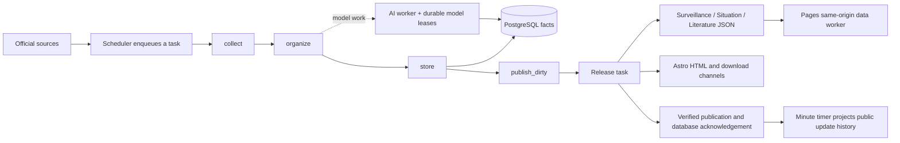

# GIDS project status (2026-11-14)

The collection and publication workflows are separated in production. Papers
projection v3 and the independent theme v1 are enabled. The 2026-11-14 audit
confirms successful Surveillance, Situation and Literature publications; it
also identifies source failures and a Literature review backlog. This is not
an assertion that every source or acceptance scenario has passed.

| Area | Verified result | Remaining boundary |
| --- | --- | --- |
| Collection | Queued `collect → organize → store` stages persist facts and affected `publish_dirty` scopes. Real collection tasks have downstream publication evidence. | Recent failures include upstream source errors, quality quarantine and a database parameter-limit error in literature gap discovery. A completed aggregate task may still contain a failed source. |
| Publication | Surveillance, Situation and Literature have independent JSON channels. Ordinary Literature publication now retains Papers projection v3. | Pending markers remain until a successful release. Literature catch-up is paused by review backpressure; interval-based publication is not immediate. |
| Public update feed | At 01:35 UTC, both monthly archives and the index matched the database projection exactly: 2,218 Surveillance, 96 Situation and 33 Literature publication records. | Knowledge has no retained acknowledged publication records. These counts measure publication batches, not observations, articles, messages or successful collection attempts. |
| Public site | Stable research routes use projection v3; the public theme uses the independent v1 stylesheet. Same-origin JSON delivery remains the current architecture. | Route samples cannot establish that every old and new page is identical. The abandoned independent JSON CDN design is not active. |
| Control plane | Plans freeze scope, source/configuration digests and remote baselines; runs enqueue tasks and expose publication receipts. | A queued task, uploaded object or successful build does not by itself prove public verification or database acknowledgement. |

### Current runtime and publication flow

Collection never publishes public projections in its storage transaction.
Publication builds and verifies a frozen candidate, conditionally advances its
channel pointer, then acknowledges only the selected dirty markers. The public
update reconciler reads acknowledged markers belonging to completed export
tasks and refreshes the monthly feed independently. The dashboard observes and
queues these workflows; it is not a second publisher.

### Website changes and the new control plane

Use `POST /api/v1/publish/plans`, followed by
`POST /api/v1/publish/runs` with `plan_id`, `plan_digest` and an idempotency key.
Inspect the task and `/api/v1/publish/plans/{id}/receipt` for authoritative
commit, public verification and database confirmation. Plan creation freezes
the scope and inputs; data bytes are frozen later by the export snapshot.

A general template change uses `code_only` with a verified source-data snapshot
retained from a successful publication. It builds in a private Astro workspace,
so background exports cannot replace its inputs. Legacy deployments lack that
retained snapshot: on November 14, changed local Literature and Situation data
blocked the earlier template task. A normal full publication establishes the
first baseline; its current result is in the acceptance record below. Reports
remain independent during code-only publication; report-template changes use
`reports_only` or full publication.

The data-updates revision adds inclusive UTC date filtering, daily publication
counts, cross-month loading and an accessible count table in three languages.
UTC normalization is shared by filtering and counting, and incomplete archive
loads do not masquerade as zero activity. Its production result is recorded in
[the November 14 acceptance record](../acceptance/DATA_UPDATES_20261114.md).

Scheduled Literature and full-site research publication emit projection v3.
A `paper_template` entry that is not schema 3 fails closed. Historical v2
objects are retained, but v2 is not a rollback path. Publication retries must
preserve committed pointers and verify the same candidate after interruption.

### Evidence and operational boundaries

- [Data-updates review and deployment acceptance](../acceptance/DATA_UPDATES_20261114.md)
- [Public update-feed semantics and operations](../publishing/PUBLIC_DATA_UPDATES.md)
- [Data-line and control-plane architecture](../architecture/DATA_LINE_AND_CONTROL_PLANE_REFACTOR.md)
- [Publication implementation](../publishing/MAIN_SITE_JSON_PUBLICATION_IMPLEMENTATION.md)
- [Original November 13 production cutovers](MAIN_SITE_PRODUCTION_DEPLOYMENT_20261113.md)

The original theme/Papers cutover receipts remain historical evidence. Current
channel generations and queue sizes must be read from the live control plane;
the initial 8,352-article generation is not a permanent current-version claim.
Production failure-fence exercises, complete source acceptance and full
content parity remain separate acceptance items. Use
`venv/bin/python scripts/restart_task_runtime.py --include-api` when a new
backend requires loading: it freezes scheduling, drains workers and recovers
only confirmed-dead owners before checking readiness. Never manually mark
running work complete or roll publication pointers back to work around errors.
